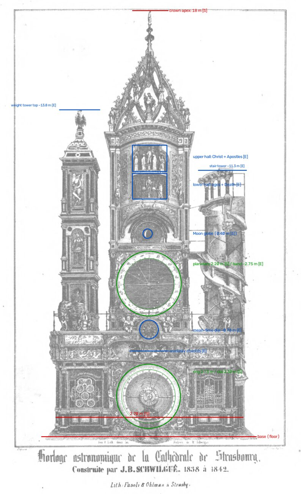

# Horloge astronomique — a 1:8 working replica of the Strasbourg astronomical clock

A working **1:8 scale replica** of Jean-Baptiste Schwilgué's astronomical clock (1838–1842) in
Strasbourg Cathedral. It is planned as a wall piece for a house in Bordeaux: about
**2250 mm tall × 962.5 mm wide**.

<p align="center"></p>

*The clock as drawn in Schwilgué's own workshop (lithograph, 1840s, public domain). The annotations
show the 1:8 scale checks used in [`docs/envelope.md`](docs/envelope.md).*

## How it is built

The replica follows the original's logic, with modern parts where they help:

- **Every astronomical and calendar ratio is mechanical.** Year, planets, sidereal day, synodic
  month, precession, the solar and lunar equations, eclipses, the perpetual calendar and the
  computus are all made by gears, cams and differentials, mostly 3D-printed. Many of the ratios
  are Schwilgué's own.
- **Stepper motors replace the weights and pendulum, and nothing more.** Each module's stepper
  turns a plain clockwork arbor (one turn per hour or per mean day). The motors follow time from
  an RTC disciplined by NTP.
- **The automata are events.** A cam on the time train releases a show, and a small motor powers
  it, like a striking train. The shows are the ages and Death, the Apostles before Christ, the
  rooster, the genies, and the calendar's midnight advance.
- **The case is woodwork**: a birch-plywood structure with hardwood framing, painted to resemble
  the original, with 3D-printed ornament and a glazed front ([D12](docs/decisions.md)). Metal is
  hidden, except the computus's visible frame.

The full rules are in [`CLAUDE.md`](CLAUDE.md). The architecture, including the upgrade path for
adding precision later without rebuilding, is in
[`docs/architecture.md`](docs/architecture.md).

## Status

| Phase | Content | Status |
|---|---|---|
| 0 | Specification, research, decisions | **Done** (PR #1, PR #2). D1–D12 all accepted, including D12: a wooden case |
| 1 | Ratio engineering and tooth-strength check: `tools/ratios/`, tests, `spec/clock.yaml`, `docs/gear-trains.md` | **Done** (PR #3) |
| 2 | Parametric CAD: shared library, main-dial feasibility, test rig, then every module and the case | **In progress**: library and main-dial feasibility done (PR #4); test rig in review |
| 3 | Electronics, firmware skeleton, accelerated-time simulator validated against an ephemeris | — |
| Local | Tolerance tests, printing, woodworking, bring-up | Later |

## Documents

| File | What it holds |
|---|---|
| [`docs/reference-notes.md`](docs/reference-notes.md) | Every fact gathered, with sources and tags: [S] sourced, [D] derived, [E] estimate, [Sn] snippet-only, [?] conflicting. **Start here.** |
| [`docs/mechanism-inventory.md`](docs/mechanism-inventory.md) | Every indication and automaton: what it shows, periods, how the original does it, the replica approach, difficulty, version |
| [`docs/envelope.md`](docs/envelope.md) | The 1:8 layout: case, dial sizes, stage heights, bed-fit checks |
| [`docs/architecture.md`](docs/architecture.md) | Modules, stepper rates, events, sensors, setting, power-cut catch-up, electronics, upgrade path |
| [`docs/decisions.md`](docs/decisions.md) | Decision records, with options, trade-offs and status |
| [`docs/bom.md`](docs/bom.md) | One running hardware list, in purchase batches |
| [`docs/gear-trains.md`](docs/gear-trains.md) | The chosen gear train for every indication, with errors and accuracy targets (generated from `spec/clock.yaml`) |
| [`docs/main-dial-feasibility.md`](docs/main-dial-feasibility.md) | Phase 2: does everything fit behind the 287.5 mm main dial? Layout, checks, eclipse-display options |
| [`docs/test-rig.md`](docs/test-rig.md) | Phase 2: the first print. One stepper driving the M1 motion work and a 24 h two-tube drive, with tolerance coupons |

## Tools

All are headless and reproducible. Python 3.11+.

```bash
python3 tools/phase0/derivations.py          # every [D] number in the docs
```

Gear trains (Phase 1; see [`tools/ratios/README.md`](tools/ratios/README.md)):

```bash
python3 -m venv .venv && .venv/bin/pip install -r requirements.txt
```

```bash
.venv/bin/python -m pytest && .venv/bin/python -m tools.ratios check
```

```bash
python3 tools/envelope/plate_measurements.py # stage heights estimated from the lithograph
```

CAD (build123d, its own venv; see [`cad/README.md`](cad/README.md)):

```bash
python3 -m venv .venv-cad && .venv-cad/bin/pip install -r cad/requirements.txt
```

```bash
.venv-cad/bin/python -m pytest cad
```

CAD toolchain check (build123d; see [`tools/toolchain-check/README.md`](tools/toolchain-check/README.md)):

```bash
python3 -m venv .venv && .venv/bin/pip install build123d bd_warehouse trimesh pycollada
```

```bash
.venv/bin/python tools/toolchain-check/check_build123d.py export/toolchain-check
```

## Repository layout

```
CLAUDE.md                standing design rules and working method
docs/                    specification, research notes, decisions, BOM
docs/img/                small reference images (public domain)
tools/phase0/            derivations behind the docs
tools/envelope/          lithograph scaling
tools/toolchain-check/   CAD smoke tests
tools/ratios/            gear-ratio search, strength check and tests (Phase 1)
spec/clock.yaml          single source of truth for rates, ratios and sensors (Phase 1)
cad/lib/, cad/modules/   parametric CAD, build123d (Phase 2; see cad/README.md)
cad/case/                parametric wooden case: joinery, cut lists (Phase 2)
firmware/                ESP32-S3 controller (Phase 3); firmware/test_rig/ is the rig sketch
sim/                     accelerated-time simulator and ephemeris validation (Phase 3)
export/                  generated STL/3MF/DAE (git-ignored except releases)
```

## Main sources

- **Ch. Schwilgué**, *Description abrégée de l'horloge astronomique de la cathédrale de
  Strasbourg*, 2nd ed. 1844 (public domain):
  https://archive.org/details/descriptionabrg00schwgoog
- **A. Ungerer**, "L'horloge astronomique de la cathédrale de Strasbourg", lecture to the Société
  astronomique de France, 15 Dec 1920, published in *L'Astronomie* 1921. Ungerer was Schwilgué's
  successor.
- **J. Lefort**, "L'horloge astronomique de la cathédrale de Strasbourg", after A. & Th. Ungerer
  (1922).
- **G. Paturel & P. Dubois**, *Cahiers Clairaut* n°102 (2003).

Copyrighted sources are cited with short quotations only. Copies are kept privately, not in this
repository.

## Working method

The project is phased, and each phase ends at a gate. Each phase or module goes through its own
pull request; Paul reviews and merges. Cloud sessions do research, specification, ratio
engineering, parametric CAD (including the case), simulation and firmware. Physical work is done
locally later: tolerance tests, printing, woodworking, bring-up.
