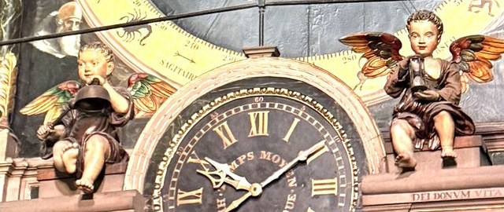
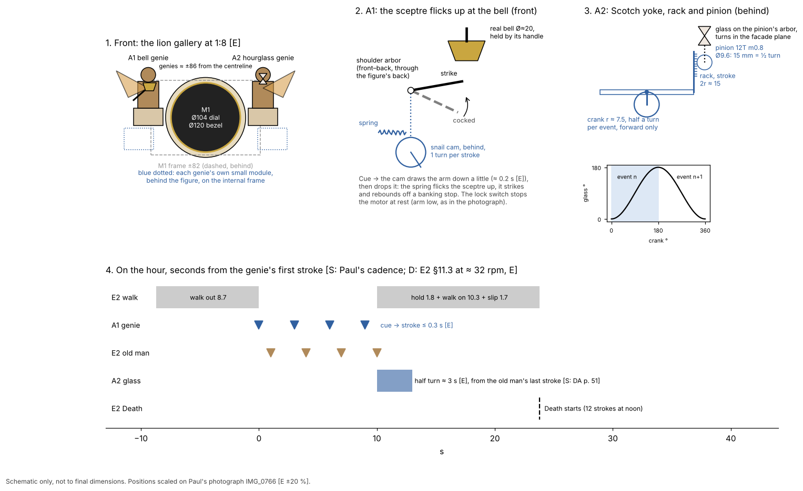
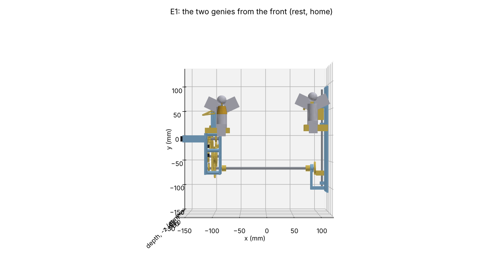
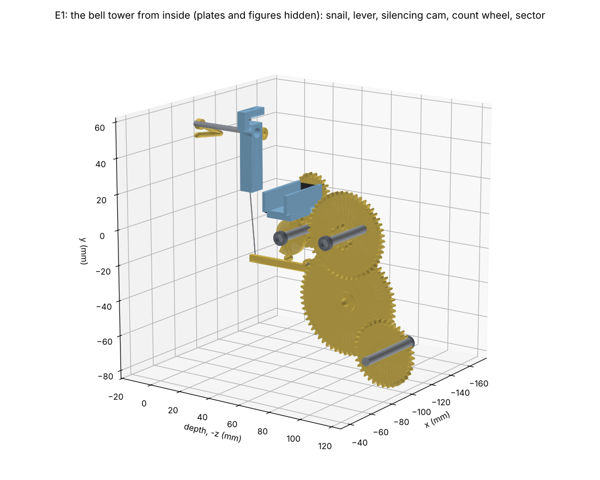
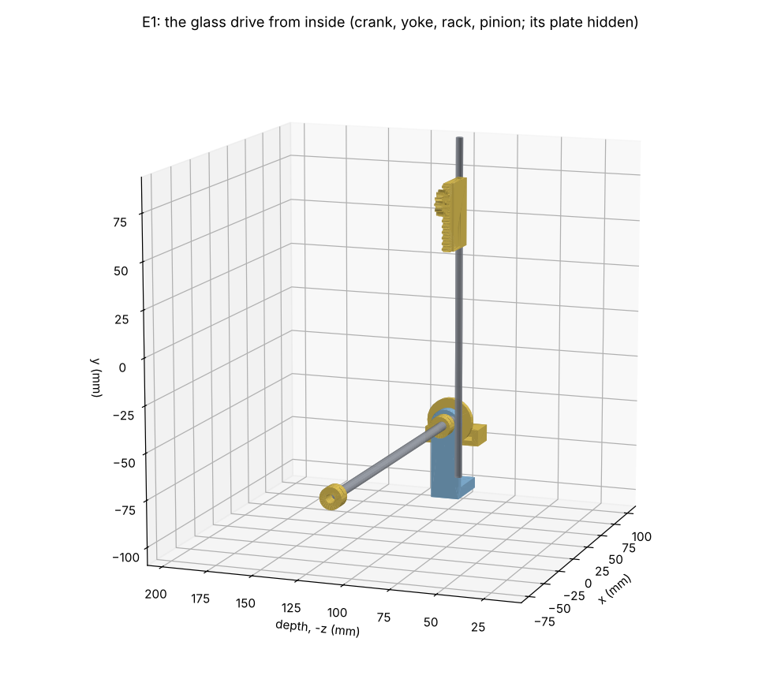
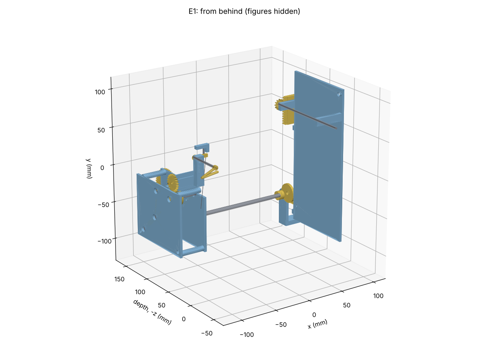

# E1 the two genies: concept gate

Phase 2, module E1: the two genies (angels) seated either side of the mean-time dial in the lion
gallery. The genie on the left (A1) strikes his hand bell with his sceptre, once before each of
the age's strokes. The genie on the right (A2) turns his hourglass each hour, half a turn,
alternately right and left.

**Status: detail design, part 1, decisions settled (§16.8); for merge.** The concept was settled on PR #18 (Paul, 7–8
Nov 2026; §12, §15): **one forward-only motor, a count wheel, and a rigid cross shaft to the glass.**
Tags as in `docs/reference-notes.md`: [S] sourced, [D] derived,
[E] estimate, [?] unclear.

*The two genies on 30 Oct 2026, 10:10 CET. Left: the bell genie, the bell held up by its handle in
his left hand, the striker low in his right. Right: the hourglass genie, the glass upright in both
hands. Crop of Paul's photograph IMG_0766 (`docs/img/m1/original_gallery.jpg`).*

*Schematic only, not to final dimensions. Positions are scaled on Paul's photograph [E ±20 %]. The
script is `cad/modules/e1_angels/concept_schematic.py`.*

## 1. What E1 does

- **A1, the bell genie** [S: DA p. 50; `docs/mechanism-inventory.md` A1].
  - "Le génie placé à la gauche du spectateur, tient d'une main un sceptre et porte dans l'autre
    un timbre, sur lequel il frappe le premier coup de chaque quart d'heure, le second étant
    répété ... par l'un des quatre âges." (The genie on the spectator's left holds a sceptre in
    one hand and a bell in the other. He strikes the first stroke of each quarter on it; one of
    the four ages repeats the second.)
  - **Observed** [S: Paul's observation of the clock in action, 30 Oct 2026]: at the n-th quarter
    the genie and the age strike **n pairs**. The genie's bell sounds first. The age strikes 1 s
    later, then there is a 2 s pause [S: Paul, PR #15, 6 Nov 2026].
  - So the genie strikes 1, 2, 3 or 4 times a quarter, 10 times an hour [D: 1 + 2 + 3 + 4].
- **A2, the hourglass genie** [S: DA p. 51, checked on the page image].
  - "[Il] tient des deux mains un clepsydre rempli de sable rouge, qu'il retourne chaque heure
    tantôt d'un demi tour à droite, tantôt d'un demi tour à gauche ... chaque fois au dernier coup
    des quatre quarts, un instant avant que la Mort ne sonne les heures." (He holds in both hands
    a glass of red sand. He turns it each hour, half a turn to the right, then half a turn to the
    left, at the last stroke of the four quarters, a moment before Death strikes the hours.)
  - Paul saw it turn during the noon show [S: Paul's observation, 30 Oct 2026].
- **Both are events** (CLAUDE.md rule 4). They hold no state that must match the time:
  - A1's count is decided by E2's quarter rack, which cues A1 once per pair (architecture §5);
  - A2 has no count. If a turn is missed, the glass simply waits; with the drive proposed in §4.3
    the next turn still goes the other way.

## 2. What is known, and what is not

Sizes are scaled on Paul's photograph IMG_0766, on the dial's pearled ring. That ring is ≈ 0.83 m
on the original and Ø 104 mm in M1's model (`docs/m1-design.md` §9.7). It spans ≈ 256 px in the
640 px copy, so **1 px ≈ 0.406 mm at 1:8** [D: 104 / 256]. The dial's own scale is ±15 %. The
figures sit on ledges a little in front of the dial, so they may read a few per cent large.
Hence ±20 % on every figure size below [E].

| Item | Value at 1:8 | Tag |
|---|---|---|
| Where | lion gallery, either side of M1's dial, centre ≈ 567 mm above the floor | [E: envelope §2] |
| Genies' centrelines | **≈ 85 mm left and 88 mm right** of the case centreline | [E: 210 and 217 px from the dial's centre] |
| Seat (top of the ledge) | ≈ 14 mm (left) and 20 mm (right) above the dial's centre | [E: 35 and 50 px] |
| Bell genie, seated | **≈ 78 mm head to soles**; 62 mm head to seat | [E: 193 and 153 px] |
| Hourglass genie, seated | **≈ 81 mm head to soles**; 72 mm head to seat | [E: 200 and 178 px] |
| Earlier figure | 78 mm: "seated height ≈ 0.63 of the bezel's diameter" | [E: `docs/m1-design.md` §2]. Agrees with the head-to-soles values. |
| Wings | span ≈ 80 mm (left); ≥ 85 mm (right, cut off by the frame) | [E: 197 and ≥ 210 px] |
| Hand bell | **≈ Ø 20 mm**, held up near the chin by its handle, mouth down | [E: 50 px]. About the size of E2's bells (Ø ≈ 21 mm, `docs/e2-design.md` §2). |
| Striker ("sceptre") | ≈ 20 mm, held low in the right hand, pointing up at the bell | [E: ≈ 48 px] |
| Hourglass | **≈ 19 mm tall × 9 mm wide**, upright in both hands at the chest | [E: 48 × 22 px] |
| Glass centre | ≈ 83 mm right of the centreline, ≈ 59 mm above the dial's centre | [E] |
| Genies' heads | ≈ 76 mm (left) and 92 mm (right) above the dial's centre, so ≈ 643–659 mm above the floor | [E]; [D: 567 + 76, 567 + 92] |
| Cadence of a pair | genie, then the age 1 s later, then a 2 s pause | [S: Paul, PR #15, 6 Nov 2026] |
| Hourglass: when | each hour, at the last stroke of the four quarters, before Death | [S: DA p. 51] |
| Hourglass: how far | half a turn, alternately right and left | [S: DA p. 51] |

**Not known:**

| Item | Why it matters | How to resolve |
|---|---|---|
| Does the genie's sceptre arm move, or is the bell struck by a hidden hammer? | Decision 2 (§6) | Paul's video of the noon show |
| Does the hourglass genie's forearms turn with the glass, or does the glass turn between still hands? In which plane: in the facade plane (seen turning clockwise, then anticlockwise), or tipping forwards? | Decision 3 (§7). DA's "à droite … à gauche" suggests the facade plane [?] | Paul's video |
| How long the half turn takes | The drive's ratio (§4.3); a parameter in any case | Paul's video. Assumed ≈ 3 s [E]. |
| Whether the genies work at night in the original | §8, question 1 | DA says only that the ages are suspended at night [S: DA p. 58, 65]. The books (Ungerer 1922; Bach et al. 1992) may say. |
| How the original drives either genie | Faithfulness of the mechanism | Not in DA. The books, still to obtain. |
| The ledges' depth, and how far the figures stand in front of the planetary dial | Depth of each module | The case design (depth still TBD) |

## 3. Boundary and interfaces

As everywhere: **pass timing electrically and position mechanically** (architecture §4). E1 has
no mechanical link to any other module.

| To | What | Link |
|---|---|---|
| M0 controller | two event motors (A1, A2); two lock switches. No trigger sensor of its own | one connector per genie (two small cassettes, §4.1) |
| E2 quarter train | **A1:** a cue before each of the age's strokes. E2 cues at the start of each pair's cam turn; the age's lifter drops 1 s later; "E1 must strike within that second" (`docs/e2-design.md` §7, item 2) | electrical, through the controller (architecture §4, E2 → E1) |
| E2 quarter train (on the hour) | **A2:** start at the old man's last stroke. The quarter train's lock switch closing on the hour is that moment | electrical, through the controller |
| M1b hour flag | **A2** when the ages are silent (quiet hours, §8): the controller turns the glass just before Death | electrical (architecture §5, E1 hourglass row) |
| E2 Death | Death starts after E2's walk on, ≈ 13.8 s after the old man's last stroke. The glass must have finished by then | timing only; ≈ 3 s needed [E] |
| M1 cassette | none mechanical. E1's cassettes sit outboard of M1's frame (±82 mm, `docs/m1-design.md` §9.2) and must clear it | geometry: checked in the detail design |
| M5 planetary dial | the genies' heads and wings reach ≈ 643–659 mm, above the bottom of M5's band at ≈ 639 mm [D: 810 − 343 / 2, envelope §3]. On the original they stand in front of it (photograph) | geometry: the figures stand in front of M5's dial plane |
| Case | the gallery's cornice and ledges. The figures sit on **printed plinths that belong to E1**; the wooden cornice fits round them with a gap. The works never stand on the case (D12 R5) | where the plinth ends and the case begins: detail design |

**Event order on the hour** (architecture §5; DA p. 64–66), in seconds from the genie's first
stroke [D: Paul's cadence and `docs/e2-design.md` §11.3 at ≈ 32 rpm [E]]:

| t (s) | What |
|---|---|
| −8.7 | E2's walk out starts (the controller starts it early, from the RTC) |
| 0, 3, 6, 9 | A1 strikes (cued by E2) |
| 1, 4, 7, 10 | the old man strikes |
| 10 | E2's quarter train locks → **A2 turns the glass** (≈ 3 s [E]) |
| 10 – 23.8 | E2 holds 1.8 s, walks on 10.3 s, slips 1.7 s |
| ≈ 23.8 | Death starts the hour |

The glass has ≈ 10.8 s of margin before Death [D: 23.8 − 10 − 3].

## 4. Proposed concept

**4.1 Two small cassettes, one per genie.** *(Superseded: Paul chose one motor, §12–13.)*
- The genies are ≈ 173 mm apart [D: 85 + 88], with M1's cassette between them. M1's gate already
  set them as separate modules (`docs/m1-design.md` §6, confirmed by Paul).
- Each cassette is a small printed frame behind its figure, on the internal frame, outboard of
  M1's frame. It carries the figure on its plinth, one gearmotor, one cam train and one lock
  switch.
- Each arbor that moves a figure runs front to back through the figure's back from the cassette.
  The figure hides it.
- Service: the figure lifts off its arbor to the front; the cassette comes out to the back with
  its connector. The gearmotor drops out of a bracket with two screws, as in E2 (`docs/e2-design.md` §11.4).

**4.2 A1: the sceptre flicks up at the bell.**
- **The bell** is a real small brass bell, Ø ≈ 20 mm, the same part as E2's two bells if one can
  be found in that size. The figure's left hand holds it by its handle, as in the photograph. A
  bell held at its crown rings freely.
- **The sceptre arm** turns on a shoulder arbor (front to back). Behind the figure a lever on the
  same arbor rests on a snail cam, so at rest the sceptre is low, as in the photograph.
- **One stroke per cam turn**, as a striking train's hammer:
  1. the cue starts the motor;
  2. the cam draws the lever a little further, against a steel spring (D13);
  3. at the snail's step the lever drops off: the spring flicks the sceptre up, its tip strikes
     the bell's rim and rebounds off a banking stop, so the bell rings free;
  4. the lever falls back onto the cam, and the lock switch stops the motor at rest.
- **Speed.** A micro metal gearmotor at ≈ 200 rpm under load [E] turns the cam once in ≈ 0.3 s.
  With the step a third of the way round, the stroke comes ≈ 0.1 s after the cue [D: 1/3 × 0.3 s].
  So **cue to stroke ≤ 0.3 s [E]**, inside E2's one second. The cycle is done long before the
  next cue, 3 s later.
- The count stays mechanical: one turn per cue, and E2's rack decides the cues.

**4.3 A2: the glass turns by a Scotch yoke, rack and pinion.**
- **The glass** is a bought miniature hourglass with red sand, ≈ 20 mm tall [E], held in a
  printed frame between the figure's hands (decision 4, §8).
- **The glass's arbor** runs front to back through the figure's chest, at the glass's centre, so
  the glass turns in the facade plane: clockwise one hour, anticlockwise the next.
- **The drive**, behind the figure:
  - the gearmotor turns a crank **half a turn per event, always forwards**;
  - the crank pin runs in a slotted yoke, which slides a rack;
  - the rack turns a pinion on the glass's arbor through half a turn.
- **Sizes [D].** A 12-tooth pinion at module 0.8 has a pitch Ø 9.6 mm. Half a turn is π × 9.6 / 2
  = 15.1 mm of rack, so the crank's radius is 7.5 mm. At module 1.0 the same is 18.8 mm and
  9.4 mm. The module stays a parameter.
- **It alternates by itself.** The glass's angle is 90° × (1 − cos θ) for crank angle θ [D: a
  Scotch yoke's stroke is r (1 − cos θ); 2r is half a turn]. From θ = 0 to 180° the glass goes
  0 → 180°; from 180° to 360° it goes back 180 → 0°. The motor never reverses.
- **It stops softly and exactly.** Both rest positions are at the crank's dead centres. There the
  glass hardly moves with the crank: a 5° overrun of the motor moves the glass by 0.34° [D:
  90° × (1 − cos 5°)]. The speed follows a sine, so the glass starts and stops gently.
- **The lock cam** has two notches, 180° apart, one at each dead centre.
- **Speed.** The 1000:1 micro gearmotor of E2's walk (≈ 32 rpm [E]) with a 3:1 pair gives a half
  turn in ≈ 2.8 s [D: 0.5 × 3 / 32 × 60]. PWM trims it once the original's time is known.
- **Missed turns are harmless.** If one is skipped, the glass rests where it was and the next turn
  still goes the other way. After an odd number of skips the glass rests "upside down"; an
  hourglass looks the same either way up.

**4.4 The controller.**
- **A1:** on E2's cue, run the A1 motor until its lock switch closes. Fault if it has not closed
  within 1.5 s, or if a cue arrives while it is still running.
- **A2:** on the hour, at E2's quarter-train lock; or, when the ages are silent, straight after
  M1b's hour flag. Run the A2 motor until its lock switch closes (timeout ≈ 6 s). Then Death may
  start, after E2's walk on as now.
- **Catch-up and night:** skip both (architecture §5). Nothing needs restoring.

## 5. Decision 1: one event motor or two — B, one motor (Paul, PR #18, 8 Nov 2026)

The architecture allows E1 one or two motors (§10). The BOM already counts two.

| Option | For | Against |
|---|---|---|
| **A. Two motors, one per genie, in two small cassettes** | Each genie is a small, separate, simple train with its own lock. Each speed suits its job: fast for the bell, slow for the glass. Nothing crosses M1. A fault in one stops only that one. Matches M1's gate ("E1's genies separate"). | One more motor and H-bridge channel than B. Already in the BOM. |
| B. One motor and a selector | One motor fewer | The genies are 173 mm apart with M1's cassette between them, so a shaft would have to cross behind or under M1. The two jobs need different speeds and different counts (n strokes, then one half turn), so a clutch or selector is needed. |

**Recommended: A, two motors.** B saves one small motor at the cost of a shaft across M1 and a
selector.

**Decided: B** (Paul: "I would prefer one motor with a selector. It seems truer to the original
design."). §13 works it out.

## 6. Decision 2: how the sceptre strikes — A (Paul, PR #18, 8 Nov 2026)

| Option | How | For | Against |
|---|---|---|---|
| **A. The sceptre strikes the hand bell** (§4.2) | A cam cocks the arm against a spring and lets it go; the sceptre's tip strikes the bell in the genie's hand and rebounds off a stop | Faithful to DA ("un timbre, sur lequel il frappe"). One moving part you can see doing the work. Same kind of bell as E2's (one purchase). | A 20 mm bell is quiet. The sceptre's tip is small (≈ 20 mm long), so the stop must be set finely. |
| B. The arm gestures, a hidden hammer strikes | The same cam moves the arm and, through a second lever, a hammer on a bigger bell hidden in the plinth | Louder and easy to adjust. The arm need not touch the bell. | Less faithful; the sound does not come from the bell you see. A bigger bell to find and hide. |
| C. A solenoid | — | — | Excluded by D8: "not a mechanical event train; clicky". |

**Recommended: A**, with B as the fallback if the test bell is too quiet. This is the same rule as
E2's strike (`docs/e2-design.md` §7, item 4). It is soft, which suits the living room (D8).

**Decided: A.** Paul: "The angel's arm holding the striker moves and strikes the bell." [S: Paul,
from his video.]

## 7. Decision 3: how the glass turns and alternates — A (Paul, PR #18, 8 Nov 2026)

| Option | How | For | Against |
|---|---|---|---|
| **A. Scotch yoke, rack and pinion** (§4.3) | Half a crank turn per event; the rack turns the glass 0 → 180°, then 180 → 0° | Forward-only motor (architecture §10). Alternates mechanically, even after skips. Rests at dead centres, so the stop is exact (0.34° per 5° of overrun). Gentle, sine-shaped motion. Small: a 15 mm stroke. | A sliding yoke and a rack to print and guide; a little backlash at the pinion, which does not matter at the rests. |
| B. Crank and rocker with a 2:1 step-up | A crank rocks a lever ±45° to ±60°; a gear pair doubles it | No sliding parts | A rocker's swing is not symmetric in time. Getting exactly 180° needs fiddly link lengths. |
| C. Reversing motor with two end switches | The H-bridge reverses the motor each hour; a 2:1 gear and a switch at each end | Simplest mechanism | The motor runs both ways, against the architecture's "DC gearmotors, one direction". The alternation lives in firmware, and the glass stops wherever the motor coasts. |
| D. Half turns, always the same way | A Geneva or 2-notch lock | Simple | **Not faithful**: DA says alternately right and left. |

**Recommended: A.** It is the only option where the alternation and the end positions are both
mechanical, with a forward-only motor.

**Which parts turn** depends on Paul's video (§2): the glass alone between still hands, or the
glass with the forearms. Both work with A: the turning part is either the glass's frame or one
print of the frame and the forearms.

**Decided: A.** Paul, from his video: "The forearms turn the glass. It turns in the facade plane.
It takes about 3 seconds for the rotation." So the turning part is **one print of the forearms and
the glass's frame**, on the chest arbor, and the half turn takes **≈ 3 s** [S: Paul].

## 8. Decision 4: figure size, the bell and the glass (Paul, PR #18, 8 Nov 2026)

1. **Figure size.** Measured on the photograph: 78 mm (bell genie) and 81 mm (hourglass genie)
   head to soles, ±20 % [E, §2]. M1's earlier 78 mm agrees.
   - **Recommended: 78 mm for both, parametric.** The 3 mm difference is inside the error, and
     may come from the right genie sitting a little nearer the camera.
   - The figures themselves (sculpted, painted prints) go with E2's figures in a later part.
     Until then the CAD has simple placeholders of the right size, with the arbors in place.
2. **The bell: one part for E1 and E2.** Ø ≈ 20 mm [E] here, ≈ 21 mm for E2. **Recommended:**
   buy three of one bell (plus a spare) if the pitches please Paul together. The local phase
   tries them.
3. **The glass.**
   - **A. A bought miniature hourglass** with red sand, ≈ 20 mm tall (sold as charms or
     pendants) ⚠ to source. The sand runs after each turn, as on the original. **Recommended.**
   - B. A printed glass in clear PETG with painted sand. No sourcing, but the sand never moves,
     so after each turn it would sit at the top. Fallback only.

**Smaller questions:**

1. **Night (D10).** A1 is cued by E2, so it is silent whenever the ages are. For A2 DA says only
   "chaque heure". **Recommended:** the glass turns every hour that Death strikes, day and night.
   It makes no sound, and it comes "un instant avant que la Mort ne sonne". A firmware setting
   can silence it too.
2. **The gap between the genie and the age.** E2's age strikes 1 s after the cue; A1 strikes
   ≈ 0.1–0.3 s after it [E]. So the gap is ≈ 0.7–0.9 s, not 1 s.
   - **Recommended:** accept it now. If Paul wants 1.0 s, E2 can delay its age's lifter by A1's
     measured latency (a parameter in E2's quarter cam). That would be an interface change for
     E2, so it is listed in §10.
3. **Depth.** Each cassette needs roughly 40–60 mm behind its figure [E: a gearmotor of 34.5 mm
   lies across, plus the cam and plates]. That is within M1's ≈ 112 mm. Checked when the case
   depth is fixed.

## 9. BOM impact

Nothing changes in `docs/bom.md` at this gate. If the recommendations are accepted, the detail
design will add these E1 rows [E]:

| Item | Qty | Note |
|---|---|---|
| DC gearmotors | 2 | **Already counted** (Batch 2: "E1 ×2 (bell, glass)"). Bell: a ≈ 200 rpm micro metal gearmotor (e.g. the 100:1 HP 6 V of Batch 1); glass: the 1000:1 HP 6 V of E2's walk. Same families, so one order. |
| H-bridge channels | 2 | Already counted (4 dual H-bridges for 8 motors). |
| Lock switches | 2 subminiature roller-lever microswitches | Within Batch 2's 10 microswitches. |
| Bell | +1 | The genie's hand bell. With E2's two: **3 (+ 1 spare)** of one bell, ⚠ not yet found. |
| Miniature hourglass, red sand, ≈ 20 mm | 1 (+ 1 spare) | **New** ⚠ to source (EU). |
| Steel spring for the sceptre | 1 (+ spares) | **New**; small extension or torsion spring (D13). |
| Rods, small bearings, screws, inserts | small | From the model, e.g. Ø3 or Ø4 rod and MR-series bearings. |
| Connectors | 2 | The BOM's "~12" lists E1 once; two cassettes need two. Within its spares. |

No stepper, no Hall sensor and no new controller channel type.

## 10. Decisions needed from Paul

1. **Motors (§5):** A, two motors, one per genie, in two small cassettes. *Recommended.*
2. **The strike (§6):** A, the sceptre strikes the hand bell; B, a hidden hammer, as the fallback.
   *Recommended: A.*
3. **The glass's drive (§7):** A, Scotch yoke, rack and pinion, forward-only and alternating
   mechanically. *Recommended.*
4. **Sizes and parts (§8):** both figures 78 mm, parametric; one bell type for E1 and E2; a bought
   miniature hourglass with red sand. *Recommended.*
5. **Night (§8, question 1):** the glass turns with Death, day and night. *Recommended.*
6. **Interface with E2 (§8, question 2):** accept a genie–age gap of ≈ 0.7–0.9 s, or ask E2 to
   delay its age's lifter by A1's latency. *Recommended: accept for now.* (An E2 interface
   change; nothing in E2 is touched by this PR.)
7. **From Paul's video, if he can:** does the sceptre arm move; do the forearms turn with the
   glass, and in which plane; how long the half turn takes.

## 11. After the gate: the detail design

- **CAD:** `cad/modules/e1_angels/`: the two cassettes, cams, the yoke, rack and pinion, the
  plinths, the bell and glass mounts, placeholder figures with their arbors.
- **Checks** (`cad/tests/test_e1*.py`): interference; every mesh engaged; the glass's travel
  exactly 180° and its error at the rests; the cam's pressure angle; the sceptre's banking
  clearance; the timing (cue to stroke, the half turn against Death's start); clearance to M1's
  frame; the gearmotor drops out (D16's rule for access); bed fit and print poses.
- **Files:** print files (`export/print/e1_angels/`), SketchUp files with an exploded view
  (`export/sketchup/e1_*.dae`), BOM rows, and a decision record ("D-next (E1)") if Paul wants one.

## 12. Decisions (Paul, PR #18, 8 Nov 2026)

1. **Motors: one, with a selector** (§5, option B). Paul: "It seems truer to the original
   design." §13 works it out.
2. **The strike: A.** The genie's arm holding the striker moves and strikes the bell [S: Paul,
   from his video].
3. **The glass: A, Scotch yoke, rack and pinion.** From Paul's video [S]:
   - the **forearms turn with the glass**, so they are one print with the glass's frame, on the
     chest arbor;
   - it turns **in the facade plane**;
   - the half turn takes **about 3 s**.
4. **Sizes and parts.**
   - Both figures **78 mm**, parametric.
   - **The bells have different tones: E2's is slightly higher than E1's** [S: Paul]. One bell
     size is fine if it gives the two tones; otherwise the bells are sized differently.
     - For bells of one shape and metal, the pitch goes roughly as wall thickness over diameter
       squared [E: thin-shell scaling; to confirm by ear]. So E1's lower note needs a thinner
       wall or a slightly larger bell. One semitone lower is ≈ 3 % larger at the same wall
       [D: √1.059 = 1.029], so ≈ Ø 21.6 mm against E2's 21 mm.
     - **Plan:** buy a few candidate bells in Ø 20–25 mm and choose the pair by ear in the local
       phase. The CAD keeps the bell's size a parameter.
   - A bought miniature hourglass with red sand.
5. **Night:** the glass turns every hour that Death strikes, day and night.
   - **Update, 8 Nov 2026** [S: Paul, PR #21]: E2's walk train now releases E2's racks, so
     **Death does not strike during quiet hours** ("I'm okay with Death not striking during the
     quiet time at night"). So under this decision the glass does not turn in quiet hours either.
     In practice the glass now turns exactly when the hour show runs, after the genie's fourth
     stroke.
6. **Interface with E2: as recommended.** The genie–age gap is ≈ 0.7–0.9 s; E2 is not changed.

The open questions in §2 about the sceptre arm, the forearms and the turn's time are answered by
items 2 and 3.

## 13. One motor: the concept, and two new questions

**What one motor has to do.**
- **Bell:** one fast stroke per cue, ≤ 0.3 s after it, up to four times at 3 s intervals.
- **Glass:** one slow half turn, ≈ 3 s, once an hour, whenever Death strikes (decision 5). Since
  PR #21, Death is silent in quiet hours (§12, item 5). So the glass only ever turns after the
  genie's four strokes on the hour, and quiet hours no longer separate the two.
- **But the glass still should not be counted from the bell's strokes.** A quarter skipped in the
  middle of an hour (a fault, a power cut, catch-up) would put a stroke count out of step.
- **One speed serves both** [D]. With the gearmotor at ≈ 200 rpm under load [E]:
  - the bell cam turns 1:1, once in 0.3 s;
  - the glass's crank turns through 20:1 (for example 12/48 · 12/60). Half a crank turn is then
    10 motor turns, which takes 3.0 s [D: 0.5 × 20 / 200 × 60]. PWM trims it.

**13.1 Question 1: the selector.** None of these is known from the original: DA does not say how
the genies are driven.

| Option | How | For | Against |
|---|---|---|---|
| **A. The direction selects** | Forward strikes the bell; reverse turns the glass. Each output sits on its own one-way needle bearing (e.g. HF0612, Ø 6 bore ⚠ verify), so the other output stands still. Each has its own lock switch. Firmware: forward until the bell's lock closes, or reverse until the glass's lock closes. | Two parts make the selector, and both are bought, metric and silent. The glass is free of the bell's count, so it turns at night and after any skipped quarter. The dual H-bridge already reverses: no new hardware. | **The motor runs both ways.** Architecture §10 says "DC gearmotors, one direction". That rule protects steppers' backlash (CLAUDE.md rule 3); an event motor's direction does not touch any time train. Needs Paul's approval to note the exception there. |
| B. A count wheel | Forward only. The genie strikes 10 times an hour [D: 1 + 2 + 3 + 4]. A count wheel on the bell train releases the glass at every 10th stroke, which is "au dernier coup des quatre quarts". | The most clock-like: one direction, the moment set mechanically, as a striking train's count wheel. Since PR #21 it no longer conflicts with decision 5 (§12, item 5). | Any quarter skipped mid-hour puts the count out, and putting it right means ringing the bell. **It still needs a selector:** the glass's 3 s turn is ≈ 10 motor turns, and the bell cam, on the same motor, would strike on each of them. So B is a count wheel *plus* A or C. |
| C. A shift actuator | Forward only. A small servo or solenoid moves a dog between the bell cam and the glass's train | Forward only; any order | A second actuator and channel, and a sensor to confirm the shift. A solenoid that only moves a dog is not against D8, but it is one more part to fail. |

**Recommended: A.** It is the simplest selector, and it stays right after skipped shows. *(Checked
again after PR #21: the night argument is gone, since the glass and the bell now run in the same
hours. A is still recommended, for the two reasons in B's row.)*

**13.2 Question 2: how the drive crosses to the far genie.**
- **The motor and the selector go in the bell genie's cassette, on the left.** The bell needs the
  short, fast path; the glass is slow and tolerates a long link.
- The far genie is ≈ 173 mm away, with M1's cassette between.
- **The crank, the yoke, the rack and the pinion stay at the glass.** So whatever slack the link
  has acts at the crank's dead centres, where it hardly moves the glass (§4.3: 5° of crank, 0.34°
  of glass).

| Option | For | Against |
|---|---|---|
| **A. A rigid Ø 5 cross shaft**, with a single-dog coupling at each cassette | No slack, no windup; the glass's phase stays fixed. Simple, metric parts. | It needs a straight route. **Under M1:** M1's lowest part is at y −88 below the dial's centre (`docs/m1-design.md` §9.2), but M7's carousel is below the gallery and not yet designed. **Behind M1:** behind its motors, which needs ≈ 15 mm more depth [E]. |
| B. A flexible rotating shaft | Routes round M1 and M7 freely. Its windup acts at the dead centres, so the glass's rests stay exact. | Flexible shafts this small are model-boat parts ⚠ to source (metric, EU). They need a gentle bend radius and a sleeve. |
| C. A push-pull cable carrying the rack's stroke | The fewest parts | The crank would stay at the motor, so the cable's slack acts at the glass. 0.5 mm of slack is ≈ 6° of glass [D: 0.5 / 15 × 180]. |

**Recommended: A, routed in the detail design against M1's model and M7's design, with B as the
fallback** if no straight route is free.

**13.3 What changes.**
- **Service:** E1 becomes two cassettes and a link. The far (glass) cassette has no motor and no
  wiring, if its lock switch sits on the reverse output at the motor end. The cross shaft lifts
  out after its two couplings.
- **BOM** (§9), if A and A are accepted [E]:
  - **DC gearmotors: E1 ×1**, so the Batch 2 total goes from 8 + 1 to 7 + 1. The four dual
    H-bridges stay, with one spare channel.
  - **New:** 2 one-way needle bearings (HF0612 class), a Ø 5 cross shaft ≈ 0.25 m, 2 single-dog
    couplings (printed), and the 20:1 reduction (printed).
  - The bells: 3 + 1 of **two sizes or two wall thicknesses**, chosen by ear (§12, item 4).
- **Shared files:** architecture §10's "one direction", and its E1×1–2 count, change only once
  Paul approves 13.1 A. The note goes in that PR as an append-only line.

## 14. Decisions needed from Paul (second round) — answered, §15

1. **The selector (13.1):** A, the direction selects (forward for the bell, reverse for the glass),
   with an exception to "one direction" for this one event motor. *Recommended.*
2. **The link (13.2):** A, a rigid cross shaft, routed under or behind M1 in the detail design,
   with a flexible shaft as the fallback. *Recommended.*

## 15. Decisions, second round (Paul, 8 Nov 2026), and the count-wheel concept

1. **The selector: B, a count wheel**, "if possible": Paul thinks it truer to the original design.
   It is possible. §15.1–15.3 show how, with one forward-only motor.
2. **The link: A, a rigid Ø 5 cross shaft** to the glass genie, routed under or behind M1 in the
   detail design. A flexible shaft is the fallback.

Since PR #21 the glass turns only in the hour show (§12, item 5), so the count wheel no longer
conflicts with decision 5. §13.1 listed two snags for B. §15.2 answers the first (a count wheel
needs a selector) without a second actuator. §15.3 deals with the second (the count can get out of
step).

**15.1 The train.**
- **One gearmotor** at ≈ 200 rpm under load [E], forward only. The architecture's "one direction"
  stands; no exception is needed.
- **The bell shaft** turns 1:1 with the motor. It carries the bell's snail cam (one stroke per
  turn, §4.2) and the **bell lock** (one notch).
- **The count wheel** is geared 1:20 from the bell shaft (e.g. 12/48 · 12/60 [D: 12/48 × 12/60 =
  1/20]). It turns **once per hour's work: 20 bell-shaft turns.**
  - **0–180°: ten stroke turns** [D: 1 + 2 + 3 + 4 = 10 strokes an hour; 10 × 18° = 180°].
  - **180–360°: ten silent turns, the glass.** The motor runs on for ten more bell-shaft turns,
    3.0 s [D: 10 / 200 rpm × 60]. That is Paul's ≈ 3 s.
  - A switch at 360° is the **count wheel's home**: the hour's work is done.

**15.2 The selector, without a second actuator.** Both jobs come off the count wheel itself:
- **A silencing cam** on the count wheel, over 180–360°, holds the sceptre's lever clear of the
  snail. The bell shaft turns ten times without a stroke. This is the "strike/silent" lever of a
  bracket clock, worked by the count wheel instead of by hand.
- **A mutilated gear** on the count wheel, toothed over 180–360° only, turns the cross shaft half a
  turn (a 1:1 pair). Over 0–180° plain locking arcs hold the cross shaft still. The cross shaft
  carries the half turn to the crank, yoke, rack and pinion at the glass (§4.3, §13.2).
- **The engagement is gentle.** The teeth meet when the crank is at a dead centre, where the
  glass's speed is zero [D: the glass's angle is 90° × (1 − cos θ), so its rate is zero at θ = 0
  and 180°].
- **So the moment of the turn is set mechanically:** the glass can only move after the tenth
  stroke, "au dernier coup des quatre quarts" [S: DA p. 51].

**15.3 The controller, and what happens after skipped shows.**
- **On each E2 cue:** run until the bell lock closes (one turn, one stroke). As before.
- **On the hour,** when E2's quarter train locks: run until the count wheel's home switch closes.
  If the count is right, that is exactly the ten silent turns: the glass turns, and the bell is
  silent.
- **The firmware knows the count.** It counts the bell lock's closings since home, so it always
  knows where the count wheel stands. The two switches are the two E1 inputs the firmware already
  plans (`docs/firmware-design.md` §3.5, E1 row).
- **Quiet hours keep it in step if they skip whole cycles.** A cycle is :15, :30, :45 and the
  :00 that ends it. The window must start after an :00 show and end before a :15 show. Example: the
  22:00 show runs, then 22:15 to 07:00 are silent, then 07:15 strikes again. **This is a rule for
  the firmware's quiet-hours setting** (`docs/firmware-design.md` §8.3, default 22:00–07:00).
- **The hourglass is no longer a separate quiet-hours class.** It now runs with the genie, which
  is in E2's class. Firmware §8.3 lists it separately; that line should follow when E1's detail
  design is merged.
- **A count wheel gets out of step if a show is skipped in mid-cycle,** after a power cut, a fault
  or catch-up. The count wheel is then behind, and the glass would wait for strokes that never
  come. That is a count-wheel clock's classic fault: it strikes wrong until it is struck through.
  - **Correction (§15.4, decided B):** a minute before the next quarter, at E2's resync
    (`docs/firmware-design.md` §7.5), the controller runs the count wheel on to where it should
    stand. The missing strokes sound on their own. If an hour was missed, the count wheel passes
    through its silent half on the way, so the glass turns too. At most nine strokes, once, after a
    fault.
  - The count wheel cannot get ahead: a stroke happens only on a cue.

**15.4 One question: when to make up the strokes after a fault.**

| Option | What is heard | For | Against |
|---|---|---|---|
| **A. At the next hour show** | the missing strokes run on after the old man's fourth pair, then the glass turns | Sounds like part of the show. As a count-wheel clock corrects itself. Rare: only after a fault or a power cut in mid-cycle. | Up to nine extra genie strokes, once, without the age answering |
| B. At E2's resync, before the next quarter | the strokes run on alone a minute before the show (firmware §7.5) | The next show is already right | A burst of strokes out of the blue |
| C. Not at all | — | — | The glass would turn in the wrong place for good. Not acceptable. |

**Recommended: A.**

**Decided: B** (Paul, PR #18, 8 Nov 2026: "Lets go with B, play them alone a minute before the
next quarter."). The next show then starts with the count wheel in step.

**15.5 What changes from §13.**
- **No one-way bearings and no reversing motor.** The count wheel, the silencing cam and the
  mutilated pair are printed.
- **BOM** (§9), as the detail design will enter it [E]:
  - DC gearmotors: **E1 ×1** (Batch 2 total 7 + 1);
  - two switches: the bell lock and the count wheel's home (microswitches, or a Hall and a magnet
    for the home);
  - the Ø 5 cross shaft, ≈ 0.25 m, and two single-dog couplings (printed);
  - the bells: E1's slightly lower than E2's (§12, item 4);
  - a miniature hourglass with red sand; the sceptre's spring.
- **Shared files, in the detail-design PR** (append-only): architecture §10, E1 ×1; firmware's
  quiet-hours rule for whole cycles; BOM rows.

**Next:** the detail design, part 1, in a new PR once this one is merged: the bell cassette with the
motor, the count wheel and the silencing cam; the cross shaft; the glass cassette. Placeholder
figures, with tests, print and SketchUp files.

## 16. Detail design, part 1: the trains, the strike, the glass drive

Model:
- `cad/modules/e1_angels/program.py`: the count wheel's program, the lever, the silencing and the glass, with no
  CAD;
- `cad/modules/e1_angels/mechanism.py`: the CAD.

The figures are placeholders at their decided size; the sculpted figures come in a later part. The model shows
the rest state at home: the arm cocked (low), the count wheel at 0, the crank at its lower dead centre, the glass
upright.

Frame: M1's (`docs/m1-design.md` §9.2): origin at the dial's centre on its face, +X right, +Y up, +Z towards the
viewer.

 

### 16.1 Layout, and why

- **Two towers and a shaft.** The bell tower (left, x −126 to −88) holds the motor and all the trains. The glass
  tower (right, x 88 to 119) holds only the crank, yoke, rack and pinion. A Ø5 cross shaft joins them.
- **The cross shaft runs behind M1, at y −65.1, z −106.8** [D: 36 mm from W at 228°].
  - M1's motor adapters reach down to y −55.5. A Ø12 coupling on the shaft tops out at −59.1, so **M1's motors
    still draw straight out backwards** (D16; tested).
  - It stays out of M7's gallery below: nothing of E1 goes lower than y −110.
- **The towers are outboard of M1's back plate** (x −81 to 83). The bell tower's inner plate is 7 mm clear of it.
  The E1 model is checked against the M1 model: no part touches.
- **The arbors in the bell tower run along X.** So the count wheel can drive the cross shaft directly, and the
  planes stack between two plates as in a clock.

### 16.2 The bell tower

| Axis (y, z) | Carries, plane by plane (inner to outer) | Turns |
|---|---|---|
| B (−7, −46), bell shaft | the snail; the 12; the lock cam; the drive gear 20 | once per stroke (0.30 s) |
| M (13, −46), the gearmotor | its pinion 20, in the drive plane. The motor lies along X above the plates' top edge, behind the plinth, in a saddle (Paul, PR #23) | once per stroke |
| I (−5.23, −75.95) | 48 + 12 in one print | 1 in 4 |
| W (−41, −80), count arbor | the silencing cam; the mutilated sector 36 (18 teeth); the count wheel 60; the home cam | 1 in 20 |
| C (−65.09, −106.75), cross shaft's stub | the 36; the detent disc; out to the coupling | half a turn per hour |
| PF (−20, −62) | the follower lever's Ø3 pin, pressed in the inner plate | — |

| Pair | Teeth | Centre (mm) | Shift | Ratio |
|---|---|---|---|---|
| B → I | 12 / 48 | 30.000 | +0.298 / −0.298 | |
| I → W | 12 / 60 | 36.000 | +0.298 / −0.298 | (12/48)(12/60) = **1/20 exactly** [D] |
| W → C | sector 36 (18 teeth) / 36 | 36.000 | 0 | 1:1 while engaged: 18 × 10° = 180° [D] |
| M → B | 20 / 20 | 20.000 | 0 | 1:1 [D] |

Module 1.0, backlash 0.15, faces 3 mm, as M1. Bearings: eight MR85ZZ in the two plates.

**The planes, along X:** inner plate −91 to −88; the follower lever −94.5 to −92; the snail and the silencing cam
−98.5 to −95.5; the sector and the cross gear −102.5 to −99.5; the 60 and I's 12 −106.5 to −103.5; I's 48 and B's 12
−110.5 to −107.5; the lock, home and detent cams −114.5 to −111.5; the drive pair −121.5 to −118.5; outer plate
−126 to −123.

### 16.3 The strike

| Item | Value | Tag |
|---|---|---|
| Snail | R 11 dwell (the rest is here); the drop at 30°; R 7 dwell to 60°; harmonic rise to R 11 at 280° | [D] `program.py` |
| Latency, cue to stroke | 30° of the bell shaft: **0.025 s** at 200 rpm | [D]; the motor's speed [E] |
| Pressure angle on the rise | 8.6° | [D] |
| Follower lever | straight, along z: the roller 16 mm in front of the pivot, the wire's hole 36 in front, the silencing pin 18 behind. The roller and the pin reach into the cams' plane on axles | [D] |
| The bank | the spring flicks the arm until the roller is 0.4 mm short of R 7 | [D] |
| Wire | Ø0.5 steel, the follower lever's tip to the shoulder lever: it only pulls (cocking). The pull is **8.1 mm** [D: 3.6 × 36 / 16] | [D] |
| Shoulder lever | 15.5 mm, so the pull cocks the arm **30°** [D: 8.1 / 0.524] | [D] |
| Arm | the arm and the striker in one print, on a Ø3 shoulder arbor in two MR63ZZ. Struck, its tip stops **0.5 mm** from the bell's rim (tested); cocked, it is well clear | [D]; the gap is set on the test bell |
| Spring | a small steel extension spring (D13) from the shoulder lever up to a post on the bracket | [E]: the rate is set on the test rig |

### 16.4 The count wheel, the silencing and the home

- **Ten strokes, then ten silent turns** (tested over all 20 turns).
- **The silencing cam** is cut as the envelope of the pin's circle, not as a point contact. Without that, the
  pin's 2 mm width would let a sharp cam push it back as the cam turns away.
  - It clears the pin by at least 0.3 mm through every stroke of the hour (count angle 0.5–170°), with the arm
    at its bank.
  - It holds the roller off the snail at every silent drop. Over the count angle 183–353° it holds the roller the
    full 0.5 mm.
  - It lifts and lowers the lever **only on the snail's high dwell** (u ≥ 280°), so the arm never twitches.
- **The home cam's notch is 18° wide** (count angle 351–9°), so only the twentieth turn's lock falls in it.
- **The detent:** a two-notch disc on the cross shaft's stub and a leaf spring hold the crank at a dead centre
  between hours. The sector's first tooth then always finds its gap.

### 16.5 The glass

| Item | Value | Tag |
|---|---|---|
| Pinion | 12 teeth, module 1.0, shift +0.298, on a Ø3 glass arbor through the chest. The arbor runs back to z −109 in two MR63ZZ, on two arms from the glass tower's plate | [D] |
| Crank radius | **9.425 mm = π · 6 / 2**, so its 18.85 mm stroke is half a turn of the pinion [D] | [D] |
| Yoke and rack | one slider: a Ø4 rod in two guides, the yoke at its foot, the rack (12 teeth) at its top. At rest a rack gap faces the pinion's tooth 0 [D: the rack starts 9 pitches below the glass's centre] | [D] |
| The glass's angle | 90° (1 − cos θ) for the crank's angle θ: 0 → 180°, then back 180 → 0° the next hour | [D] |
| An overrun of 5° at the crank | **0.34°** at the glass | [D] |
| Time | ten silent turns, **3.0 s** at 200 rpm (Paul: about 3 s) | [D]; the speed [E] |
| Forearms and frame | one print on the arbor's front end; the bought hourglass sits in the frame | [E] its size: 19 × 9 mm |

### 16.6 Size and parts

- **Envelope [D]:** x −126.5 to 121.8; y −110 to 95; z −126 to 29 (the bell at the front).
- **Parts:** 71, of which 36 are printed. Every printed part fits the H2D's bed and meshes clean.
- **Print files:** `export/print/e1_angels/` (33 files for 36 prints).
- **SketchUp:** `export/sketchup/e1_angels.dae` and `e1_angels_exploded.dae` (pulled apart along X).

### 16.7 Checks

`cad/tests/test_e1.py`, 23 tests.
- **The program:**
  - the 1/20 ratio;
  - the centre distances;
  - the sector's 18 teeth;
  - the latency;
  - the pressure angle;
  - ten strokes, then ten silent turns;
  - the silencing cam's clearances and holds;
  - the ramps on the high dwell;
  - the home notch;
  - the wire's pull.
- **The glass:**
  - 2r = π · r_p;
  - it alternates;
  - it turns only in the silent half, in 3.0 s;
  - the overrun error.
- **The controller** (`program.simulate`):
  - a normal day stays in step;
  - quiet hours that skip whole cycles keep the count;
  - a skip in mid-cycle is made up on its own before the next show (§15.4 B). If the hour itself was lost, the
    glass turns in the make-up.
- **The model:**
  - no interference, and every part fits the bed;
  - E1 is clear of M1;
  - M1's motors still draw out backwards;
  - the gearmotor stays within the tower's width, and lifts out upwards with its saddle and pinion;
  - the arm is shown cocked, and struck its tip is 0.2–1.0 mm from the bell.

### 16.8 Estimates to confirm, and decisions

**Estimates [E]:**
- **The gearmotor ⚠:** ≈ 200 rpm under load, for example a 100:1 HP 6 V micro metal gearmotor, as in Batch 1.
  The timing scales with it. Firmware F2 drives the event motors on or off, with no PWM, so the time is set by
  choosing the ratio. A 75:1 or 150:1 of the same family moves it ±25 % or so [E].
- **The sceptre's spring and the bank:** set on the test bell, for a clean ring.
- **The detent's leaf spring:** shown as a placeholder.
- **Press fits and bearing seats:** wait for the tolerance coupons, as everywhere.
- **The plinths:** simple blocks for now. Their shape follows the case's cornice when it is designed.

**Interfaces to note (no other module's file is changed here):**
- **Firmware** (`docs/firmware-design.md` §8.3, F6: quiet hours 22:00–07:00):
  - for E1's count, the 22:00 show must run in full, and 07:00 must be silent with the rest of its cycle (§15.3);
  - E1's make-up strokes run at E2's resync (§7.5 there; §15.4 B here);
  - E1's two switches are the bell lock and the home switch.
- **M5:** the glass tower's plate and slider reach y 95 at x 116–119, z −121 to −20. The genies' heads reach
  ≈ 76–92 mm above the dial's centre, in front of M5's band.
- **The case:** the gallery's bay must take E1 from x −166 to 122 and back to z −126.

**Decisions (settled, Paul, PR #23, 8 Nov 2026):**
1. **The gearmotor: B, folded inside the bell tower** (Paul, PR #23: "Fold it inside the bell tower").
   - It now lies along X **above the plates' top edge**, behind the plinth (y 8 to 18, z −52 to −40). A 20/20
     pair in its own plane drives the bell shaft 1:1, so the timing is unchanged.
   - **What it cost.**
     - The two gears, as expected.
     - The outer plate moves out 7 mm, to x −126.
     - The saddle has a relief cut for the intermediate's 48.
     - **No depth**: the motor sits inside the tower's existing z range. My ≈ 15 mm estimate was for a motor
       between the plates, which do not have room for its 34.5 mm length.
   - **What it gained.** The whole module is 39 mm narrower: its left end moves from x −165.5 to −126.5.
   - **Service.** Undo the saddle's four M2 screws and lift the saddle, the motor and its pinion straight up
     (tested). Nothing above it is in the way: the plinth and the shoulder bracket are further forward.
2. **The glass tower's tall plate: A, keep one plate** (Paul, PR #23: "Go with A -- keep it"). It carries the
   slider's guides, both of the glass arbor's arms and the crank block.