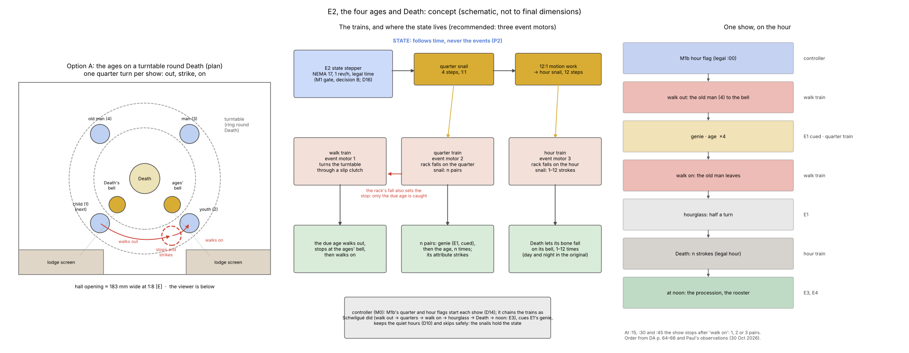
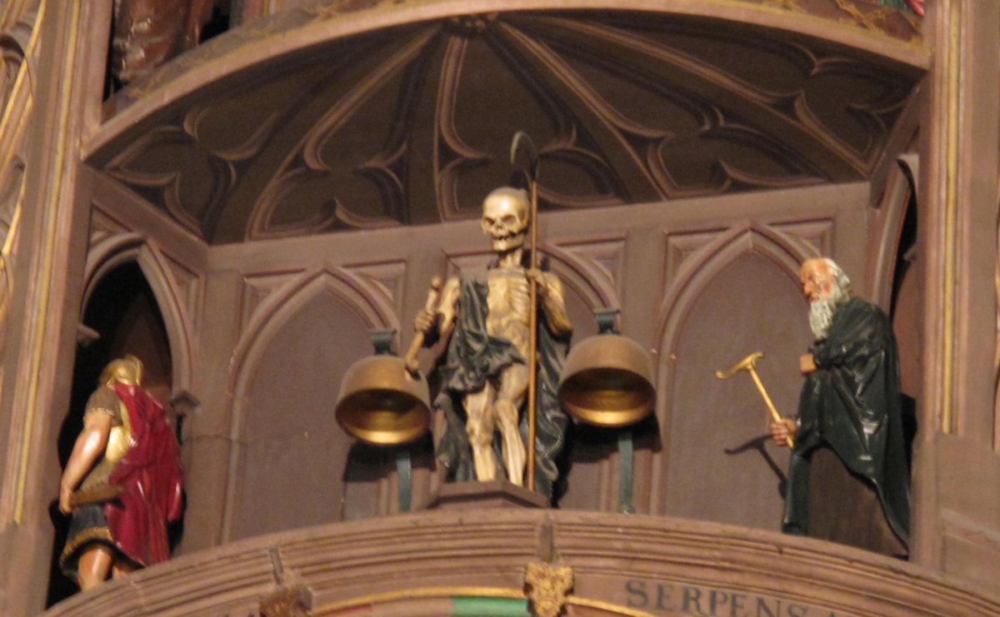
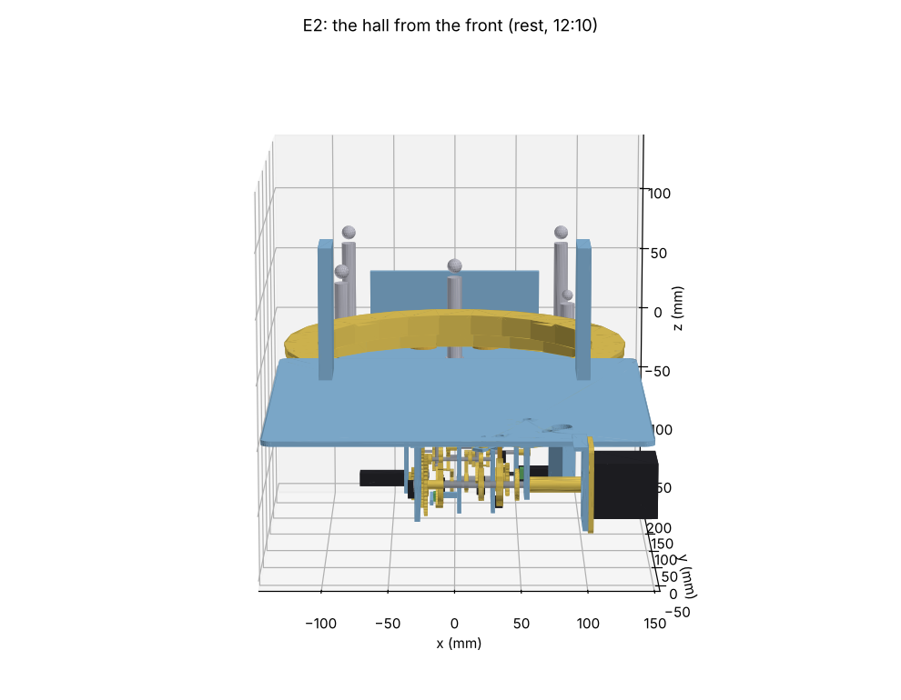
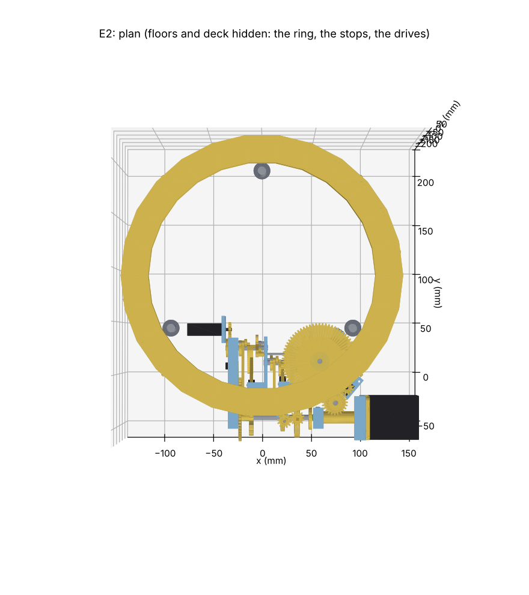
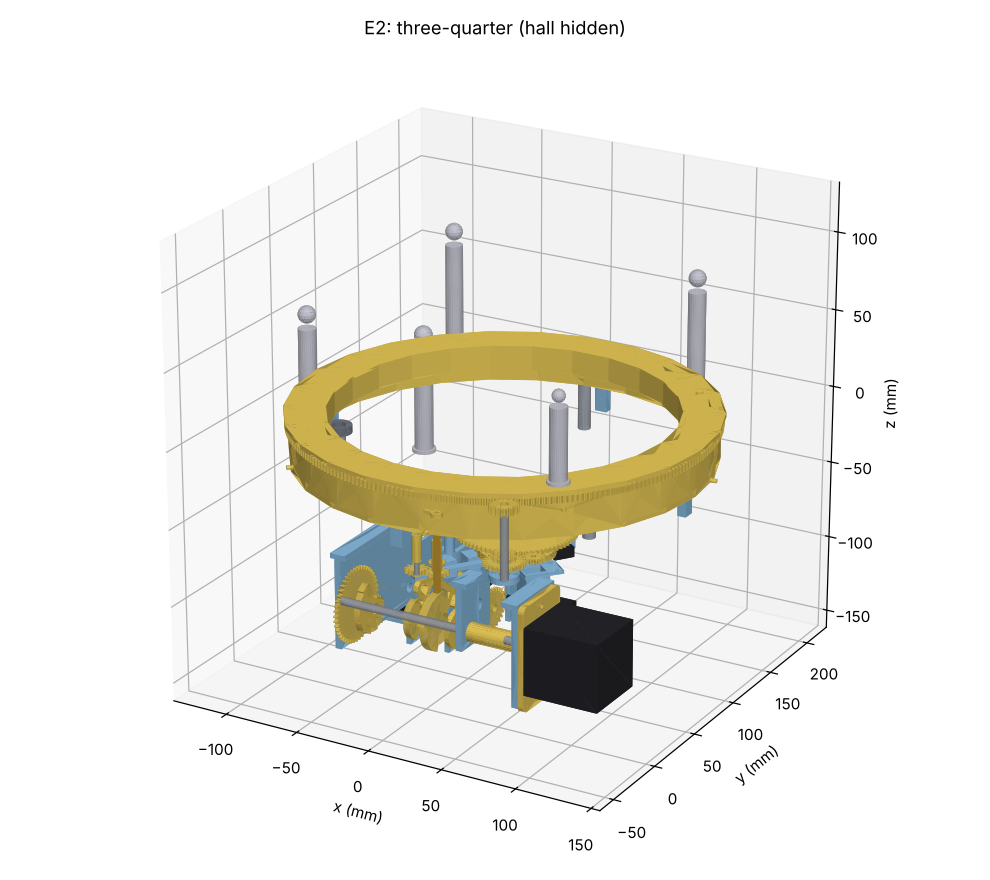
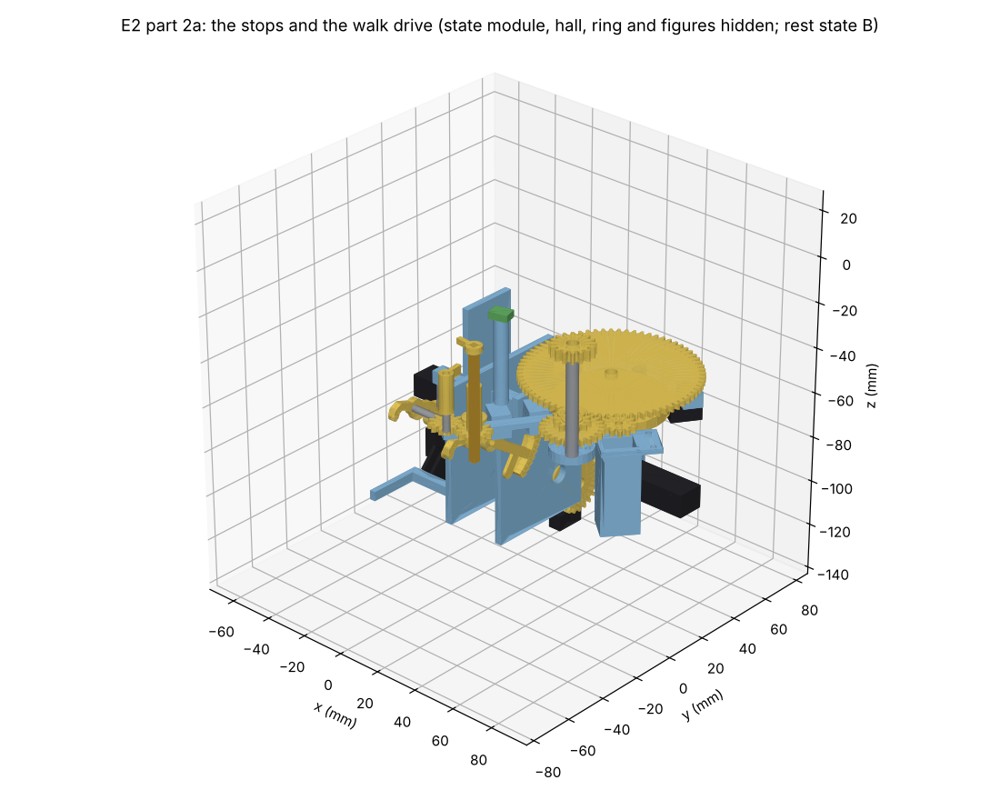
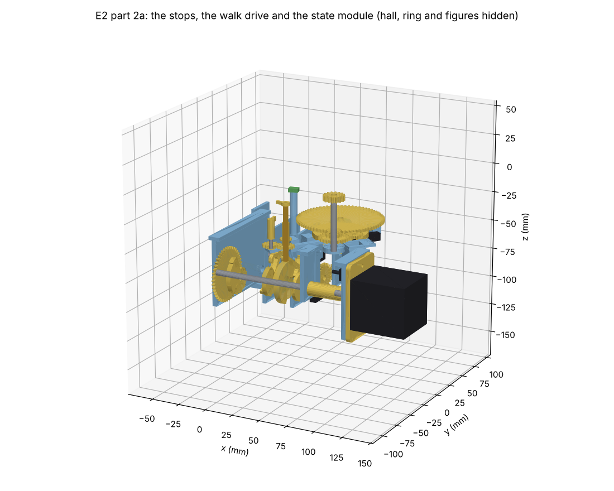
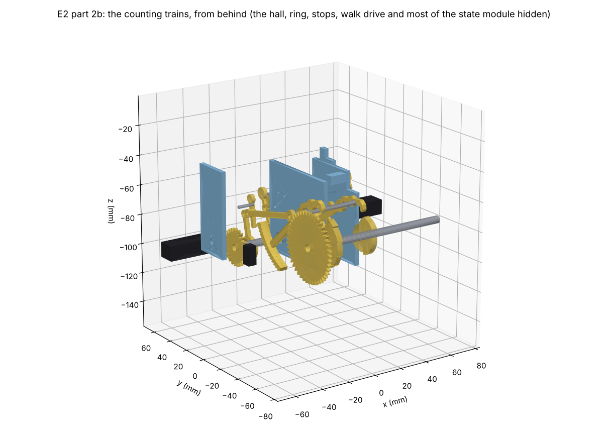
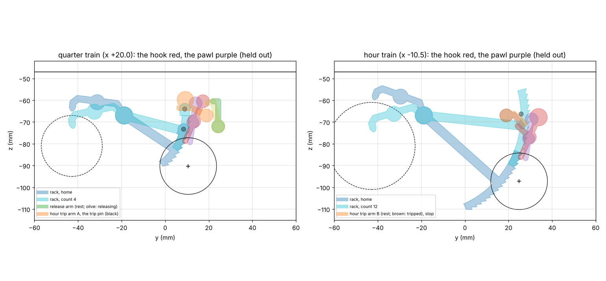

# E2 the four ages and Death: concept gate

Phase 2, module E2: the lower hall of the automata. At each quarter one of the four ages of life
walks out in front of Death and strikes the quarter, answering the genie's strokes (E1). Each hour
Death strikes the hour.

**Status: Detail design, part 1 for review (§10).** The concept was accepted (Paul, PR #15, 6 Nov
2026; the decisions are in §9). Tags as in `docs/reference-notes.md`.

*Schematic only, not to final dimensions. The hall's width is from `docs/envelope.md` §3 [E]. The
hall's plan is scaled from the 2011 photograph below [E].*

*The lower hall at rest, 7 Dec 2011, 12:24 CET, which is 11:55 Strasbourg mean time [D: mean =
CET − 29 min]. The man struck at 11:45 and stands at the left doorway, back turned. The old man,
who strikes at 12:00, waits at the right. Photograph: Tangopaso, Wikimedia Commons,
"Death_and_old_man_of_the_astronomical_clock_of_Strasbourg.jpg", released into the public domain
(crop, downscaled). Found by Paul.*

## 1. What E2 does

- **The four ages strike the quarters** [S: DA p. 56–58; mechanism-inventory A3].
  - Each age has its own quarter and attribute:
    - the child strikes the first quarter with a thyrsus;
    - the youth (a hunter) strikes the half with an arrow;
    - the man (a warrior) strikes the three-quarters with a sword;
    - the old man strikes the four quarters with his crutch, "un instant avant que l'heure sonne".
  - Each age "en sortant de sa loge, fait deux pas pour s'approcher d'un timbre suspendu tout
    auprès", strikes, and disappears for the next.
  - They strike only the second stroke of each pair; "le premier [est] frappé par le génie au
    sceptre" (E1).
  - **Observed** [S: Paul's observation of the clock in action, 30 Oct 2026, his video and YouTube
    videos]:
    - At the n-th quarter the genie and the age strike **n pairs**: genie, age, genie, age, and
      so on.
    - The age walks out in front of Death and strikes the bell at the **viewer's right of Death**.
      Then it walks on past Death.
  - **By day only** in the original: the central motor suspends the ages at night [S: DA p. 58,
    65].
- **Death strikes the hours** [S: DA p. 57–58; mechanism-inventory A4].
  - Death stands on a pedestal in the middle of the hall. It drops the bone in its right hand onto
    the bell at its right, which is the **viewer's left**, 1 to 12 times, day and night.
  - Paul's photographs IMG_0769 and IMG_0770 (10:10 CET) show:
    - Death with the bone raised in its right hand and the scythe in its left;
    - a bell on each side of Death.
  - Those two photographs frame only the centre of the hall, so they do not show the doorways.
- **The hall at rest** [S: the 2011 photograph above; its clock agrees with the shows' schedule].
  - **Two ages are in view between shows.** The one that struck last stands at the left doorway
    with its back turned. The next one waits at the right, facing Death.
  - **They walk from right to left.** Each comes in from the right doorway, strikes the bell at the
    viewer's right of Death, walks on in front of Death, and goes out by the left doorway. That
    matches Paul's "walks on past Death".
  - The bells hang mouth down from curved brackets on posts, one either side of Death at about its
    waist.
  - The doorways sit at the two ends of the back wall. The hall's front is convex, a shallow bay.
- **The order of the trains** [S: DA p. 64–66, quoted in `docs/architecture.md` §5].
  - Schwilgué gave E2's work to **three separate trains**:
    1. the "rouage des quatre âges" moves the age out;
    2. the "sonnerie des quarts" strikes the quarters;
    3. the ages' train moves the automata on;
    4. the "sonnerie des heures" strikes the hours.
  - At noon the hour train hands on to the Apostles and rooster (E3, E4).
- **In the replica:**
  - The shows follow legal time: the quarters at :15, :30, :45 and :00, and Death's count is the
    legal hour (D14).
  - E2's state comes from **its own 1 rev/h state stepper** on legal time. It carries a four-step
    quarter snail, and a twelve-step hour snail through 12:1 (M1 gate, decision 1: B, Paul, 4 Nov
    2026).
  - The bells are real bells, struck mechanically (D8). Quiet hours are a controller setting (D10).

## 2. What is known, and what is not

| Item | Value | Tag |
|---|---|---|
| Height of the hall | ≈ 1324 mm above the floor at 1:8; E3's hall ≈ 149 mm above it | [E: envelope §2]; [D: 1473 − 1324] |
| Hall opening | ≈ 1.46 m wide, so **≈ 183 mm at 1:8** | [E: envelope §3] |
| Depth available | TBD: the case depth is still open | `docs/reference-notes.md`, open items |
| Death's height | **≈ 0.62 m, so ≈ 78 mm at 1:8** (range 0.52–0.74 m, 65–92 mm) | [E: 2011 photograph. Death is 0.349 of the hall's width as seen, corrected by 1/cos 35° for the upward view; 0.349 × 1.46 m / 0.82. The view angle comes from the bells' rim ellipses (axis ratio 0.58–0.64, so 35–40°; 30° allowed for tilt). The hall's width is ±11 % (envelope §3)] |
| The ages' heights | the old man as tall as Death, though stooped. The man appears about 0.8 of Death, but he is turned away in the doorway. **The child is about ¾ of the old man**, so ≈ 58 mm at 1:8. The youth and the man are not much different from the old man. They are told apart by their costumes and attributes more than by size | [E: same photograph]; [E: Paul's estimate from his video, 6 Nov 2026]; [D: ¾ × 78 mm] |
| Bells | **≈ 0.17 m across, so ≈ 21 mm at 1:8**, their centres ≈ 24 mm either side of Death's axis | [E: 0.113 and 0.133 of the hall's width; widths are not foreshortened; ±11 %] |
| Which way the ages walk | **in from the right doorway, strike at the right-hand bell, on past Death, out by the left doorway** | [S: 2011 photograph and Paul's observation] |
| Rest state | the last age stands at the left doorway, the next waits at the right; both in view | [S: 2011 photograph, 12:24 CET = 11:55 mean time, between the 11:45 and 12:00 shows] |
| Turntable that fits these positions | four ages 90° apart on a ring of R ≈ 121 mm, its centre ≈ 94 mm behind Death; the front of the ring ≈ 27 mm in front of Death; **≈ 243 mm deep in all** | [D: a circle through both doorways (±0.42 of the hall's width, at Death's depth) and 0.15 of the width in front of Death; the photograph's rest positions (±0.41 and −0.46 of the width) fall at ±45° on it] |
| Stroke cadence | **the genie strikes, the age strikes 1 s later, then a 2 s pause; repeated n times.** So a pair every 3 s, and the old man's four pairs take ≈ 10 s from the genie's first stroke to his last | [S: Paul's observation, 6 Nov 2026]; [D: 3 × 3 s + 1 s] |
| Walk duration | **the walk on takes ≈ 10 s**: from the old man's last stroke, past Death to the left doorway. The next age comes into view at the right during the same move. The walk out, from the right doorway to the bell, was not timed; at the same speed it would take ≈ 6 s | [S: Paul's observation, 6 Nov 2026]; [E: 34° of the ring's 56° walk on, at its 5.6°/s (§2 geometry), 34/56 × 10 s] |
| Death's cadence | **one stroke every 3 s** | [S: Paul, PR #21, 8 Nov 2026] |
| What follows the walk | **Death starts the hour as soon as the walk ends.** The hourglass turns "au dernier coup des quatre quarts", so it runs during the walk | [S: Paul, 6 Nov 2026; DA p. 51] |
| How the original moves the ages | not described in DA; Ungerer 1922 and Bach et al. 1992 may show it | [?]: the books are still to obtain |
| State arbor | 1 rev/h, legal time; quarter snail 1:1; hour snail through 12:1 (12/48 · 15/45, as M1's motion work) | [S: M1 gate, decision 1; architecture §3] |

## 3. Boundary and interfaces

As everywhere: **pass timing electrically and position mechanically** (architecture §4).

| To | What | Link |
|---|---|---|
| M0 controller | the state stepper; the event motors (§6); sensors: the state arbor's index, a witness on the hour snail, a lock switch per event train, the walk stops, E1's cue switch, "last stroke" | one connector |
| M1b | quarter and hour releases, in legal time (D14) | electrical, through the controller |
| E1 genies | a cue before each of the age's strokes (the genie strikes first); after the fourth quarter, the hourglass before Death strikes | electrical, through the controller |
| E3 procession | at noon, after Death's last stroke | electrical, through the controller |
| Case | the hall's architecture in front (arcade, lodge screens, balustrade, vault) | the works stand on the internal frame, never on the case (D12 R5); where E2's stage ends and the case begins is for the detail design |

**State and events (P2).**
- What must match the time is in the state train: which age is due, how many pairs, and Death's
  count.
- The event motors only supply the energy for each show.
- **Between shows the next age is in view**, waiting at the right. So a skipped show (quiet
  hours, catch-up, a fault) would leave the wrong age waiting. The walk train therefore always
  stops on an age chosen by the state train (4.2), and the controller runs it alone, silently,
  after any skip (4.5).

## 4. Proposed concept

**4.1 The state module.**
- E2's own NEMA 17 turns the state arbor at 1 rev/h on legal time.
  - It plugs in from behind on the D16 adapter (`cad/lib/motor_mount.py`).
  - It follows P1, like M1b, including the +1 h and +23 h summer-time changes (D14).
- The arbor carries the **four-step quarter snail**. A 12:1 motion work carries the **twelve-step
  hour snail**.
- An index Hall reads the arbor each hour; a witness Hall reads the hour snail at 12:00.
- The snails turn continuously with the arbor. A rack falls at the middle of a step:
  - at :15 the quarter snail is 7.5 min from each step edge [D: a step is 15 min];
  - at :00 the hour snail is 30 min from each edge [D: a step is 1 h].
  - The controller starts each show at the exact minute, so the margin is large.

**4.2 The quarter train: the count and the choice of age.**
- When released, a rack falls onto the quarter snail. Its fall (1–4 steps) sets the number of pairs,
  as in rack quarter-striking.
- **The state train picks the age.** A four-step age cam on the state arbor sets a stop finger at
  one of four radii.
  - Each age has a peg at its own radius on the turntable (option A, §5).
  - So only the age that is due next can stop at the waiting position, at the right doorway.
  - The age cam steps just after each show starts, a quarter ahead of the quarter snail.
    Whenever the walk train stops, the next due age is waiting.
- Each stroke cycle closes a cue switch. The controller fires E1's genie, and the age's stroke
  follows a moment later on the cam.
- The age strikes the ages' bell with its attribute. A lifter at the bell station raises the arm
  of whichever age stands there, and the arm falls onto the bell.

**4.3 The walk.**
- At rest the due age waits at the right doorway, held by the age cam's stop, and the last one
  stands at the left doorway.
- **The show.**
  1. The walk train lifts the stop and turns the turntable through a slip clutch. A fixed cam
     brings the waiting age to the bell, a short move.
  2. The quarter train strikes.
  3. The walk train walks the age on past Death to the left doorway, in about 10 s [S: Paul]. The
     turntable stops when the next due age reaches the waiting position: a quarter turn in all.
     At the 1:8 ring that is ≈ 12 mm/s at the figures [D: 56° of R 121 mm in 10 s].
  4. On the hour, the walk train's lock starts the hour train at once. E1's hourglass has already
     started, at the quarter train's last stroke.
- **If shows were skipped**, running the walk train simply turns on until the age cam's stop
  catches the age now due. The skipped ages pass without striking. So it corrects itself, as a
  rack on a snail does.

**4.4 The hour train.**
- A rack falls onto the hour snail (1–12).
- A gathering pallet counts the strokes. A lifter raises Death's forearm, and the bone falls onto
  Death's bell, as DA describes.
- The train locks when the rack is gathered, then closes the "last stroke" switch. At noon that
  starts E3.

**4.5 Night, catch-up and setting.**
- Quiet hours are firmware (D10). The minimal faithful setting silences the ages at night, while
  Death strikes day and night [S: DA p. 58, 65].
  - **Changed in part 2b:** the walk train releases the racks (Paul, PR #21, 8 Nov 2026), so Death is
    silent whenever the ages are. Paul: "I'm okay with Death not striking during the quiet time at
    night". E2 goes quiet as a whole (`docs/firmware-design.md` §8, F6).
- At the end of quiet hours, and after a power cut, the controller runs the walk train alone,
  silently (4.3). Then the right age waits in view. Nothing else needs catching up: the snails
  are on the state arbor. The silent walk drops the racks; they rest on their snails until the next
  show gathers them (§12.2).
- No hands to set: the state arbor's phase is the stepper's (P1). The hour snail is meshed at its
  mark at commissioning, and its witness checks it.

## 5. Decision 1: how the ages move — A (Paul, PR #15, 6 Nov 2026)

All three options keep the state in the state train. They differ in how the age reaches the bell.

| Option | How | For | Against |
|---|---|---|---|
| **A. Turntable, stopped by the state** (4.2–4.3) | The four ages stand 90° apart on a ring whose centre is behind the back wall. Only its front arc, between the two doorways, is in view. Each show turns it a quarter turn: in from the right, strike, out by the left. | Matches the 2011 photograph and Paul's observation, including the two ages in view at rest. One rigid, printable ring (Ø ≈ 243 mm, within the bed) on one bearing. It corrects itself after skipped shows. | **About 243 mm of depth** at the original's geometry [E]. A smaller ring, with the doorways moved in, needs less depth but spoils the look. Two stops and a slip clutch to design. |
| B. Turntable geared to the state arbor | The ring turns continuously at 1 rev/h. Each age reaches the bell at its own quarter. | The simplest: no walk motor, no stops, no clutch. Nothing can get out of step. | The ages creep all the time. With a visible arc of ≈ 80°, an age is in view for ≈ 13 min each hour, so one is in view ≈ 53 min of every hour [D: 80/360 × 60 × 4]. Not what Paul saw. |
| C. Four lodges, one slide per age (DA's "sort de sa loge, fait deux pas") | The state arbor turns a selector that couples the walk train to the due age's slide. The age steps out two paces, strikes, and steps back. | Follows DA's wording. Each show starts and ends at rest. | Four slides and a selector. The age goes back rather than on past Death, against Paul's observation. Four lodges take up the hall's width. |

**Decided: A** (Paul: "go with A"). It was recommended because:
- It is the only option that matches DA ("sort de sa loge … disparaît"), Paul's observation
  ("walks on past Death") and the 2011 photograph (two ages in view at rest).
- It stays self-correcting.
- The cost is the two stops and the clutch, which the detail design proves on paper first, with a
  test over every pair of resting age and due age.

## 6. Decision 2: how many event motors — three (Paul, PR #15, 6 Nov 2026)

| Option | For | Against |
|---|---|---|
| One motor and one long cam program (walk, quarters, hours) | Fewest motors | A long, intricate cam train; the hours wait on the quarters mechanically; one fault stops everything |
| Two: walk and quarters on one cam program, hours separate | One fewer motor than three | The walk and strike motions still share a cam program, and the walk's slip clutch shares the strike train's motor |
| **Three: walk, quarters, hours, as Schwilgué** | Each train is a simple, classic one with its own locking. The controller chains them in DA's order (walk out, quarters, walk on, hourglass, Death). A fault in one does not jam the others. | Two more DC gearmotors and two more H-bridge channels than the BOM's one for E2 |

**Decided: three** (Paul: "three motors"). It was recommended because it is faithful to the
original's separate trains, and it gives the simplest mechanisms.
- The BOM now has 8 + 1 gearmotors, up from 6 + 1, and 4 dual H-bridges, up from 3.
- Architecture §10 now has 9 event channels, up from 7.

## 7. Smaller questions (answered, Paul, PR #15, 6 Nov 2026)

1. **Figure heights.** The 2011 photograph gives Death ≈ 78 mm at 1:8 (65–92 mm) [E, §2]. That is
   nearer the plate's 88 mm than the 57 mm source.
   - **Decided: 78 mm** (Paul: "78mm is fine").
   - The man, youth and old man are about as tall. The child is about ¾ of the old man, so ≈ 58 mm
     (Paul's estimate from his video). They are told apart by costume and attribute more than by
     size.
   - All are parametric, so the books can still correct them.
   - The 57 mm Apostles in `CLAUDE.md` came from the same 18-inch source. E3 will need the same
     check against a photograph.
2. **The walk and the strokes.**
   - The direction is settled: in from the right, out by the left (§1).
   - **The cadence** (Paul): the genie strikes, the age strikes 1 s later, then a 2 s pause, and
     the pair repeats; four times for the old man.
   - So the quarter train turns its strike cam once per pair, every 3 s. The cue to E1 comes at the
     start of each turn, and the age's lifter drops 1 s later. E1 must strike within that second.
   - **The walk** (Paul, 6 Nov 2026): after the old man's fourth stroke he walks on past Death.
     That takes about 10 s, while the next age comes into view at the right.
   - Death starts the hour immediately after the walk.
   - The walk out was not timed; it is a parameter, ≈ 6 s at the same speed [E].
3. **Depth.** With A at the original's geometry, the turntable needs about 243 mm of depth at E2's
   level (§2). The case depth is still open. The detail design carries 243 mm into the envelope
   and reports back if the case cannot give it; a shallower ring is the fallback.
4. **The strike.** Taken as recommended ("for the rest, go with…"):
   - **Recommended:** the age's own attribute strikes the bell, as in the original. It is soft,
     which suits a living room (D8).
   - **Fallback:** a hidden hammer moved with the arm, if the test bells sound too weak.
   - Death's bone strikes its bell directly.

## 8. After the gate: the detail design

- **CAD:** `cad/modules/e2_ages/`:
  - the state module (stepper, snails, 12:1, sensors);
  - the turntable and its stops;
  - the walk, quarter and hour trains;
  - the bells, Death, the four ages (parametric figures) and the stage.
- **Checks:**
  - interference;
  - every mesh engaged;
  - the stop selection over all sixteen cases of resting age and due age;
  - the rack counts 1–4 and 1–12;
  - the strike timing;
  - endshake;
  - motor access (D16);
  - bed fit and print poses.
- **Files:** print files, SketchUp files with an exploded view, BOM rows, and `spec/clock.yaml`
  entries for E2's state rates.

## 9. Decisions (settled, Paul, PR #15, 6 Nov 2026)

1. **How the ages move: A.**
   - A turntable carries the four ages 90° apart, with its centre behind the back wall.
   - Each show turns it a quarter turn: in from the right doorway, strike, out by the left.
   - An age cam on the state arbor sets the stop, so the next due age always waits at the right
     (§4.2–4.3, §5).
2. **Event motors: three**, for the walk, the quarters and the hours, chained by the controller in
   DA's order (§6).
3. **Figures: Death 78 mm at 1:8**, the youth, the man and the old man about as tall, the child
   ≈ ¾ of that (≈ 58 mm); all parametric (§7.1).
4. **Cadence:** genie, the age 1 s later, then 2 s, repeated n times. The walk on takes ≈ 10 s,
   and Death starts at once after it (§7.2).
5. **The strike:** the age's own attribute strikes the bell, with a hidden hammer only as a fallback.
   Death's bone strikes directly (§7.4).
6. **Depth:** the faithful ring (≈ 243 mm deep), to be checked against the case in the detail
   design (§7.3).
7. **The stop fingers are swung by a program cam on the walk train** (Paul, 6 Nov 2026, choosing A
   over two micro servos).
   - The cam turns once per show, through a 1:5 pair; a rocker and two rods swing both fingers.
   - Two notches on the cam stop the walk motor at the end of each phase.
   - A Hall at the bell station, with a magnet in each age's base, tells the controller whether an
     age was caught, so it knows whether to strike or run another turn (§10.3).
   - Part 2a refines how: two stop shafts geared 1:1, one push rod, a 1:6 program pair (§11.1).

## 10. Detail design, part 1: the layout, the ring and the selection

The detail design comes in three parts, so each can be checked before the next:
1. **This part:**
   - the hall's layout;
   - the ring (turntable) on its rollers, with its teeth and the four selection pegs;
   - the two stop fingers, and the age cam that sets the bell finger's height;
   - a simulation of the walk over every case.

   The drives that part 2 details were placeholders, at their true places, so their space was held.
   Part 2a has replaced them (§11).
2. **The drives:**
   - the walk train's slip clutch and program cam, and the fingers' linkages;
   - the state module: the quarter snail, the 12:1 motion work, the hour snail and the sensors;
   - the quarter and hour striking trains, with the figures' arms and push pins.
3. **The figures:** sculpted to the decided heights.

Model: `cad/modules/e2_ages/` (`layout.py` for the numbers and the simulation, `mechanism.py` for the
CAD). Tests: `cad/tests/test_e2.py`. Frame: X to the viewer's right, Y away from the viewer, Z up,
with the origin on Death's axis on the floor. The model shows the rest state at 12:10: the child
waits at the right doorway, and the old man stands at the left one.

 

### 10.1 The layout

| Item | Value | Tag |
|---|---|---|
| Hall opening | 183 mm; piers at ±91.5–101.5, 100 mm high | [E: envelope §3] |
| Back wall | x ±64, y 12–16, 72 mm high; the doorways are the gaps at its ends | [E: photo, e2-design §2] |
| Death | on a 24 × 18 × 6 pedestal at the origin; 78 mm | [S: decided] |
| Bells | Ø21 × 15 brass bowls, mouth down, at x ±24, y 0, rims at z 16, each on a printed bracket | [E: photo] |
| The ring's centre C | (0, 94): 94 mm behind Death | [D: §2] |
| The figures' path | R 121 | [D: §2] |
| Waiting positions | φ ±45°: (±85.6, 8.4), in the doorways | [D] |
| Bell station | φ 15°: (31.3, −22.9), just right of the ages' bell, 8 mm from it | [D] |
| Floors | static island inside the ring (R < 107.5) and a static front floor outside it (R > 134.5), both flush with the ring | [D] |

### 10.2 The ring and its rollers

| Item | Value |
|---|---|
| Walking surface | annulus R 108–134, z −3 to 0, flush with the floor, 0.5 mm gap each side |
| Inner skirt | R 108–110, from the surface down to z −16; the guide rollers run inside it |
| Outer body | R 127–131, down to z −30 (part 2a: −28 before the waiting pegs); it carries the teeth and the pegs |
| Teeth | 264, module 1, z −8 to −3 |
| Walk pinion | 16, at C + 140 mm at −60° (under the front floor, right); profile shifts −0.064/+0.064 |
| Selection pegs | one per age, Ø2.5, radial from R 131 to 135, at its own height: child −12, youth −16, man −20, old man −24 |
| Support rollers | 4 × 688ZZ, horizontal radial axes at R 118, every 90°; the ring rests on their tops |
| Guide rollers | 3 × 688ZZ, vertical axes at R 100, at −30°, 90° and 210° (clear of Death's axis) |
| Print | one piece, Ø268, face down, within the bed |

### 10.3 The selection and the walk

- **The bell finger** pivots on a vertical shaft at R 141, just downstream of the bell station.
  - **Its height is the selection.** The shaft rides on the age cam, so its arm sits at the due
    age's peg height. Only that peg can run into it.
  - The walk train's program cam swings it in for the walk out only (part 2).
- **The waiting finger** spans all four peg heights, so it catches whichever age comes next. It is
  in at rest and during the walk on, and out during the walk out.
- **The age cam** sits on the state arbor (1 rev/h, legal time), right under the bell finger's
  shaft.
  - Its radii are 20, 16, 12 and 8 mm: the child from :07.5, the youth from :22.5, the man from
    :37.5 and the old man from :52.5.
  - It rises back from the old man to the child as a ramp between :01 and :07, so the riding shaft
    is lifted, never struck.
  - Each quarter's show falls in the middle of its step.
- **The program.** Each show is one turn of the walk train's program cam.
  - **Phase A, the walk out:** the waiting finger is out and the bell finger in. The ring turns at
    most 40°: 30° to the bell, then 10° of clutch slip.
  - **Phase B, the walk on:** the bell finger is out and the waiting finger in. The ring turns at
    most 70°: 60° to the next waiting age, then 10° of slip.
  - If no age is caught at the bell in phase A, the controller skips the strikes and runs another
    turn.
- **The simulation** (`layout.simulate_walk`), over all 16 pairs of waiting age and due age:
  - the due age is always the one struck, and the next one is left waiting;
  - it takes (due − waiting) mod 4 + 1 program turns, each exactly a quarter turn of the ring.
  - So skipped shows correct themselves, with the skipped ages walking past silently.
- **Timing** [D: from Paul's 10 s walk on]:
  - the ring turns at 6°/s (1 rpm);
  - the walk out takes 5 s and the walk on 10 s. (Part 2a gives the full program's timing: §11.3.)
  - The pinion turns at 16.5 rpm. A walk gearmotor of ≈ 33 rpm through 12/24 gives that. Part 2
    chooses the motor (⚠ a micro metal gearmotor of the 1000:1 HP 6 V class, about 32 rpm [E]).

### 10.4 What is a placeholder

These hold space at their true places; part 2 replaces them.
- **Walk drive:** below the pinion, the space for the slip clutch and the program cam's gearing;
  below the deck, the walk gearmotor.
- **State module:** under the front of the hall, along X at z −80, next to the age cam (the
  quarter snail, the 12:1 motion work and the hour snail).
- **State motor:** the NEMA 17 on its D16 adapter at the right-hand end. It is withdrawn to the
  right, from the module's side.
- **Figures:** Death and the four ages, at the decided heights (part 3).

### 10.5 Size

The model's envelope [D] is:
- **x:** −145 to 152, 297 mm. That is wider than the hall's 183 mm opening: the ring and the
  deck run on behind the piers.
- **y:** −64 to 235, about 299 mm deep from the stage's front to the deck's back. The ring alone
  is 273 mm deep.
- **z:** −101 to 100, from the state motor's bottom to the piers' tops. The vault above the hall is
  not modelled.

**Check the depth against the case** when the case design fixes it (still TBD).

### 10.6 Checks

`cad/tests/test_e2.py`, 26 tests:
- the walk over all 16 cases;
- the timing against Paul's 10 s;
- the layout against the 2011 photograph: both doorways, the bell station's reach to the bell;
- the decided heights;
- the age cam against the peg heights at each quarter, and its ramp;
- the bell finger catches only the selected peg at each of the four heights, and none when
  withdrawn;
- the waiting finger catches every peg, and each rests against it;
- no interference, and every part fits the bed.

### 10.7 Open items for part 2

- The walk train (decided: a program cam, §9.7): the gearmotor (⚠ choose from the maker's table),
  the slip clutch, the program cam with its two lock notches, the rocker and rods to the fingers,
  and the Hall that says an age was caught at the bell.
- The state module: the snails, the 12:1, and the index and witness Halls.
- The quarter and hour trains: racks, gathering pallets, lifters, E1's cue switch, the lock
  switches, and Death's arm.
- The figures' arms and push pins, which are lifted at the bell station from below the ring.
- **The bells ⚠:** Ø21 brass bowl bells, to source.
- The hall's vault and side walls, and where E2 ends and the case begins (D12 R5).

## 11. Detail design, part 2a: the stops, the walk drive and the state module

Paul chose the program cam on the walk train (§9.7). Part 2a details it, the walk drive around it,
and the state module. Part 2b follows: the quarter and hour trains, Death's arm, and the ages' arms
and push pins. Part 3 is the figures.

Model:
- `cad/modules/e2_ages/drives.py`: the CAD;
- `cad/modules/e2_ages/program.py`: the program's geometry and timing, with no CAD;
- `mechanism.py` assembles them with part 1.

The model shows the rest state at 12:10, program angle 0 (state B).

 

### 11.1 What changed from the plan in §9.7, and why

- **Two stop shafts, geared together, instead of one shaft or a rocker with two rods.**
  - **Both stops now stand together at the bell station.** Each age gets a second peg, its
    *waiting peg*. It is as long as the selection pegs but lower than all of them (z −28), and it
    sits 35.1° behind its age. When an age stands at the right doorway (φ 45°), its waiting peg is
    at the waiting stop, next to the bell stop. So no rods run across the front of the hall.
  - **Why not one shaft:** a first version put both arms on one shaft, and it would have pushed the
    waiting age back about 2° (about 4 mm at the figure) at the start of every show.
    - An arm that pivots outside the ring must swing out *downstream* to let a held peg go.
      Otherwise it shoves the peg back against the clutch.
    - A single shaft swings one way and then the other, so one of its two arms would always
      release upstream.
  - **The fix:** the arms are on two shafts 12.5 mm apart, coupled by a pair of 12-tooth gears
    under the deck.
    - The shafts turn in opposite senses, so each arm swings out downstream.
    - The held peg's own push then helps it go.
- **The program pair is 12'/72 (1:6), not 1:5, and each change of state takes 45° of the
  program.**
  - A 5° change would make the follower rise its full travel in 1.5 mm of cam, a pressure angle
    over 80°. With 45° changes the largest pressure angle is 35.8° [D].
  - The longer changes cost ring travel, so a program turn now carries the ring 130.9° instead
    of 109°. The phases' limits still come out at 40.0° and 70.0°, as in part 1.
- **One push rod drives a crank on the waiting shaft**, with no rocker. The rod is a radial
  translating follower of the program cam.
- **The deck is 3 mm lower** (z −47 to −43), so the walk clutch's hub clears the waiting pegs.
- **The ring's outer body now reaches z −30**, down from −28, to carry the waiting pegs.
- **A drawing fix:** part 1 drew the age cam turned by 45 minutes against its follower. Its numbers
  and tests were not affected. Part 2a draws every cam on the state arbor in its true phase.

### 11.2 The stops

| Item | Value | Tag |
|---|---|---|
| Bell stop's shaft | 3 × 3 brass square rod at R 141, φ 13.94°, at (33.96, −42.85). It slides in a keyed sleeve; the sleeve and its 12-tooth gear are one print, turning in the deck, with a collar pressed on above the deck. The rod's foot rides on the age cam | [D] |
| Bell arm | pressed on the rod at the selected peg's height (child −12 … old man −24); 2.5 high, 2 wide, tip at R 132.2 | [D] |
| Waiting stop's shaft | Ø3 ground rod at R 141, φ 8.85°, at (21.69, −45.32). It is 12.52 mm from the bell shaft, the 12/12 pair's centre distance | [D] |
| Waiting arm | z −30 to −26, tip at R 132.2; its hub rests on the deck | [D] |
| Pegs | all Ø2.5, from R 131 to 135. Selection pegs at z −12, −16, −20, −24; waiting pegs at −28, 35.09° behind their age | [D] |
| Where a peg rests | 1.06° upstream of its arm (the peg's radius, half the arm and a 0.2 mm gap): the bell station at φ 15.00°, the waiting station at φ 9.91° | [D] |
| Swing | 70°. An arm holds with at least 1 mm overlap while swung less than 36.2°. It lets every peg by when swung more than 49.9° (tip at R 135.5). Fully out, the tip is at R 138.2 | [D] |
| Heights apart | the old man's bell arm (−25.25 to −22.75) clears the waiting arm (top −26) and the waiting pegs (top −26.75) | [D] |
| Crank | r 5 on the waiting shaft, under its gear; a Ø2 steel pin runs in the push rod's yoke | [D] |
| Push rod | 5 × 2.2 PETG bar, 49.5 mm from the follower pin to the crank pin, in two guides under the deck. The Ø2.5 follower pin runs in the program cam's groove | [D] |

### 11.3 The program

One program turn per show. The stops' swing ψ is 0 in state A (the bell arm in) and 70° in state
B (the waiting arm in). Program angles [D: `program.py`]:

| Program angle | Phase | What happens |
|---|---|---|
| 0–45° | BA | harmonic swing from B to A. At 22.0° the bell arm can hold; at 28.8° the waiting arm lets the waiting age go |
| 45–138.75° | A | the walk out. The lock switch stops the motor at 138.75° for the strikes |
| 138.75–183.75° | AB | at 160.8° the waiting arm can hold; at 167.6° the bell arm lets the struck age go |
| 183.75–360° | B | the walk on. The lock switch stops the motor at 360°: rest |

- **Ring travel [D]:** 0.3636° of ring per program degree (6 × 16 / 264).
  - In phase A the ring can turn at most 40.0°; it needs 30°.
  - In phase B it can turn at most 70.0°; it needs 60°.
  - In a skipped show it runs free for 48.0° before the waiting arm can hold again. The next
    waiting peg is 90° away.
  - The lock switch may close up to 4° of program early. Each phase still keeps at least 5° of
    clutch slip (tested).
- **The program cam:** Ø47 × 4.3, with a groove 2.8 wide and 1.8 deep underneath. The groove's
  radius runs from 20.0 (state A) to 14.3 (state B). Its largest pressure angle is 35.8°.
- **The lock cam:** R 12, with two notches 1.5 deep (a 4° ramp, then a 16° flat) starting at the
  two stop angles. A subminiature roller-lever microswitch reads it, on a bracket under the deck.
- **Timing [D: `program.timing`, with the gearmotor at ≈ 32 rpm [E]]:** the ring turns at
  5.82°/s and the program at 16°/s.

| Step | s |
|---|---|
| Hold before the walk out (the stops change over) | 1.80 |
| Walk out, 30° | 5.16 |
| Clutch slip, then the motor stops: the strikes | 1.72 |
| Hold after the strikes (the stops change over) | 1.80 |
| Walk on, 60° (Paul: ≈ 10 s) | 10.31 |
| Clutch slip, then the motor stops: rest | 1.72 |
| **Program turn (motor running)** | **22.50** |

### 11.4 The walk drive

| Item | Value |
|---|---|
| Walk shaft | Ø5 ground rod at (70.00, −27.24), z −51.4 to −3.4, in two MR85ZZ: one in the deck's top face, one in a block screwed under the deck. A Starlock under the lower bearing |
| Slip clutch, bottom up | a spacer on the top bearing's inner race (z −43 to −42); the wave washer (−42 to −41.4); the compound 24 + 12', free on the shaft (−41.4 to −35.4, with a Ø8 friction boss on top); the Ø12 hub pressed on the shaft (−35.4 to −33.4) |
| Walk pinion 16 | pressed on the top of the shaft, z −8 to −3.4; it drives the ring's 264 |
| Gearmotor | micro metal gearmotor ⚠ (12 × 10 × 34.5 [E], Ø3 D-shaft) under the deck, at 50° from the walk shaft (81.57, −13.45). Its 12-tooth pinion drives the compound's 24 (cd 18) through a Ø16 hole in the deck |
| Gearmotor bracket | a sleeve round the gearbox, a lip under it, a flange under the deck (2 × M2). Undo the two screws and the motor drops out with its pinion (tested) |
| Program shaft | Ø5 at (55.64, 12.22), 42 mm from the walk shaft at 110° (12'/72). Gear 72 above the deck (z −38.5 to −36.0). Two MR85ZZ: one in the deck's bottom face, one in a block screwed on the deck. The program cam (−51.6 to −47.3) and the lock cam (−58 to −56) below |
| Bell-station Hall | a DRV5032 board under the ring at φ 15°, R 123.5, on a post from the deck. A Ø5 × 2 magnet sits in the ring under each age (R 123.5), clear of the support rollers' track (R 115.5–120.5) |

### 11.5 The state module

As designed in part 2a. Part 2b rearranged the arbor and reversed its turn (§12.6).

| Item | Value |
|---|---|
| State arbor | Ø5 ground rod along X at y −42.85, z −81 (under the bell rod), x −31 to 79.5. Two MR85ZZ (the left plate and the right block); a Starlock at its left end. It turns at 1 rev/h legal time; clockwise seen from the motor since part 2b (§12.2) |
| Coupling (x 56.6–95.5) | the arbor is pressed into one end; the NEMA's D-shaft slides into a D socket at the other (slip fit, D16) |
| Index (x 45.5–48.5) | a Ø24 disc with a magnet at R 9 (minute 0); the index Hall is on the right block |
| Quarter snail (x 39.5–43.5) | radii 14, 12, 10, 8 for 1–4 pairs; each step is centred on its show |
| Age cam (x 31.46–36.46) | radii 20, 16, 12, 8 and the ramp (§10.3), under the bell rod |
| Motion work 12:1 | 12/48 · 15/45, centre distance 30, as in M1. The pinion 12 is on the arbor (x −13.2 to −10.7). The lay compound (48 + 15) turns on a Ø4 stud fixed in the left plate at y −12.85. The hour wheel 45 is at the end of its tube, free on the arbor |
| Hour snail | pressed on the hour wheel's tube; radius 20 − 0.9 (n − 1) for n strokes, each step centred on its hour. A magnet in the snail at 12; the witness Hall is on the left plate |
| Frame | the left plate, the right block and the motor plate hang from the deck on flanges (M3 into inserts) |
| Stepper | NEMA 17 on its D16 adapter, on the motor plate's right face (x 100). Undo two M3 and draw it out to the right (tested) |

### 11.6 Size and parts

- **Envelope [D]:**
  - x: −145 to 152 (297 mm);
  - y: −66.2 to 235; the hour wheel reaches 4 mm in front of the deck;
  - z: −114 to 100; the bottom is the motor adapter's lower ear.
- **Parts:** 106, of which 54 are printed. Every printed part fits the H2D's bed.
- **Print files:** `export/print/e2_ages/`. The deck now prints flat: its bearing bosses became
  separate blocks.
- **SketchUp:** `export/sketchup/e2_ages.dae` and `e2_ages_exploded.dae`.

### 11.7 Checks

`cad/tests/test_e2.py`, 41 tests: part 1's, rewritten for the stops, plus these.
- **The program:**
  - the phase travel the walk simulation uses is the program's;
  - the margins: at least 5° of slip in each phase with the switch 4° early; the skipped show;
    a program turn carries the ring at least a quarter turn;
  - one arm always holds, or can hold, through each change;
  - the cam's pressure angle is at most 40°;
  - the lock switch closes only at the two stops.
- **The trains:**
  - the walk train's speed and the 1:6 program pair;
  - the 12:1 motion work;
  - the show timing;
  - the snails' counts.
- **The stops:**
  - the bell arm catches only the selected peg and no waiting peg; swung out, it catches none;
  - the waiting arm catches every waiting peg and no selection peg; swung out, it catches none;
  - the waiting peg puts its age in the doorway;
  - the shafts' spacing is the gears' centre distance;
  - each arm swings out downstream.
- **The model:**
  - no interference, and every part fits the bed;
  - the NEMA withdraws to the right;
  - the gearmotor drops out with its pinion and bracket;
  - the rest state: the waiting arm is 0.2 mm in front of the child's waiting peg, and the bell
    arm is clear.

### 11.8 Estimates to confirm, and decisions

**Estimates [E]:**
- **The gearmotor ⚠:** a 1000:1 micro metal gearmotor (12 × 10 mm, Ø3 D-shaft), about 32 rpm
  under this load.
  - Check its length (34.5 mm) and its shaft (9 mm) against the chosen motor's drawing.
  - The controller trims the walk on to 10 s with the H-bridge's PWM.
- **The clutch:** its preload (the wave washer) and its slip torque are set on the test rig.
- **Small parts:** check the microswitch, the Starlocks and the wave washer against the parts
  chosen.
- **Press fits:** printed parts are pressed on ground rods, as in M1; the tolerance test sets the
  fits.

**Decisions (settled, Paul, PR #17, 6 Nov 2026):**
1. **Two geared stop shafts (§11.1): kept**, instead of one shaft or a rocker with two rods. It is
   the only layout here in which neither arm pushes a peg back.
2. **The holds: 45° per change of state, kept.** The cam's pressure angle stays at 36°. The cost is
   two holds:
   - each show starts with a 1.8 s hold before the waiting age moves. The controller starts the
     walk motor 1.8 s earlier, so the show's timing is unchanged;
   - the struck age stands 1.8 s after its last stroke before it walks on.

   (30° changes would have given about 1.2 s, with the cam at about 47°.)
3. **The module's size below the floor: left until the case is designed.** It reaches 114 mm down
   (the NEMA adapter's lower ear), and its front is at y −66. Check both against the case when its
   design fixes them (still TBD).

### 11.9 Open items for part 2b

- The quarter and hour striking trains: racks on the two snails, gathering pallets, lifters, lock
  switches, and E1's cue switch.
- Death's arm, and the ages' arms with their push pins (lifted at the bell station from below the
  ring).
- **The bells ⚠:** to source.

## 12. Detail design, part 2b: the quarter and hour counting trains

Part 2b counts the quarters' pairs and Death's strokes and drives the two strike shafts:
- the racks, snails and gathering;
- the releases, by the walk train (Paul, PR #21);
- the lock, cue and home switches;
- the two gearmotors.

Part 2c takes each strike shaft's lift up to the figures: the ages' push pins and arms at the bell station,
and Death's forearm. Part 3 is the figures.

Model:
- `cad/modules/e2_ages/striking.py`: the geometry and logic, with no CAD;
- `cad/modules/e2_ages/strikers.py`: the CAD;
- `drives.py`: the state arbor, rearranged for the racks, and the release disc on the walk's program shaft
  (§12.6).

The model shows the rest state at 12:10: both racks gathered, the hooks in, the pawls held out, the shafts
at their lock angle, the release arms clear of the hooks.

**What changed on Paul's review (PR #21, 8 Nov 2026).** The walk train now releases the racks (decision 1,
§12.7). The release cams and levers on the state arbor are gone. In their place:
- a grooved release disc on the walk's program shaft;
- the quarter release shaft, with its follower and arm;
- the hour trip shaft, rocked by a pin in the quarter rack at the fourth quarter.

Death is now silent whenever the ages are (§4.5).

 

### 12.1 How each train counts

It is a rack and snail, as the concept gate decided (§4.2, §4.4), adapted for printing.

1. **Release, by the walk train** (Paul, PR #21, decision 1).
   - **Quarters.** A grooved disc under the program shaft's lock cam moves the follower of the quarter release
     shaft once per program turn, in phase A. The shaft's arm pushes the quarter hook's weighted tail: the hook
     turns out and the quarter rack falls. Every show releases it.
   - **Hours.** A pin in the quarter rack lifts arm A of the hour trip shaft, but only when the rack falls past
     three pairs: at the fourth quarter. Arm B then pushes a tab on the hour hook, which turns out, and the hour
     rack falls. The first pair gathered lowers the pin again, and the hour hook drops back into the teeth.
   - The time train still decides *when* (rule 4): the controller starts each walk from the time base, and the
     snails on the state arbor set the counts.
   - **So a show that does not walk strikes nothing, Death included.** E2 goes quiet as a whole at night
     (§4.5).
2. **Fall.** A spring pulls the rack's spoke up, so the rack turns until its tail finger rests on the snail.
   The snail's step sets how many teeth fall: 1–4 pairs, or 1–12 strokes.
   - The spring is needed because the toothed side outweighs the tail (§12.3).
3. **Strike.** The controller runs the strike shaft, one turn per stroke (3 s), after the walk out. Each turn:
   - closes the cue switch (quarters only), so E1's genie strikes;
   - lifts the striking figure and drops it 1 s later (part 2c);
   - gathers one tooth.
4. **Lock.** When the rack is home, its vane blocks the home opto. The controller stops at the next closing of
   the lock switch.
   - **Simulated:** every count gives exactly that many strokes, and the rack comes home (`simulate_show`).

**Two printing adaptations:**
- **The gathering pallet becomes a gathering pawl.**
  - A one-tooth pallet that gathers exactly one tooth of a 2.5 mm-pitch rack would need a radius of about 3 mm,
    too small to print.
  - Instead, an eccentric on the strike shaft rocks a feed lever, coaxial with the rack, through 1.6 teeth. Its
    pawl pushes the rack 1.3 teeth: the hook drops behind the next tooth and the rack settles back onto it.
  - At rest the pawl's tail sits on a fixed guard pin, so the pawl is out of the teeth and the rack can fall.
- **The racks amplify.** The teeth are on an arc at a larger radius than the tail, so a fine snail step
  becomes a printable tooth.
  - The pitch is 2.5 mm, the module-0.8 class, printed with the 0.2 mm nozzle [E: CLAUDE.md working defaults].
  - Both racks turn on one Ø3 stud behind the state arbor.

### 12.2 The racks and snails [D: `striking.py`]

| | Quarters | Hours |
|---|---|---|
| Counts | 1–4 pairs | 1–12 strokes |
| Rack's tooth arc | R 30, 4.775° per tooth | R 48, 2.984° per tooth |
| Tail | 24 mm from the stud (−18.85, −67), above the snail | the same |
| Snail radii (derived) | 14.00, 12.00, 10.01, 8.05 | 20.00, 18.78, 17.55, 16.32, 15.07, 13.83, 12.58, 11.33, 10.09, 8.85, 7.64, 6.47 |
| Gathered tail above the count-1 step | 1.99 | 1.21 |
| Rack's swing | 19.1° | 35.8° |
| Snail steps | each centred on its show; the one rise (4 → 1) is a ramp from :07.5 to :12 | each centred on its hour; the 12 → 1 rise is a ramp from 12:30 to 12:51 |

- **The radii are derived from the rack.** Each count turns the rack exactly one more tooth, and its radius is
  where the tail then rests. Part 2a's 0.9 mm hour steps are replaced by these.
- **Ramps instead of rising steps.** A rack left down rests on its snail: after a silent walk (the catch-up
  at the end of quiet hours, §4.5), or a fault. The snail may
  drop away from the tail, but it only rises on a ramp of at most 2 mm per minute (tested), so the tail is
  lifted, never struck.
- **The state arbor now turns clockwise, seen from its motor.** Only the snails' past steps, never their coming
  ones, then pass under the racks' tail arms. Otherwise the hour rack's arm would have hit the 1-stroke step at
  noon. The stepper can turn either way, and part 2a's cams work in either direction.

### 12.3 The parts

| Part | What it is |
|---|---|
| Rack | printed lever (body 3 mm thick; teeth rim 5.5 mm, flush with the body's +X face so it prints flat), on the 0.2 mm nozzle. A tail arm and finger on one side; a spoke and the toothed rim on the other; a vane for the home opto; a Ø2 pin for its spring |
| Rack spring | Sodemann E00940110500S, the extension spring M2 already uses (accepted by Paul, D13). It hangs vertically from an anchor on the strike plate to the pin on the spoke, 10 mm from the pivot. Stretched 7.3 mm at home; quarters 12.2 → 9.0 N·mm and hours 10.9 → 5.2 N·mm from home to the full count, against the toothed side's weight of 0.13 and 0.48 N·mm [D] |
| Hook | printed pawl on a Ø3 stud (0.2 mm nozzle). Its rounded tip sits in the notch before the hooked face, clear of the next tooth's slope, on a radial stem; the lump on its tail keeps it in the teeth (its weight 0.9 mm on the far side of the pivot) |
| Feed lever and pawl | printed lever on the rack's stud, carrying the gathering pawl on a Ø2 pin; the pawl works the rim's left half |
| Eccentric and strap | eccentric on the strike shaft, throw 2.07 mm (quarters) and 2.02 mm (hours); a printed strap to the feed lever's pin |
| Release disc | printed, pressed on the walk's program shaft under its lock cam (z −62 to −59, R 16). Its groove (1.6 deep, 2.6 wide, underneath) runs at R 13.2 except in the release window, where it eases to R 11.0 and back: rise 30–65°, hold to 80°, back by 115° of the program (harmonic; pressure angle 25.1° [D]) |
| Quarter release shaft | Ø3 rod at (24.32, −72), turning in the right strike plate and the quarter motor plate. Its follower (5 mm thick, under the disc) carries a Ø2 steel pin, pressed upright in its top block, that runs in the groove: a round pin, so the groove's slope never pinches it (0.15 mm clear all round, tested). Its arm (beside the quarter hook) ends 0.4 mm off the hook's weighted tail. The groove turns it 13.1°: the hook turns out 0.199 rad, its tip 1.18 mm above the teeth's tips (0.11 rad is enough) [D]. Positively driven both ways |
| Trip pin | Ø2 pin in a lobe of the quarter rack, R 28 from the stud, beyond the rim's spare tooth (the hook and the pawl never reach it). From three to four pairs it rises 2.33 mm |
| Hour trip shaft | Ø2 rod at (19, −67), turning in the middle and right strike plates. Arm A (x 21.8–24, beside the quarter rack) has a level shoe 0.6 mm above the pin at three pairs; at four pairs the pin turns the shaft 9.7°. Arm B (beside the hour hook) runs along the line to the hour hook's pivot and ends 0.4 mm off a tab on the hook: the hook turns out 0.192 rad [D]. A lump on arm A holds arm B on a Ø2 stop pin, with 3.3 times its bearings' friction [D; E: μ 0.3] |
| Hour hook's tab | 7.5 mm, toward the trip shaft; the hook's tail lump grows to R 4 to keep its weight 0.9 mm on the far side of its pivot |
| Guard | Ø2 pin under the pawl's tail at rest |
| Strike shaft | Ø5 ground rod in two MR85ZZ. Quarters at (10.0, −90.0), x 1.5–42; hours at (24.3, −97.0), x −35.8–5.5 |
| Cams on it | lock (R 9, notch at the rest angle); lifter (R 7 → 13, drop at 120° = 1 s, part 2c); cue, quarters only (R 9 → 10.5 over 5–35°) |
| Drive | 12/24 at m 1 (cd 18) from a micro metal gearmotor at ≈ 40 rpm [E] ⚠: 20 rpm, 3 s per stroke. The motors sit outside the trains (hours to the left, quarters to the right) on plates hanging from the deck; each slides out along X after two M1.6 (tested) |
| Switches | lock: one subminiature roller microswitch per train; cue: one (quarters); home: one Vishay TCST1202 slotted opto per rack (no force on the rack) |
| Plates | the middle (x 2–5) and right (x 27.6–30.6) strike plates hang from the deck; they carry the trip shaft, and the right one the quarter release shaft (it reaches out to y 28.5 for it). The quarter motor plate carries the release shaft's other end; its top is cut back under the walk's lock and release cams. The state module's left plate now also carries the hour strike shaft's left bearing |

**The strike cycle**, in strike-shaft degrees:

| Angle | Event |
|---|---|
| 0 | rest |
| 5–35 | cue (E1's genie) |
| 20–110–120 | lift, hold, drop: the figure's stroke at 1.0 s |
| 150–330 | the eccentric's gathering stroke |
| 350–360 | lock |

### 12.4 Timing

- A pair every 3 s, with the age 1 s after the cue (Paul).
- Death's strokes: one every 3 s [S: Paul, PR #21, 8 Nov 2026]. So twelve at noon take 33 s from the first to the last [D: 11 × 3 s].
- **The release, in a show's walk** (at the walk motor's estimated 32 rpm, §11.8) [D: `release_times_s`]:

  | Seconds into phase A | |
  |---|---|
  | 1.9 | the follower starts to move (the waiting age has just been let go) |
  | 4.1 | the quarter hook is out: the quarter rack falls (and, at the hour, trips the hour rack) |
  | 5.0 | the hook starts back |
  | 7.2 | the hook is back in |
  | 8.7 | the program stops at the lock notch: the strikes start |

  So the racks fall about 4.6 s before the first pair, and the snails' steps are centred on the shows.
- The controller's sequence on the hour:
  1. the walk out (phase A, ≈ 8.7 s, started early so the first pair lands on time);
  2. the quarters: n turns;
  3. the walk on (phase B);
  4. the hours: H turns.

  Each train is run until its home opto is blocked, then stopped at its lock angle.

### 12.5 Checks

`cad/tests/test_e2.py` now has these part 2b tests:
- **The logic:**
  - the snail radii come from the rack: one tooth per count, about one step of home clearance;
  - every count is struck and the rack comes home;
  - each show reads the right step, from the fall to the end of the gathering;
  - the snails never rise steeply;
  - the walk releases inside phase A: after the waiting age is let go, back in at least 1 s before the strikes,
    and at rest the rest of the turn; pressure angle under 30°;
  - the strike cycle's timing (1 s, 3 s);
  - the gathering stroke gathers exactly one tooth;
  - the releases turn each hook clear (0.03 rad past the turn that lifts its tip 0.3 above the teeth); at rest
    each release arm stands 0.4 off its hook, and a hook riding the teeth only moves away from it;
  - the quarter release follows its window;
  - the hour trip works only at the fourth quarter, and its weight holds it on its stop.
- **The racks fall and the pawls drop in:**
  - each rack spring gives at least three times the toothed side's weight, plus 1 N·mm, at every count, within
    the spring's range;
  - the hooks' and pawls' weighted tails turn them into the teeth.
- **The CAD:**
  - each rack rests on its snail at every count, touching only with its tail;
  - the hook locks, and lifted, the hook and the guard-held pawl let the rack fall to every count;
  - the home opto sees only home;
  - the racks swing clear of everything fixed;
  - the release parts move clear: through the window, the release arm, its follower (its pin never touches the
    groove's walls) and the turned-out quarter hook; at every count, the trip pin; at four pairs, the tripped
    arms and the turned-out hour hook;
  - the strike gearmotors slide out;
  - no interference, and every part fits the bed.

**Size and files.**
- **Parts:** 168, of which 87 are printed. Every part fits the H2D's bed.
- **Envelope:** unchanged (x −145 to 152, y −66.2 to 235, z −114 to 100).
- **Print files:** 70 in `export/print/e2_ages/`.
- **SketchUp:** both models now include the counting trains; the exploded view drops them 200 mm.

### 12.6 What changed in part 2a

- **The state arbor is rearranged:**
  - the motion work moves to the left end;
  - the hour wheel's tube runs right to the hour snail (x −12.5 to −8.5);
  - the quarter snail moves to x 18–22;
  - the witness magnet is on the hour snail's 6 o'clock step (R 9), and the witness Hall sits under it at
    12:00, on a bracket from the middle strike plate.
- **The state arbor turns clockwise** (§12.2).
- **The left plate is extended** to carry the hour strike shaft.
- **The program shaft** reaches 4 mm lower, to carry the release disc under the lock cam.

### 12.7 Estimates to confirm, and decisions

**Estimates [E]:**
- the strike gearmotors (≈ 40 rpm under load) ⚠;
- the 2.5 mm tooth pitch with the 0.2 mm nozzle: the tolerance test sets it;
- the pawls', hooks' and the hour trip's weights, which do the work of springs (a click spring each is the
  fallback): to try on the test rig.

**Now sourced:** Death's cadence, one stroke every 3 s (Paul, PR #21, 8 Nov 2026; §12.4).

**Decisions (settled, Paul, PR #21, 8 Nov 2026):**
1. **The walk train releases the racks.** Paul: "Lets try for the walk train described. I'm okay with Death not
   striking during the quiet time at night". So the quarter rack is released in every show's phase A, and the
   hour rack by the quarter rack at the fourth quarter (§12.1). The recommendation had been release cams on the
   state arbor; they are gone.
2. **A gathering pawl on an eccentric, instead of a one-tooth gathering pallet**, as recommended: printable, and
   the same count.
3. **Home detection by slotted opto** (as M2's E6), as recommended: it puts no force on the rack.
4. **A rack spring each:** M2's Sodemann extension spring (D13), as recommended.
