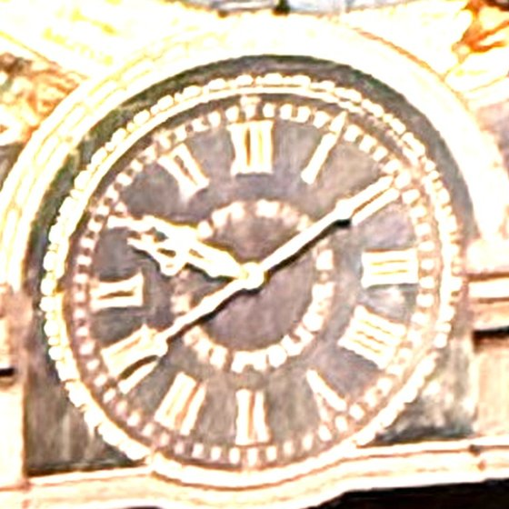

# M1 time and release: concept gate

Phase 2, module M1: the mean-time dial in the lion gallery, its gold hands (Strasbourg mean time),
the silver legal-time hands (M1b, D9) on the same dial, and the release cams that start every
automaton.

**Status: Proposed (concept gate).** Nothing is modelled yet. The decisions needed are in §7. Tags
as in `docs/reference-notes.md`.

*The original mean-time dial on 30 Oct 2026 at 10:10 CET (Paul's photograph, crop): a 12-hour
face; the legal minute hand at :10, the mean one at :41.*

*Schematic only. Heights are from `docs/envelope.md` §2 [E]; the section is not to final
dimensions.*

## 1. What M1 does

- **Mean time, gold hands.**
  - "Les aiguilles dorées donnent le temps moyen de Strasbourg" [S: ELS i1].
  - They are on "un petit cadran destiné à l'indication du temps moyen" in the middle of the
    "galerie aux lions" [S: DA p. 49–50].
  - "Le moteur central de l'horloge communique directement aux aiguilles du temps moyen le
    mouvement qui les anime" [S: DA p. 49–50]. The replica's M1 stepper is that central motor for
    this dial: 1 rev/h on the minute arbor (architecture §3).
  - The mean time is Strasbourg's (D2): LMT = UT + 31.00 min, so the noon show starts at 12:29 CET
    or 13:29 CEST [D: D2].
- **Legal time, silver hands.**
  - "Les aiguilles argentées, ajoutées en Mars 1919, donnent l'heure légale" [S: ELS i1]. They are
    not Schwilgué's.
  - In the replica they follow CET/CEST on their own stepper, **M1b** (D9). The change to summer
    time is +1 h in spring and +11 h in autumn on a 12 h face, both forward, run at catch-up speed.
- **Releases** (architecture §5; the order is the original's [S: DA p. 64–66]):
  - **each quarter:** E1's genie strikes the first stroke [S: DA p. 50], then an age the second
    [S: DA p. 56–58];
  - **each hour:** after the old man's four quarters, E1's other genie turns the hourglass, then
    Death strikes the hours [S: DA p. 51, 57–58];
  - **at noon:** after Death's last stroke, the Apostles (E3), with the rooster (E4) cued by E3.
- **Sensing** (architecture §6): an index on each minute arbor (each hour at :00), and a witness on
  each hour train (at 12:00) that checks the hands' friction clutch.
- **Setting** (architecture §7): each hand on a friction clutch, turned forward by hand.

## 2. What is known, and what is not

| Item | Value | Tag |
|---|---|---|
| Dial diameter | **≈ 98–104 mm** at 1:8: the pearled minute ring is ≈ 0.83 m on the original, the bezel ≈ 0.98 m | [E] ±15 %: scaled on the calendar ring in Paul's photograph (`docs/reference-notes.md`, *Paul's photographs of 30 October 2026*). Agrees with the lithograph's 0.78 m (envelope §3). DA says only "petit cadran". |
| Height | ≈ 567 mm, on the case centreline | [E]: envelope §2 |
| Face | **12 hours**, Roman numerals I–XII in gilt on a dark ground, a pearled minute ring and an inner pearled ring, gilt bezel | [S: Paul's photographs, 30 Oct 2026]. The Phase 1 trains (`M1.hour_hand` 1/12) stand. |
| Hands | **Four.** At 10:10 CET the photograph shows minute hands at :10 (legal) and :41 (mean), nearly opposite, and two ornate hour hands together near X | [S: photograph; D: mean time = CET − 29 min] |
| Order of the four hands, front to back; colours | **TBD** | Not readable at the photograph's resolution: needs a close-up |
| Genies' size (E1), either side of the dial | **TBD** | photo or plate |
| Motion work | 12/48 × 15/45, exact 1/12, at 30.000 mm centres with profile shift | [S: `spec/clock.yaml` `M1.hour_hand`; `docs/test-rig.md` §2] |
| Noon train | 12/54 × 12/64, exact 1/24 (one turn a day) | [S: `spec/clock.yaml` `M1.noon_cam`] |
| Motor margin, NEMA 17 at 1:1 | M1 23×, M1b 24× | [D: `docs/gear-trains.md` §5] |

**The test rig is already half of M1.** It runs the real `M1.hour_hand` and `M1.noon_cam` trains
at 1 rev/h, with the cannon-pinion clutch and an index flag (`docs/test-rig.md` §1). M1's detail
design reuses its parts and its results.

## 3. Boundary and interfaces

The rule: **pass timing electrically and position mechanically** (architecture §4).

| To | What | Link |
|---|---|---|
| M0 controller | the two steppers, the release sensors, the index and witness sensors | one connector |
| E1 genies | quarter and hour releases | electrical (Hall switches → controller → E1's motors) |
| E2 ages and Death | quarter and hour releases | electrical |
| E2 ages and Death | **which age appears; Death's count (1–12)** | **Decision 1 (§5)** |
| E3 Apostles (and E4 through E3) | noon release | electrical |
| Case | the gallery bay | the works' internal frame, never the case (D12 R5) |

## 4. Proposed concept

**4.1 One gallery cassette: M1 with M1b.**
- Both steppers, both motion works, the four hands, the release flags and the dial are in one
  removable cassette behind the dial (P4).
- E1's two genies, on either side, are separate small modules. Their only link to M1 is
  electrical.

**4.2 Four hands on one centre.**
- A Ø3 arbor and brass tubes OD 4, 5 and 6 (D4: 0.45 mm wall, 1 mm steps).
  - The two minute hands are on the Ø3 arbor and the OD 4 tube.
  - The two hour hands are on the OD 5 and OD 6 tubes.
- Two motion works, 12/48 · 15/45 as on the test rig, on studs above and below the centre.
- Each minute hand sits on a friction-clutched cannon pinion, as on the test rig.

**4.3 Drives.**
- The system on the Ø3 arbor is driven directly from behind; the other through a 1:1 gear pair to
  its tube. Which system takes the Ø3 follows the hand order on the original (§2).
- Both steppers are NEMA 17 at 1:1, with the margins in §2. The depth behind a ≈ 98 mm dial, with
  two motors side by side, is checked against the case depth (TBD) in the detail design.

**4.4 Releases.**
- A flag disc on M1's minute arbor, ahead of the hands' clutch, carries four magnets, one per
  quarter. A second track marks the hour; its sensor is also M1's hourly index.
- A magnet on the 24 h noon wheel gives noon.
- The switches are DRV5032 Hall sensors, which put no load on the train (architecture §5).
- The releases follow the stepper, not the hands. Re-setting the hands by hand never moves a show.
- Timing: at 1 rev/h, 1° of the flag disc is 10 s [D: 3600 s / 360°]. The controller also checks
  each release against its own clock (fault detection).

**4.5 Setting and night silence.**
- Hands: turned forward on their clutches against the dial.
- Noon wheel: an indexed dog clutch set to its mark at commissioning (architecture §7).
- Night silence and the chaining of the shows are firmware (D10, architecture §5).

## 5. Decision 1: how E2 gets its state

**Context.**
- Which age appears is state, so it must live in a train that follows time, never in the event
  train (P2).
- Death's count is decided mechanically by a snail (`docs/mechanism-inventory.md` A4).
- E2's hall is about **757 mm above M1** [D: 1324 − 567, envelope §2 heights [E]], and M5's
  planetary dial (band Ø ≈ 343) and Moon globe lie in between.
- The architecture put the lodge cam on an M1 shaft and left the snail open: "keep M1 and E2 in one
  cassette, or move the snail into E2 on its own index" (§4).

| Option | For | Against |
|---|---|---|
| **A. A position shaft from M1**: 1 rev/h, about 760 mm up the side of the case, a right-angle pair at each end, keyed couplings. E2 makes its 12 h snail with its own 12:1 motion work and carries a four-sector lodge cam. | Position passes mechanically, as the architecture's rule says. No extra motor. | A long shaft with intermediate bearings past the M5 bay. Two printed right-angle pairs. Alignment between cassettes in a wooden case. Every keyed coupling must re-engage in phase when M1, E2 or M5 is refitted. |
| **B. E2 gets its own stepper at 1 rev/h**, on the same time base (rule 3 allows one per module; rule 2: a plain clockwork rate). The snail (through 12:1) and the lodge cam are on that arbor, with an hourly index like every stepper module (P1, §6). | E2 is self-contained and removable (P4). No long shaft. M1 stays small. The state still lives in a gear train, not in the event motor (P2). | One more NEMA 17, TMC2209 and Hall sensor (6 steppers + 1 spare in the BOM). Position passes through the time law rather than a shaft, which the architecture already allowed for the snail. M1 and E2 could disagree only if one loses steps, which each hourly index detects. |
| **C. State in the E2 event train**: a count wheel and a lodge cam turned by the strikes, as in many striking clocks. | Traditional; no extra motor or shaft. | Every skipped show (night silence, catch-up) puts it out of step, unless the train runs silently. Rejected by P2. |

**Recommendation: B.** It keeps M1's boundary purely electrical (releases and sensors) plus the
dial. With A, M1 would also get a right-angle output on its minute arbor and a keyed coupling on
the cassette's side.

## 6. Smaller choices (recommended; say if you disagree)

- **Cassettes:** M1 and M1b in one cassette; E1's genies separate (4.1).
- **Release switches:** Hall sensors and magnets (4.4), not mechanical switches or optos. They are
  the same parts as every other index and witness.
- **Which system is direct-driven:** whichever matches the original's hand order (4.3). M1's
  release flags stay on its own minute arbor either way.

## 7. Decisions needed from Paul

1. **E2's state:** A, B or C (§5). **Recommended: B.**
2. **From a photo:**
   - **Settled by your photographs of 30 Oct:** the face is 12 h, and it carries four hands. The
     dial is about 98–104 mm at 1:8 [E].
   - **Still open:** the four hands' order, front to back, their colours and shapes. A close-up of
     the gallery dial would settle it.
3. **Confirm:** M1 and M1b in one cassette, with E1's genies separate.

## 8. After the gate: the detail design

- **CAD:** `cad/modules/m1_time/`: the cassette, the coaxial stack, both motion works, the flag
  disc and noon wheel, the sensors, the dial and hands.
- **Checks:** interference; every mesh engaged; the hands' clutch torque against the train's;
  release timing from the flag geometry; bed fit and print poses.
- **Files:** print files and SketchUp files with an exploded view; BOM rows.
- **Then:** E1 and E2 can be designed against M1's fixed boundary.
