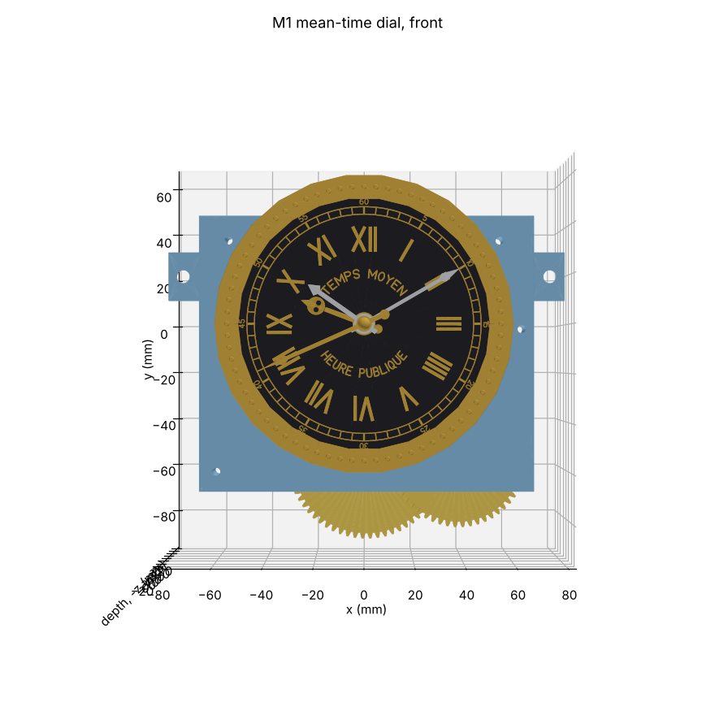
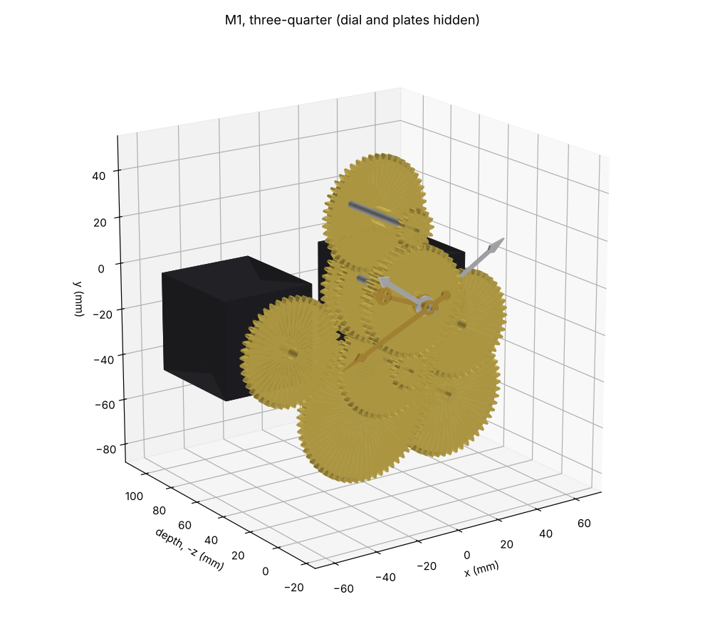
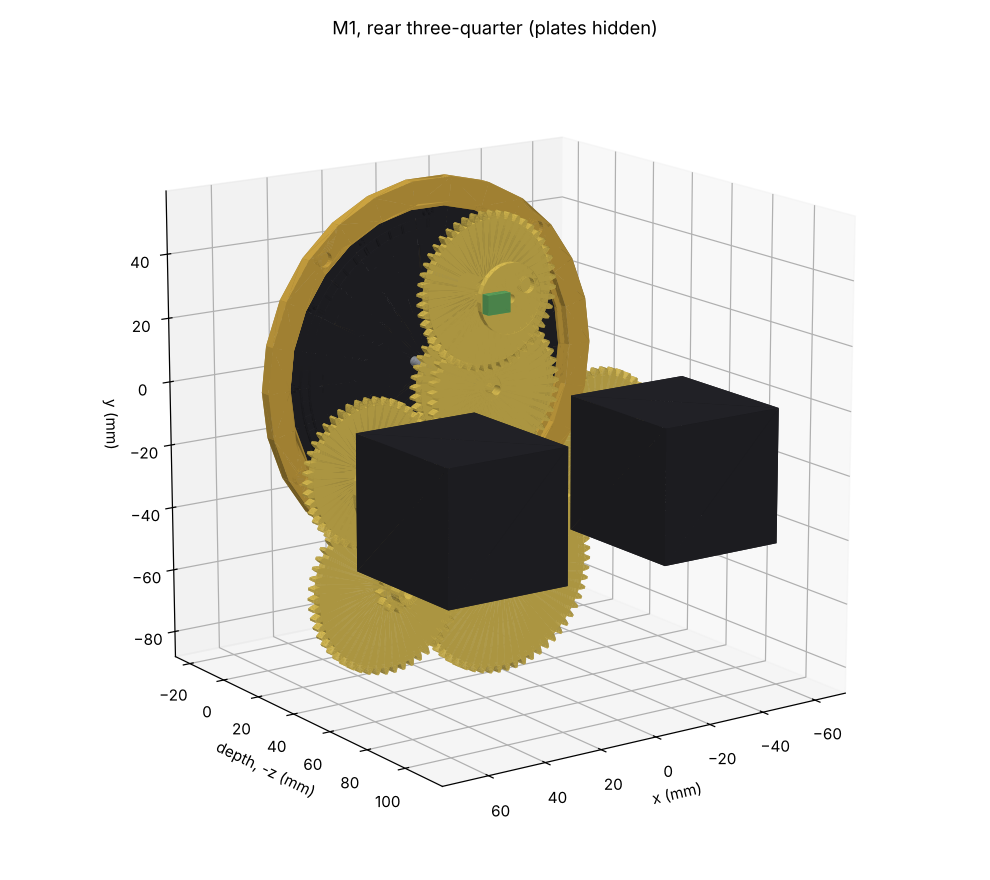

# M1 time and release: concept gate

Phase 2, module M1: the mean-time dial in the lion gallery, its gold hands (Strasbourg mean time),
the silver legal-time hands (M1b, D9) on the same dial, and the release cams that start every
automaton.

**Status: Detail design for review.** The concept was accepted (Paul, PR #11, 4 Nov 2026; the
decisions are in §7). The detail design is §9: `cad/modules/m1_time/`, its checks, print files and
SketchUp files. The motor-access decision is settled: option A, plug-in motors (§10, D16). The
open items are in §11. Tags as in
`docs/reference-notes.md`.

*The original gallery on 30 Oct 2026 at 10:10 CET (Paul's photograph IMG_0766, crop).*
- The 12-hour dial reads "TEMPS MOYEN" and "HEURE PUBLIQUE".
- The silver legal hands show 10:10; the gold mean-time hands show 9:41.
- The genies sit either side: bell and striker on the left, hourglass on the right.

*Schematic only. Heights are from `docs/envelope.md` §2 [E]; the section is not to final
dimensions.*

## 1. What M1 does

- **Mean time, gold hands.**
  - "Les aiguilles dorées donnent le temps moyen de Strasbourg" [S: ELS i1].
  - They are on "un petit cadran destiné à l'indication du temps moyen" in the middle of the
    "galerie aux lions" [S: DA p. 49–50].
  - "Le moteur central de l'horloge communique directement aux aiguilles du temps moyen le
    mouvement qui les anime" [S: DA p. 49–50]. The replica's M1 stepper is that central motor for
    this dial: 1 rev/h on the minute arbor (architecture §3).
  - The mean time is Strasbourg's (D2): LMT = UT + 31.00 min [D: D2]. In Strasbourg the noon show
    therefore starts at 12:29 CET. The replica's shows follow legal time instead (D14).
- **Legal time, silver hands.**
  - "Les aiguilles argentées, ajoutées en Mars 1919, donnent l'heure légale" [S: ELS i1]. They are
    not Schwilgué's.
  - In the replica they follow CET/CEST on their own stepper, **M1b** (D9).
  - **M1b also carries every release (D14)**, so the shows run on the house's time.
  - The change to summer time is +1 h in spring and **+23 h in autumn**. +23 h is −1 h on both the
    12 h dial and the 24 h noon wheel; +11 h would leave the noon wheel 12 h out. Both run forward,
    at catch-up speed, with the shows suppressed.
- **Releases** (architecture §5; the order is the original's [S: DA p. 64–66], as Paul observed
  it on 30 Oct 2026 (`docs/mechanism-inventory.md` A1–A6)):
  - **each quarter:** at the n-th quarter the genie and an age strike **n pairs**: genie, age, and
    so on, one pair at :15 up to four on the hour. The age walks out in front of Death, strikes the
    bell at the viewer's right of Death, and walks on.
  - **each hour:** after the four pairs, E1's other genie turns the hourglass. Then Death strikes
    the hours on the bell at the viewer's left [S: DA p. 51, 57–58].
  - **at noon:** after Death's last stroke, the procession (E3) passes. The rooster (E4) crows after
    the 4th, 8th and 12th figure. In the replica the procession's twelve figures are Paul's own
    choice (D15), replacing the Apostles and Christ.
  - **When (D14):** the quarters at :15, :30, :45 and :00 of **legal time**, and the noon show at
    12:00 CET/CEST. Strasbourg runs them at 12:29 CET, on mean time. Paul's choice is closer to
    Schwilgué's intent: in 1842 local mean time was the civil time.
- **Sensing** (architecture §6): an index on each minute arbor (each hour at :00), and a witness on
  each hour train (at 12:00) that checks the hands' friction clutch.
- **Setting** (architecture §7): each hand on a friction clutch, turned forward by hand.

## 2. What is known, and what is not

| Item | Value | Tag |
|---|---|---|
| Dial diameter | **≈ 98–104 mm** at 1:8: the pearled minute ring is ≈ 0.83 m on the original, the bezel ≈ 0.98 m | [E] ±15 %: scaled on the calendar ring in Paul's photograph (`docs/reference-notes.md`, *Paul's photographs of 30 October 2026*). Agrees with the lithograph's 0.78 m (envelope §3). DA says only "petit cadran". |
| Height | ≈ 567 mm, on the case centreline | [E]: envelope §2 |
| Face | **12 hours**: gilt Roman numerals I–XII on a black ground (IIII for four); a minute track with small figures 5 … 60; "TEMPS MOYEN" on an arc above the centre, "HEURE PUBLIQUE" below; a pearled gilt bezel in an arched stone frame | [S: Paul's photographs IMG_0766–0768, 30 Oct 2026]. The Phase 1 trains (`M1.hour_hand` 1/12) stand. |
| Hands | **Four.** At 10:10 CET the **silver** minute and hour hands show 10:10 (legal) and the **gilt** ones 9:41 (mean). The minute hands are nearly opposite. | [S: photographs; D: mean time = CET − 29 min, 174° of the minute circle] |
| Hand shapes | Gilt minute hand with an ornate tip; gilt hour hand with an openwork fleur. Both silver hands are plain spears. A gilt cap covers the centre. | [S: IMG_0766] |
| Order, front to back | **The silver hour hand lies over the gilt hour hand.** The minute hands' order is hidden by the cap. | [S: IMG_0766]; the minute pair is assumed (§4.2) |
| Genies (E1) | Winged children seated on the cornice either side: bell and striker (left), hourglass (right). Seated height ≈ 0.63 of the bezel's diameter, so **≈ 78 mm at 1:8** | [S: IMG_0766; E: scaled on the bezel] |
| Motion work | 12/48 × 15/45, exact 1/12, at 30.000 mm centres with profile shift | [S: `spec/clock.yaml` `M1.hour_hand`; `docs/test-rig.md` §2] |
| Noon train | 12/54 × 12/64, exact 1/24 (one turn a day) | [S: `spec/clock.yaml` `M1.noon_cam`] |
| Motor margin, NEMA 17 at 1:1 | M1 23×, M1b 24× | [D: `docs/gear-trains.md` §5] |

**The test rig is already half of M1.** It runs the real `M1.hour_hand` and `M1.noon_cam` trains
at 1 rev/h, with the cannon-pinion clutch and an index flag (`docs/test-rig.md` §1). M1's detail
design reuses its parts and its results.

## 3. Boundary and interfaces

The rule: **pass timing electrically and position mechanically** (architecture §4).

| To | What | Link |
|---|---|---|
| M0 controller | the two steppers, the release sensors, the index and witness sensors | one connector |
| E1 genies | the hourglass after the fourth quarter; the bell genie's strokes, which alternate with the age's | electrical. The bell genie is cued by E2's quarter train before each of the age's strokes, so E2's rack decides the count (`docs/mechanism-inventory.md` A3). |
| E2 ages and Death | quarter and hour releases (legal time, D14) | electrical |
| E2 ages and Death | **which age appears; Death's count (1–12)** | **Decision 1 (§5)** |
| E3 procession (and E4 through E3) | noon release (12:00 legal time) | electrical |
| Case | the gallery bay | the works' internal frame, never the case (D12 R5) |

## 4. Proposed concept

**4.1 One gallery cassette: M1 with M1b.**
- Both steppers, both motion works, the four hands, the release flags and the dial are in one
  removable cassette behind the dial (P4).
- E1's two genies, on either side, are separate small modules. Their only link to M1 is
  electrical.

**4.2 Four hands on one centre.**
- A Ø3 arbor and brass tubes OD 4, 5 and 6 (D4: 0.45 mm wall, 1 mm steps). Front to back:
  - **gilt minute hand** on the Ø3 arbor (M1), under a gilt centre cap;
  - **silver minute hand** on the OD 4 tube (M1b);
  - **silver hour hand** on the OD 5 tube (M1b);
  - **gilt hour hand** on the OD 6 tube (M1).
- **Why this order** [S: Paul's photograph IMG_0766 and his screen grab of a YouTube video of the
  noon show, which shows the gilt hands at XII and the silver hands at 12:30]:
  - the silver hour hand lies over the gilt one;
  - the gilt cap at the very front looks like the gilt minute hand's nut, so that hand is in front;
  - the minute hands pass over the hour hands, as on any clock.
- Paul: "So long as we can make out the hour and minute, I don't think the order of the hands is
  important to me. Put them in the order that makes sense." This is that order.
- Two motion works, 12/48 · 15/45 as on the test rig, on studs above and below the centre.
- Each minute hand sits on a friction-clutched cannon pinion, as on the test rig.

**4.3 Drives.**
- M1 (gilt, mean time) drives the Ø3 arbor directly from behind.
- M1b (silver, legal time) drives the OD 4 tube through a 1:1 gear pair. That pair's driving shaft
  turns once an hour on legal time. It carries the release flags and drives the 24 h noon wheel
  (4.4).
- Both steppers are NEMA 17 at 1:1, with the margins in §2. The depth behind a ≈ 98 mm dial, with
  two motors side by side, is checked against the case depth (TBD) in the detail design.

**4.4 Releases.**
- The releases are on **M1b, the legal-time train** (D14).
- A flag disc on M1b's driving shaft, ahead of the silver hands' clutch, carries four magnets, one
  per quarter. A second track marks the hour; its sensor is also M1b's hourly index.
- A magnet on the 24 h noon wheel (12/54 · 12/64, driven from the same shaft) gives 12:00 legal
  time.
- M1 keeps its own index and witness, for the gilt hands only.
- The switches are DRV5032 Hall sensors, which put no load on the train (architecture §5).
- The releases follow the stepper, not the hands. Re-setting the hands by hand never moves a show.
- Timing: at 1 rev/h, 1° of the flag disc is 10 s [D: 3600 s / 360°]. The controller also checks
  each release against its own clock (fault detection).

**4.5 Setting and night silence.**
- Hands: turned forward on their clutches against the dial.
- Noon wheel: an indexed dog clutch set to its mark at commissioning (architecture §7).
- Night silence and the chaining of the shows are firmware (D10, architecture §5).

## 5. Decision 1: how E2 gets its state — B (Paul, 4 Nov 2026)

**Context.**
- Which age appears is state, so it must live in a train that follows time, never in the event
  train (P2).
  - Since each age always strikes the same quarter, it also fixes the count: n pairs at the n-th
    quarter (observed, A3).
  - So the state is two snails, as in rack quarter-and-hour striking: a **four-step quarter
    snail** turning once an hour (which age, how many pairs) and a **twelve-step hour snail**
    (Death's count).
  - The event motors' racks fall onto them. That is self-correcting: after skipped shows, the next
    show still reads the right count.
- Death's count is decided mechanically by the hour snail (`docs/mechanism-inventory.md` A4).
- E2's hall is about **757 mm above M1** [D: 1324 − 567, envelope §2 heights [E]], and M5's
  planetary dial (band Ø ≈ 343) and Moon globe lie in between.
- The architecture put the lodge cam on an M1 shaft and left the snail open: "keep M1 and E2 in one
  cassette, or move the snail into E2 on its own index" (§4).

| Option | For | Against |
|---|---|---|
| **A. A position shaft from M1**: 1 rev/h, about 760 mm up the side of the case, a right-angle pair at each end, keyed couplings. E2 carries the quarter snail on it, and makes the hour snail with its own 12:1 motion work. | Position passes mechanically, as the architecture's rule says. No extra motor. | A long shaft with intermediate bearings past the M5 bay. Two printed right-angle pairs. Alignment between cassettes in a wooden case. Every keyed coupling must re-engage in phase when M1, E2 or M5 is refitted. |
| **B. E2 gets its own stepper at 1 rev/h**, on the same time base (rule 3 allows one per module; rule 2: a plain clockwork rate). The quarter snail is on that arbor and the hour snail behind a 12:1 motion work, with an hourly index like every stepper module (P1, §6). | E2 is self-contained and removable (P4). No long shaft. M1 stays small. The state still lives in a gear train, not in the event motor (P2). | One more NEMA 17, TMC2209 and Hall sensor (6 steppers + 1 spare in the BOM). Position passes through the time law rather than a shaft, which the architecture already allowed for the snail. M1 and E2 could disagree only if one loses steps, which each hourly index detects. |
| **C. State in the E2 event train**: count wheels turned by the strikes, as in many striking clocks. | Traditional; no extra motor or shaft. | Every skipped show (night silence, catch-up) puts it out of step, unless the train runs silently. Rejected by P2. |

**Recommendation: B.** It keeps M1's boundary purely electrical (releases and sensors) plus the
dial. With A, M1 would also get a right-angle output on its minute arbor and a keyed coupling on
the cassette's side.

**Decided: B** (Paul, PR #11: "Lets go with your option B").
- E2 gets its own 1 rev/h state stepper on legal time (D14), carrying the quarter snail, and the
  hour snail through 12:1.
- The BOM now has 6 steppers + 1 spare (`docs/bom.md`).
- Architecture §2–§5 are updated.

## 6. Smaller choices

- **Cassettes:** M1 and M1b in one cassette; E1's genies separate (4.1). **Confirmed** by Paul.
- **Release switches:** Hall sensors and magnets (4.4), not mechanical switches or optos. They are
  the same parts as every other index and witness.
- **Which system is direct-driven:** M1, whose gilt minute hand is in front (4.2–4.3). The release
  flags are on M1b's driving shaft.

## 7. Decisions (all settled, Paul, PR #11, 4 Nov 2026)

1. **E2's state: B**, E2's own 1 rev/h state stepper on legal time (§5).
2. **From the photographs:**
   - the face is 12 h, with its lettering;
   - there are four hands: silver for legal time, gilt for mean time;
   - the dial is ≈ 98–104 mm and the genies ≈ 78 mm at 1:8 [E].
3. **Hand order:** "Put them in the order that makes sense". So, front to back: gilt minute,
   silver minute, silver hour, gilt hour (§4.2).
4. **Cassettes:** M1 and M1b in one, with E1's genies separate.
5. **Also decided in this PR:**
   - the shows run on legal time (**D14**);
   - the noon procession is astronomy and time, passing Urania (**D15**);
   - Death, the four ages and the genies stay as on the original.

## 8. After the gate: the detail design

The plan from the gate, all done in §9:
- **CAD:** `cad/modules/m1_time/`: the cassette, the coaxial stack, both motion works, the flag
  disc and noon wheel, the sensors, the dial and hands.
- **Checks:** interference; every mesh engaged; the hands' clutch torque against the train's;
  release timing from the flag geometry; bed fit and print poses. Added during the design: the
  endshake of every moving part (§9.6).
- **Files:** print files and SketchUp files with an exploded view; BOM rows.
- **Then:** E1 and E2 can be designed against M1's fixed boundary.

## 9. Detail design

Model: `cad/modules/m1_time/` (`mechanism.py`, `dial.py`, `hands.py`); tests:
`cad/tests/test_m1.py`. Run `python -m cad.modules.m1_time.mechanism` for the checks, renders and
`export/m1_time/m1_time.json`. The model shows 30 Oct 2026, 10:10 CET, as in Paul's photograph: the
silver hands at 10:10 (legal), the gilt ones at 9:41 (mean).

 

### 9.1 What changed from the concept, and why

- **Both cannon pinions and both clutches are between the plates.** In the concept (§4.2) each
  minute hand's cannon pinion sat in front of the front plate. But the silver minute tube (OD 4)
  covers the Ø3 gilt arbor all the way back to its own clutch, so the gilt cannon pinion can only
  sit behind the silver one. Both are now between the plates, the silver one in front.
- **Each motion work runs on its own arbor through the front plate.** The minute wheel 48 is
  behind the plate, meshing its cannon pinion. The minute pinion 15 is in front, meshing its hour
  wheel on its hour tube. Gilt arbor GM is above the centre, silver arbor SM below.
- **Both motors drive through 45/45 pairs (1:1)**, not only M1b. With both cannons between the
  plates, nothing can reach the gilt arbor from directly behind. The two motors sit side by side
  below the centre.
- **The noon wheel needs no dog clutch** (concept §4.5). It is set by meshing it at its mark. The
  error is ±½ tooth = ±11.25 min [D: 1440 min / 64 / 2], well inside the noon window (§9.4).

### 9.2 Arbors and levels

Coordinates: origin at the dial centre, on the dial face; +X right, +Y up, +Z towards the viewer.

| Arbor | x, y (mm) | Carries | Turns |
|---|---|---|---|
| Centre | 0, 0 | Ø3 steel arbor (gilt minute); brass tubes OD 4 (silver minute), OD 5 (silver hour), OD 6 (gilt hour) | 1/h and 1/12 h |
| TA, M1 motor | −38.97, −22.5 | M1's drive 45 and its index disc, sliding on the motor's D-shaft | 1/h, mean time |
| TB, M1b motor | 38.97, −22.5 | M1b's drive 45, the noon pinion 12, the flag disc, sliding on the D-shaft | 1/h, legal time |
| GM | 0, 30 | gilt minute wheel 48, gilt minute pinion 15, gilt witness disc | 1 in 4 h |
| SM | 0, −30 | silver minute wheel 48 (witness magnet), silver minute pinion 15 | 1 in 4 h |
| X | 38.97, −55.5 | noon wheel 54 with pinion 12, on a stud | 1 in 4.5 h |
| N | 0.97, −55.5 | 24 h wheel 64 (noon magnet), on a stud | 1 in 24 h |

Seen from the front the minute members turn clockwise. So both drives and both motion-work
arbors turn anticlockwise; the firmware sets each motor's direction.

| Level, front to back | z (mm) | Parts |
|---|---|---|
| Hands | 0.6 to 5.8 | gilt hour (OD 6) 0.6–1.6; silver hour (OD 5) 2.0–3.0; silver minute (OD 4) 3.4–4.4; gilt minute (Ø3) 4.8–5.8; gilt cap at 6.1 |
| Dial and bezel | −2.6 to 1.2 | dial −2.0 to 0; bezel −2.6 to 1.2 |
| L1 | −6.2 to −3.2 | gilt hour wheel 45 (on OD 6; a hub forward to the dial's back) and gilt minute pinion 15 (GM) |
| L2 | −9.5 to −6.5 | silver hour wheel 45 (on OD 5; a hub back to the front plate) and silver minute pinion 15 (SM) |
| Front plate | −21.0 to −17.0 | PETG. Dial feet forward to −2.6; bosses for GM and SM |
| Silver cannon | −24.3 to −21.3 | silver cannon 12 (pressed on OD 4) and silver minute wheel 48 (SM) |
| Silver drive | −27.7 to −24.7 | silver drive 45, free on OD 4, with a Ø8 friction face forward; M1b's drive 45 (TB) |
| Silver clutch | −30.2 to −27.7 | wave washer and Ø4 collar |
| Gilt cannon | −33.5 to −30.5 | gilt cannon 12 (pressed on Ø3) and gilt minute wheel 48 (GM, a hub forward to the front plate) |
| Gilt drive, noon 1 | −36.9 to −33.9 | gilt drive 45, free on Ø3, with its friction face; M1's drive 45 (TA); noon 12 (TB) / 54 (X) |
| Gilt clutch | −39.4 to −36.9 | wave washer and Ø3 collar; the MR63ZZ behind it in a back-plate boss (−42.2 to −39.7) |
| Noon 2 | −42.3 to −39.3 | noon 12 (X) / 24 h wheel 64 (N) |
| Flags | −44.7 to −42.7 | M1 index disc (TA), M1b flag disc (TB), gilt witness disc (GM) |
| Back plate | −51.1 to −47.1 | PETG. Hall pockets in its front face; the drive parts' spigots pass through it to −49.8 |
| Motor adapters | −55.1 to −50.1 | PETG, one per motor; a Ø26 boss locates each in a pocket in the back plate's rear face (§10) |
| Motors | −103.1 to −55.1 | two NEMA 17 |

**Size** [D: model envelope]. The plates are 136 × 112 mm, and the frame tabs bring the width to
164 mm. The bezel is Ø 120. The noon wheels hang 20 mm below the plates (y down to −88). The depth
from the cap to the motors' backs is ≈ 112 mm. Check this against the case depth when the depth is
known (still TBD, `docs/reference-notes.md`). The cassette hangs on the works' internal frame by
two M5 tabs (D12 R5).

### 9.3 Trains and ratio errors

| Pair | Teeth | Centre (mm) | Profile shift | Ratio | Error |
|---|---|---|---|---|---|
| Cannon / minute wheel (each system) | 12 / 48 | 30.000 | +0.298 / −0.298 | | |
| Minute pinion / hour wheel (each system) | 15 / 45 | 30.000 | +0.123 / −0.123 | (12/48)(15/45) = 1/12 | 0 [D] |
| Drive (each system) | 45 / 45 | 45.000 | 0 | 1 | 0 [D] |
| Noon 1 (TB → X) | 12 / 54 | 33.000 | +0.298 / −0.298 | | |
| Noon 2 (X → N) | 12 / 64 | 38.000 | +0.298 / −0.298 | (12/54)(12/64) = 1/24 | 0 [D] |

Module 1.0, backlash 0.15 mm, faces 3 mm. Every ratio is exact, as in `spec/clock.yaml`
(`M1.hour_hand`, `M1b.legal_hour_hand`, `M1.noon_cam`). Each motion work's two pairs share one
centre distance through profile shift, as on the test rig. A test pulls each driven wheel 0.4 mm
towards its driver and checks that it collides, so every mesh is engaged.

### 9.4 Releases and sensors

All releases are on **M1b, on legal time** (D14). Magnets are 5 × 2 mm NdFeB discs; the sensors
are DRV5032 Hall switches on small boards, 1 mm from the magnet's face.

| Sensor | Where | Reads | Window, half-width |
|---|---|---|---|
| Quarters | back-plate pocket, under TB's flag disc | four magnets at r 13, 90° apart: :15, :30, :45, :00 | ±2.9 min [E] |
| Hour (M1b's index) | back-plate pocket, under TB's flag disc | one magnet at r 19, outside the quarters | ±2.0 min [E] |
| Noon | on a back-plate boss, facing N | one magnet at r 26 on the 24 h wheel | ±35.3 min [E] |
| M1 index | back-plate pocket, under TA's disc | one magnet at r 9 | (index only) |
| Gilt witness | back-plate pocket, under GM's disc | one magnet: GM turns once in 4 h, after the clutch | (check only) |
| Silver witness | front-plate pocket, facing SM's wheel | one magnet in the wheel's face, after the clutch | (check only) |

- **Windows** [E]. A switch stays on while its magnet is within about 4 mm of it, sideways
  (`HALL_RANGE`, an estimate for a DRV5032 with a 5 × 2 magnet at a 1 mm gap). Half-width =
  4 / (2π r) × period [D]: quarter 4 / (2π · 13) × 60 = 2.94 min; hour 4 / (2π · 19) × 60 = 2.01 min; noon
  4 / (2π · 26) × 1440 = 35.3 min. **The test rig measures `HALL_RANGE`** (`docs/test-rig.md`,
  question 5).
- **Timing comes from the controller** (CLAUDE.md, accuracy split). A window opens; the
  controller starts the show at the exact minute on its own clock, inside the window. If the
  minute is not inside the window, it reports a fault. Each window is far narrower than the 15 min
  between quarters, and the noon window is wider than the noon wheel's setting error (±11.25 min).
- **Witnesses after the clutches.** A slipping clutch shows as a witness that does not arrive
  when the motor's count says it should. They are on the motion-work arbors (1 turn in 4 h), not
  the hour wheels, because there is room for a magnet and a sensor there.
- **Totals:** 6 Halls and 9 magnets in the mechanism, plus 8 magnets for the dial (§9.7).

### 9.5 The clutches

Each minute member has a friction clutch: its 45-tooth drive gear runs free on the arbor or tube.
A wave washer and a collar press the gear's raised Ø8 face against the cannon pinion, which is
fixed in front of it. The hands are set by turning a minute hand forward; the motor side,
with the releases, does not move.

| Quantity | Value | Basis |
|---|---|---|
| Running torque of a hand set and its motion work | 1.0 N·mm | [E] |
| Slip torque, minimum | 3.0 N·mm | 3 × running [D] |
| Finger at the minute hand's tip | 0.3 N × 45 mm = 13.5 N·mm | [E] |
| Slip torque, maximum | 13.5 N·mm | must slip before the finger's torque [D] |
| Friction | μ 0.3, two faces, mean radius 3 mm | [E], as the M2 setter |
| Washer preload | 1.7 to 7.5 N | T / (2 μ r) [D] |
| NEMA 17 at 0.5 A run current | 148 N·mm | `docs/gear-trains.md` §5 [E] |
| Motor margin over the maximum slip torque | 11× | [D] |

The wave washer must give 1.7–7.5 N at its working height. Choose it when sourcing (§11), then set
it with the collar on the test rig.

### 9.6 Endshake: what stops each part along its axis

Each moving part runs against a designed stop each way, with **0.3 mm** play (`E` in
`mechanism.py`) [E: the tolerance coupons set the final value]. A test slides each one 0.45 mm
each way and checks that it meets its stop. Three details came out of this check:
- **Each drive gear sits 0.4 mm behind its cannon pinion.** Its raised Ø8 friction face spans
  the gap. Without that gap, the drive gear's face would rub the minute wheel 48 where the two
  overlap; they turn at different speeds.
- **The MR63ZZ sits in a boss on the back plate.** Its face stops the gilt collar.
- **Both noon wheels have Starlock push-on washers** in front of them, set with a 0.3 mm shim.

| Moving part | Stop, forwards | Stop, backwards |
|---|---|---|
| Gilt minute (Ø3 arbor, cannon, drive, collar, hand, cap) | gilt cannon on the silver collar's tube end | gilt collar on the MR63ZZ |
| Silver minute (OD 4, cannon, drive, collar, hand) | silver cannon on the front plate | tube end on the gilt cannon |
| Silver hour (OD 5, wheel, hand) | wheel on the OD 6 tube's end | wheel's rear hub on the front plate |
| Gilt hour (OD 6, wheel, hand) | wheel's front hub on the dial's back | tube end on the silver hour wheel |
| Gilt motion work (GM) | wheel 48's hub on the front plate | arbor end in its blind pivot |
| Silver motion work (SM) | wheel 48 on the front plate | pinion's hub on the front plate's boss |
| Noon wheel X | Starlock | rear hub on the back plate |
| 24 h wheel N | Starlock | rear hub on the back plate |
| M1 drive (TA: drive 45, index disc) | a post on the front plate | its spigot on the adapter's boss |
| M1b drive (TB: drive 45, noon 12, flag disc) | a post on the front plate | its spigot on the adapter's boss |

The drive parts slide on the motors' D-shafts (D16). When a motor is out, its drive part stays in
the cassette: its spigot runs in the back plate's hole, and its post stops it from the front.

### 9.7 Dial, bezel and hands

- **Dial** (`dial.py`): Ø 104 [E], a two-colour print, gilt on black, after Paul's photographs. It
  has Roman numerals with IIII, standing on the radius, and a minute track with figures 5 … 60.
  "TEMPS MOYEN" runs on an arc above the centre and "HEURE PUBLIQUE" below. It prints face down
  as one 3MF with two bodies: the black field with 0.6 mm pockets, and the gilt inlay that fills
  them flush. The figures (2.2 mm) and the lettering need the 0.2 mm nozzle.
- **Bezel:** Ø 120, gilt, pearled (72 pearls) [E: the original's bezel is ≈ 0.98 m, scaled on
  Paul's photograph; 0.98 m / 8 = 122.5 mm, ±15 %]. The dial is glued into its seat.
- **The dial lifts straight off the front.** The motion works sit in front of the front plate,
  under the dial. So the dial cannot be screwed from behind: the plate could not come off before
  the dial, nor the dial before the plate. Four feet are printed with the front plate, each with
  a magnet in its top, and four magnets in the bezel's back meet them. One foot is at 330° instead
  of 315°, so the dial fits only one way round.
- **Hands** (`hands.py`), flat 1 mm prints with the 0.2 mm nozzle, each pressed on its arbor or
  tube:
  - gilt minute: 45.5 mm, a slender blade with a pierced lozenge and a short tail;
  - gilt hour: 27 mm, an openwork head;
  - silver minute 44 mm and silver hour 27.5 mm: plain spears;
  - a gilt cap on the arbor's tip.
- **To change a motor** (D16): from behind, undo the adapter's two M3 screws and draw the motor
  straight out with its adapter. Nothing else moves. To refit it, turn the shaft until its flat
  enters the drive part's D-bore, and push the adapter home.
- **Service order for the works:**
  1. Pull the hands.
  2. Lift off the dial.
  3. Slide the hour wheels and tubes forward off the stack.
  4. Pull the minute pinions 15 off GM and SM.
  5. Remove the four pillar nuts on the front plate, and lift the plate off.

### 9.8 Print and SketchUp files

- **Print files:** `export/print/m1_time/`, 27 STL/3MF files for 31 prints, all closed and
  manifold. The manifest README gives each part's pose, nozzle and down-facing area.
  - **Flag discs:** printed separately and pressed on their drive part's Ø8 spigot. Printed in
    one piece with the drive part, they would overhang its hub by about 800 mm².
  - **Remaining overhangs:**
    - the back plate's two Ø 26 adapter pockets, bridged. The pocket's wall locates the adapter,
      so the bridged ceiling's finish does not matter;
    - each adapter's Ø 22 pilot counterbore, bridged the same way;
    - the bezel's 1.7 mm lip over the dial seat.
  - The fits wait for the tolerance coupons, as for every module.
- **SketchUp files:** `export/sketchup/m1_time.dae` and `m1_time_exploded.dae`.

## 10. Motor access — A, plug-in motors (Paul, PR #13, 5 Nov 2026; D16)

`docs/architecture.md` §11 says "Motors are reachable without removing gears". The first model
did not meet that. Each motor was screwed to the back plate from the inside, and its drive part
was pressed on the motor's D-shaft between the plates. To change a motor you had to pull the
hands, lift off the dial and open the cassette. M2 is the same: its motor pinion is on the shaft
between the plates (`cad/modules/m2_main_dial/mechanism.py`, level `RED1`).

| Option | How | For | Against |
|---|---|---|---|
| **A. Plug-in motor** | Each motor is screwed (at the bench) to a small printed adapter plate. The adapter locates in a spigot pocket in the back plate and is held by 2 × M3 from behind, into heat-set inserts. The drive part slides on the D-shaft (slip fit). Stops on both plates hold it to 0.3 mm endshake. | Motor out from behind in a few minutes, without touching a gear. +4 mm depth. | A slip fit on the D-shaft, so a little more backlash in the drive (taken up because the motors only run forwards, CLAUDE.md rule 3). 2 adapters and 4 inserts. The front stop for TA is a 12 mm post. |
| B. Arbor and coupling | Each drive part on its own Ø5 arbor in a bearing. A dog coupling behind the back plate; the motor on standoffs (as on the test rig). | Classic. The motor never carries the gear. | ≈ +30 mm depth. Two couplings and two bearings. |
| C. Keep as modelled | Open the cassette to change a motor. | Simplest; nothing to add. | Breaks the architecture rule. Steppers rarely fail, but the job takes the dial and hands off. |

**Decided: A** (Paul: "Lets go with option A for the motors"). As built in the model:
- **Adapter** (`adapter_M1`, `adapter_M1b`): PETG, 42.3 × 66 × 4 mm.
  - The motor is screwed to it at the bench: 4 × M3 × 6 ISO 7380, heads in Ø6.2 counterbores in
    its front face.
  - Its rear face has a counterbore for the motor's Ø22 × 2 pilot boss [E: NEMA 17 standard].
  - A Ø26 × 1 boss on its front face locates it in a Ø26.3 pocket in the back plate.
  - Two M3 × 8 screws from behind, 27 mm above and below the shaft, go into heat-set inserts in
    the back plate. Both clear the motor's body by 3 mm, so a hex key reaches them.
- **Drive parts:** a slip fit on the D-shaft (round bore Ø5.3, the key 0.15 mm off the flat).
  - The Ø8 spigot runs through a Ø8.3 hole in the back plate and stops 0.3 mm in front of the
    adapter's boss.
  - A PETG post, its Ø4 peg pressed into the front plate, stops the part 0.3 mm in front. TA's post
    is 12.6 mm long, with a Ø6 hole for the shaft's tip; TB's is 3.4 mm.
- **The hour magnet moved from r 7 to r 19.** At r 7 its Hall pocket would have broken into the
  spigot's hole. The hour window narrows to ±2.0 min, still far wider than the controller needs.
- **Checks:**
  - each motor, its shaft and its adapter, withdrawn backwards in steps to 30 mm, touch nothing;
  - both drive parts meet their stops each way within 0.45 mm;
  - the pillar nuts clear the adapters.
- **M2** gets the same scheme in its own PR.

## 11. Open items

- **Motor drawing** [E]: check these against the chosen motor's drawing:
  - the NEMA 17's shaft length (24 mm in the model, `MOTOR_SHAFT`);
  - its D-flat (4.5 mm across, 15 mm long);
  - its pilot boss (Ø22 × 2).
- **Heat-set inserts** ⚠: M3, no longer than 4 mm (the back plate is 4 mm thick). The model's
  Ø4.0 hole (`INSERT_HOLE`) is to be set from the chosen insert's datasheet.
- **`HALL_RANGE`** [E]: measure on the test rig (question 5). The windows in §9.4 scale with it.
- **Endshake `E`** [E] and all fits: set from the tolerance coupons.
- **Clutch:** the wave washers' load at their working height (1.7–7.5 N), and the running torque
  (1.0 N·mm [E]). Both are measured on the test rig.
- **Sourcing** ⚠ (`docs/bom.md`): shaft collars with Ø3 and Ø4 bores and an OD of 9 mm or less;
  wave washers for Ø3 and Ø4; Starlock washers for Ø3 (also needed by M2).
- **Case depth:** M1 needs ≈ 112 mm (§9.2). Check when the case depth is fixed.
- **Hand lengths and the dial's size** [E] stay scaled on Paul's photographs (±15 %) until the
  Ungerer or Bach books give drawings.
