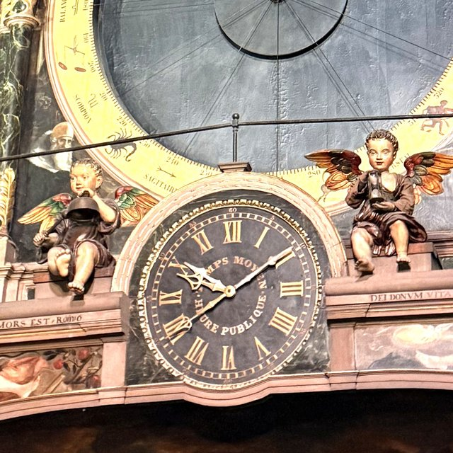
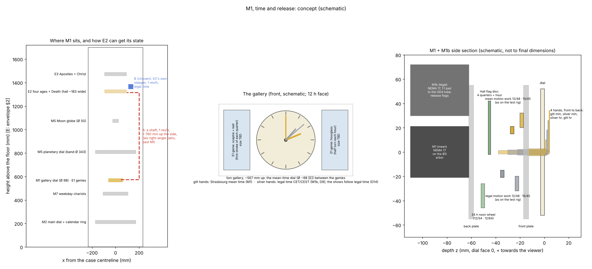

# M1 time and release: concept gate

Phase 2, module M1: the mean-time dial in the lion gallery, its gold hands (Strasbourg mean time),
the silver legal-time hands (M1b, D9) on the same dial, and the release cams that start every
automaton.

**Status: Proposed (concept gate).** Nothing is modelled yet. The decisions needed are in §7. Tags
as in `docs/reference-notes.md`.

*The original gallery on 30 Oct 2026 at 10:10 CET (Paul's photograph IMG_0766, crop).*
- The 12-hour dial reads "TEMPS MOYEN" and "HEURE PUBLIQUE".
- The silver legal hands show 10:10; the gold mean-time hands show 9:41.
- The genies sit either side: bell and striker on the left, hourglass on the right.

*Schematic only. Heights are from `docs/envelope.md` §2 [E]; the section is not to final
dimensions.*

## 1. What M1 does

- **Mean time, gold hands.**
  - "Les aiguilles dorées donnent le temps moyen de Strasbourg" [S: ELS i1].
  - They are on "un petit cadran destiné à l'indication du temps moyen" in the middle of the
    "galerie aux lions" [S: DA p. 49–50].
  - "Le moteur central de l'horloge communique directement aux aiguilles du temps moyen le
    mouvement qui les anime" [S: DA p. 49–50]. The replica's M1 stepper is that central motor for
    this dial: 1 rev/h on the minute arbor (architecture §3).
  - The mean time is Strasbourg's (D2): LMT = UT + 31.00 min [D: D2]. In Strasbourg the noon show
    therefore starts at 12:29 CET. The replica's shows follow legal time instead (D14).
- **Legal time, silver hands.**
  - "Les aiguilles argentées, ajoutées en Mars 1919, donnent l'heure légale" [S: ELS i1]. They are
    not Schwilgué's.
  - In the replica they follow CET/CEST on their own stepper, **M1b** (D9).
  - **M1b also carries every release (D14)**, so the shows run on the house's time.
  - The change to summer time is +1 h in spring and **+23 h in autumn**. +23 h is −1 h on both the
    12 h dial and the 24 h noon wheel; +11 h would leave the noon wheel 12 h out. Both run forward,
    at catch-up speed, with the shows suppressed.
- **Releases** (architecture §5; the order is the original's [S: DA p. 64–66], as Paul observed
  it on 30 Oct 2026 (`docs/mechanism-inventory.md` A1–A6)):
  - **each quarter:** at the n-th quarter the genie and an age strike **n pairs**: genie, age, and
    so on, one pair at :15 up to four on the hour. The age walks out in front of Death, strikes the
    bell at the viewer's right of Death, and walks on.
  - **each hour:** after the four pairs, E1's other genie turns the hourglass. Then Death strikes
    the hours on the bell at the viewer's left [S: DA p. 51, 57–58].
  - **at noon:** after Death's last stroke, the procession (E3) passes. The rooster (E4) crows after
    the 4th, 8th and 12th figure. In the replica the procession's twelve figures are Paul's own
    choice (D15), replacing the Apostles and Christ.
  - **When (D14):** the quarters at :15, :30, :45 and :00 of **legal time**, and the noon show at
    12:00 CET/CEST. Strasbourg runs them at 12:29 CET, on mean time. Paul's choice is closer to
    Schwilgué's intent: in 1842 local mean time was the civil time.
- **Sensing** (architecture §6): an index on each minute arbor (each hour at :00), and a witness on
  each hour train (at 12:00) that checks the hands' friction clutch.
- **Setting** (architecture §7): each hand on a friction clutch, turned forward by hand.

## 2. What is known, and what is not

| Item | Value | Tag |
|---|---|---|
| Dial diameter | **≈ 98–104 mm** at 1:8: the pearled minute ring is ≈ 0.83 m on the original, the bezel ≈ 0.98 m | [E] ±15 %: scaled on the calendar ring in Paul's photograph (`docs/reference-notes.md`, *Paul's photographs of 30 October 2026*). Agrees with the lithograph's 0.78 m (envelope §3). DA says only "petit cadran". |
| Height | ≈ 567 mm, on the case centreline | [E]: envelope §2 |
| Face | **12 hours**: gilt Roman numerals I–XII on a black ground (IIII for four); a minute track with small figures 5 … 60; "TEMPS MOYEN" on an arc above the centre, "HEURE PUBLIQUE" below; a pearled gilt bezel in an arched stone frame | [S: Paul's photographs IMG_0766–0768, 30 Oct 2026]. The Phase 1 trains (`M1.hour_hand` 1/12) stand. |
| Hands | **Four.** At 10:10 CET the **silver** minute and hour hands show 10:10 (legal) and the **gilt** ones 9:41 (mean). The minute hands are nearly opposite. | [S: photographs; D: mean time = CET − 29 min, 174° of the minute circle] |
| Hand shapes | Gilt minute hand with an ornate tip; gilt hour hand with an openwork fleur. Both silver hands are plain spears. A gilt cap covers the centre. | [S: IMG_0766] |
| Order, front to back | **The silver hour hand lies over the gilt hour hand.** The minute hands' order is hidden by the cap. | [S: IMG_0766]; the minute pair is assumed (§4.2) |
| Genies (E1) | Winged children seated on the cornice either side: bell and striker (left), hourglass (right). Seated height ≈ 0.63 of the bezel's diameter, so **≈ 78 mm at 1:8** | [S: IMG_0766; E: scaled on the bezel] |
| Motion work | 12/48 × 15/45, exact 1/12, at 30.000 mm centres with profile shift | [S: `spec/clock.yaml` `M1.hour_hand`; `docs/test-rig.md` §2] |
| Noon train | 12/54 × 12/64, exact 1/24 (one turn a day) | [S: `spec/clock.yaml` `M1.noon_cam`] |
| Motor margin, NEMA 17 at 1:1 | M1 23×, M1b 24× | [D: `docs/gear-trains.md` §5] |

**The test rig is already half of M1.** It runs the real `M1.hour_hand` and `M1.noon_cam` trains
at 1 rev/h, with the cannon-pinion clutch and an index flag (`docs/test-rig.md` §1). M1's detail
design reuses its parts and its results.

## 3. Boundary and interfaces

The rule: **pass timing electrically and position mechanically** (architecture §4).

| To | What | Link |
|---|---|---|
| M0 controller | the two steppers, the release sensors, the index and witness sensors | one connector |
| E1 genies | the hourglass after the fourth quarter; the bell genie's strokes, which alternate with the age's | electrical. The bell genie is cued by E2's quarter train before each of the age's strokes, so E2's rack decides the count (`docs/mechanism-inventory.md` A3). |
| E2 ages and Death | quarter and hour releases (legal time, D14) | electrical |
| E2 ages and Death | **which age appears; Death's count (1–12)** | **Decision 1 (§5)** |
| E3 procession (and E4 through E3) | noon release (12:00 legal time) | electrical |
| Case | the gallery bay | the works' internal frame, never the case (D12 R5) |

## 4. Proposed concept

**4.1 One gallery cassette: M1 with M1b.**
- Both steppers, both motion works, the four hands, the release flags and the dial are in one
  removable cassette behind the dial (P4).
- E1's two genies, on either side, are separate small modules. Their only link to M1 is
  electrical.

**4.2 Four hands on one centre.**
- A Ø3 arbor and brass tubes OD 4, 5 and 6 (D4: 0.45 mm wall, 1 mm steps). Front to back:
  - **silver minute hand** on the Ø3 arbor (M1b);
  - **gilt minute hand** on the OD 4 tube (M1);
  - **silver hour hand** on the OD 5 tube (M1b);
  - **gilt hour hand** on the OD 6 tube (M1).
- This puts the silver hour hand over the gilt one, as on the original. It assumes the minute hands
  are in the same order (silver in front), which the photographs cannot show. The minute hands
  pass over the hour hands, as on any clock.
- Two motion works, 12/48 · 15/45 as on the test rig, on studs above and below the centre.
- Each minute hand sits on a friction-clutched cannon pinion, as on the test rig.

**4.3 Drives.**
- M1b (silver, legal time) drives the Ø3 arbor directly from behind. Its rear end carries the
  release flags and drives the 24 h noon wheel (4.4).
- M1 (gilt, mean time) drives the OD 4 tube through a 1:1 gear pair.
- Both steppers are NEMA 17 at 1:1, with the margins in §2. The depth behind a ≈ 98 mm dial, with
  two motors side by side, is checked against the case depth (TBD) in the detail design.

**4.4 Releases.**
- The releases are on **M1b, the legal-time train** (D14).
- A flag disc on M1b's Ø3 arbor, ahead of the silver hands' clutch, carries four magnets, one per
  quarter. A second track marks the hour; its sensor is also M1b's hourly index.
- A magnet on the 24 h noon wheel (12/54 · 12/64, driven from the same arbor) gives 12:00 legal
  time.
- M1 keeps its own index and witness, for the gilt hands only.
- The switches are DRV5032 Hall sensors, which put no load on the train (architecture §5).
- The releases follow the stepper, not the hands. Re-setting the hands by hand never moves a show.
- Timing: at 1 rev/h, 1° of the flag disc is 10 s [D: 3600 s / 360°]. The controller also checks
  each release against its own clock (fault detection).

**4.5 Setting and night silence.**
- Hands: turned forward on their clutches against the dial.
- Noon wheel: an indexed dog clutch set to its mark at commissioning (architecture §7).
- Night silence and the chaining of the shows are firmware (D10, architecture §5).

## 5. Decision 1: how E2 gets its state

**Context.**
- Which age appears is state, so it must live in a train that follows time, never in the event
  train (P2).
  - Since each age always strikes the same quarter, it also fixes the count: n pairs at the n-th
    quarter (observed, A3).
  - So the state is two snails, as in rack quarter-and-hour striking: a **four-step quarter
    snail** turning once an hour (which age, how many pairs) and a **twelve-step hour snail**
    (Death's count).
  - The event motors' racks fall onto them. That is self-correcting: after skipped shows, the next
    show still reads the right count.
- Death's count is decided mechanically by the hour snail (`docs/mechanism-inventory.md` A4).
- E2's hall is about **757 mm above M1** [D: 1324 − 567, envelope §2 heights [E]], and M5's
  planetary dial (band Ø ≈ 343) and Moon globe lie in between.
- The architecture put the lodge cam on an M1 shaft and left the snail open: "keep M1 and E2 in one
  cassette, or move the snail into E2 on its own index" (§4).

| Option | For | Against |
|---|---|---|
| **A. A position shaft from M1**: 1 rev/h, about 760 mm up the side of the case, a right-angle pair at each end, keyed couplings. E2 carries the quarter snail on it, and makes the hour snail with its own 12:1 motion work. | Position passes mechanically, as the architecture's rule says. No extra motor. | A long shaft with intermediate bearings past the M5 bay. Two printed right-angle pairs. Alignment between cassettes in a wooden case. Every keyed coupling must re-engage in phase when M1, E2 or M5 is refitted. |
| **B. E2 gets its own stepper at 1 rev/h**, on the same time base (rule 3 allows one per module; rule 2: a plain clockwork rate). The quarter snail is on that arbor and the hour snail behind a 12:1 motion work, with an hourly index like every stepper module (P1, §6). | E2 is self-contained and removable (P4). No long shaft. M1 stays small. The state still lives in a gear train, not in the event motor (P2). | One more NEMA 17, TMC2209 and Hall sensor (6 steppers + 1 spare in the BOM). Position passes through the time law rather than a shaft, which the architecture already allowed for the snail. M1 and E2 could disagree only if one loses steps, which each hourly index detects. |
| **C. State in the E2 event train**: count wheels turned by the strikes, as in many striking clocks. | Traditional; no extra motor or shaft. | Every skipped show (night silence, catch-up) puts it out of step, unless the train runs silently. Rejected by P2. |

**Recommendation: B.** It keeps M1's boundary purely electrical (releases and sensors) plus the
dial. With A, M1 would also get a right-angle output on its minute arbor and a keyed coupling on
the cassette's side.

## 6. Smaller choices (recommended; say if you disagree)

- **Cassettes:** M1 and M1b in one cassette; E1's genies separate (4.1).
- **Release switches:** Hall sensors and magnets (4.4), not mechanical switches or optos. They are
  the same parts as every other index and witness.
- **Which system is direct-driven:** whichever matches the original's hand order (4.3). M1's
  release flags stay on its own minute arbor either way.

## 7. Decisions needed from Paul

1. **E2's state:** A, B or C (§5). **Recommended: B.**
2. **From the photographs (settled, 30 Oct):**
   - the face is 12 h, with its lettering;
   - there are four hands: silver for legal time, gilt for mean time, the silver hour hand in front;
   - the dial is ≈ 98–104 mm and the genies ≈ 78 mm at 1:8 [E].

   **One assumption to confirm or correct:** the silver minute hand is in front of the gilt one, like
   the hour hands (§4.2).
3. **Confirm:** M1 and M1b in one cassette, with E1's genies separate.

## 8. After the gate: the detail design

- **CAD:** `cad/modules/m1_time/`: the cassette, the coaxial stack, both motion works, the flag
  disc and noon wheel, the sensors, the dial and hands.
- **Checks:** interference; every mesh engaged; the hands' clutch torque against the train's;
  release timing from the flag geometry; bed fit and print poses.
- **Files:** print files and SketchUp files with an exploded view; BOM rows.
- **Then:** E1 and E2 can be designed against M1's fixed boundary.
