# M2 main dial: detailed design

Phase 2, module M2: the main (apparent-time) dial, its hands and trains, the calendar ring and its
New Year station.

- **Built on:** the accepted feasibility layout ([`main-dial-feasibility.md`](main-dial-feasibility.md),
  PR #4).
- **Paul's decisions of 3 Nov 2026:**
  - **60:1 worm** correction inputs;
  - **all of M2** in one design;
  - **two-colour printed dial**.
- **Paul's review of PR #5 (3 Nov 2026):**
  - **M2 design approved.** He asked for more detail on the weekday output (§3 item 2).
  - Saints' names out. **0.2 mm nozzle approved.** He asked the point size of 2 mm text (§11).
  - **Noon at the top**, as in Strasbourg (§7, now sourced).
  - **Clock works printed and independent of the decorative case.** Model-grade plywood only where
    size or strength rules out a print (§6 carrier frame; decisions D12).
  - **Every printed part gets an STL or 3MF for Bambu Studio** (§8) and SketchUp files get an
    **exploded view**.
- **Model:** [`cad/modules/m2_main_dial/`](../cad/modules/m2_main_dial/)
  - `mechanism.py`: trains, differentials, centre stack, plates, motor;
  - `calendar.py` and `calendar_logic.py`: the calendar ring;
  - `setter.py`: the sector setter (rocker and ramps) and the year counter (§6);
  - `dial.py`: the dial face;
  - `full.py`: everything together.
- **Tests:** `cad/tests/test_m2_design.py`, `test_calendar_logic.py`, `test_calendar_ring.py`,
  `test_setter.py`, `test_worm_diff.py`.
- **SketchUp:** `export/sketchup/m2_main_dial.dae` and `m2_main_dial_exploded.dae`.
- **Print files:** `export/print/m2_main_dial/` (STL per part, 3MF for the two-colour dial,
  manifest in its `README.md`).

**Status: Proposed** (Phase 2 gate). The decisions needed are in §11.

## 1. Result

| Check | Result |
|---|---|
| Interference, all 160 parts, exact B-rep (the 5 date inlays are checked as part of their own parts: `Item.inside`) | **0** |
| Fixed parts inside the path of the turning calendar ring (other than its designed readers) | **0** |
| Movable sector against the ring, common and leap positions | **0** overlap (`test_calendar_ring.py`) |
| Rotating hands: any two parts on different tubes that could touch at some angle | 0 (feasibility study; same front stack) |
| Calendar logic, day by day, 2026–2426, five different start dates | **0 wrong days**. Every New Year jump is 4 divisions (common) or 3 (leap), including 2100, 2200, 2300 and 2400. |
| Bed fit, single and dual nozzle | every printed part fits in its print pose. The largest are the dial (Ø 287.5) and the plates (281 × 232). |
| Envelope | x −196 … +184, y −195 … +192, z −162 … +24 mm: inside the M2 bay. Nothing comes within about 18 mm of the floor. **Depth 185 mm.** |
| Parts | 160 in the model: 98 printed (including 5 date inlays), 60 bought (plus 2 v1.5 space claims) |
| Motor torque | ≈ 2.9 mN·m at the motor, **≈ 50×** margin at 0.5 A [E, §9] |

<p align="center">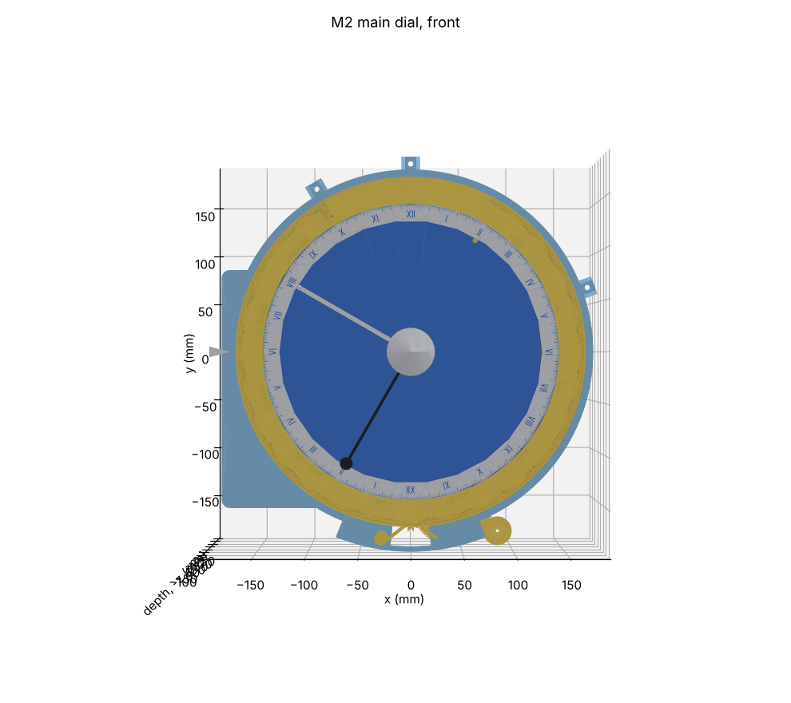 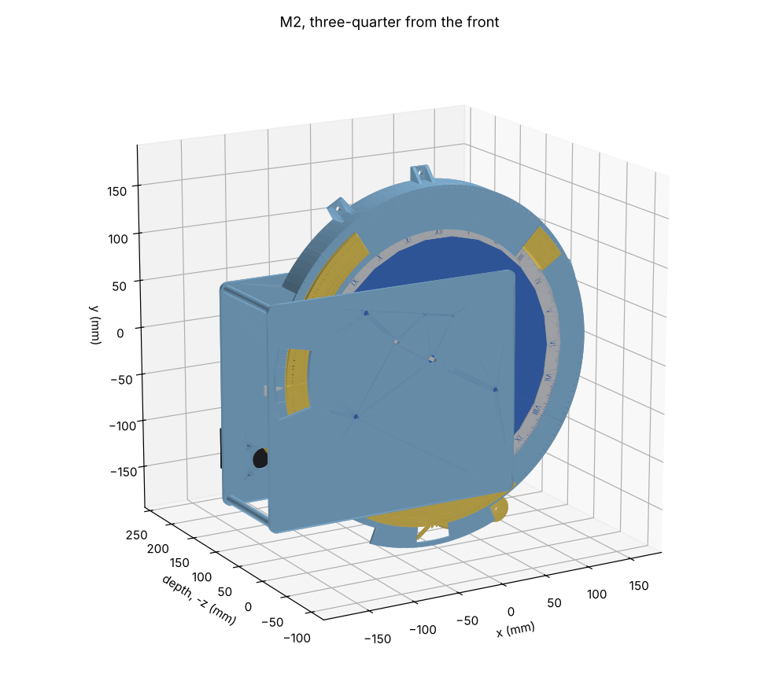</p>
<p align="center">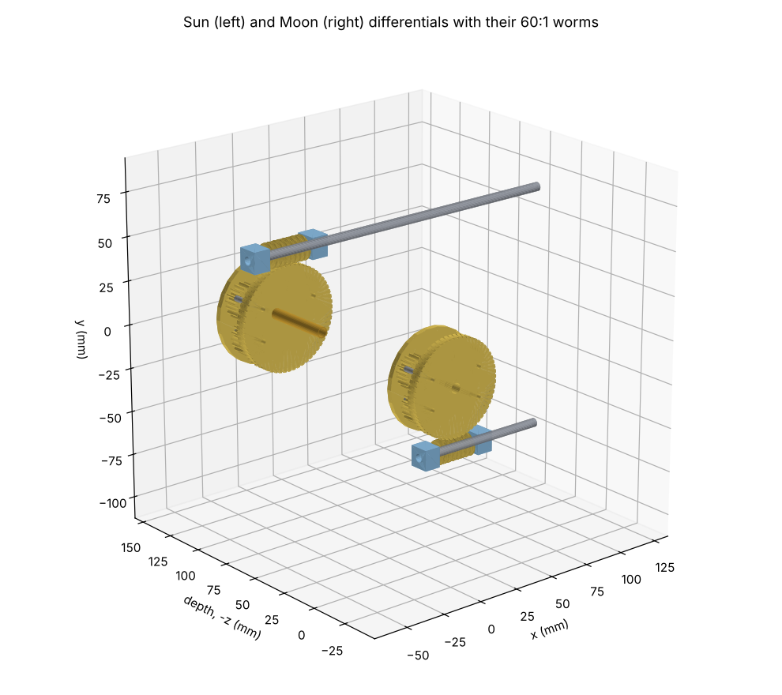 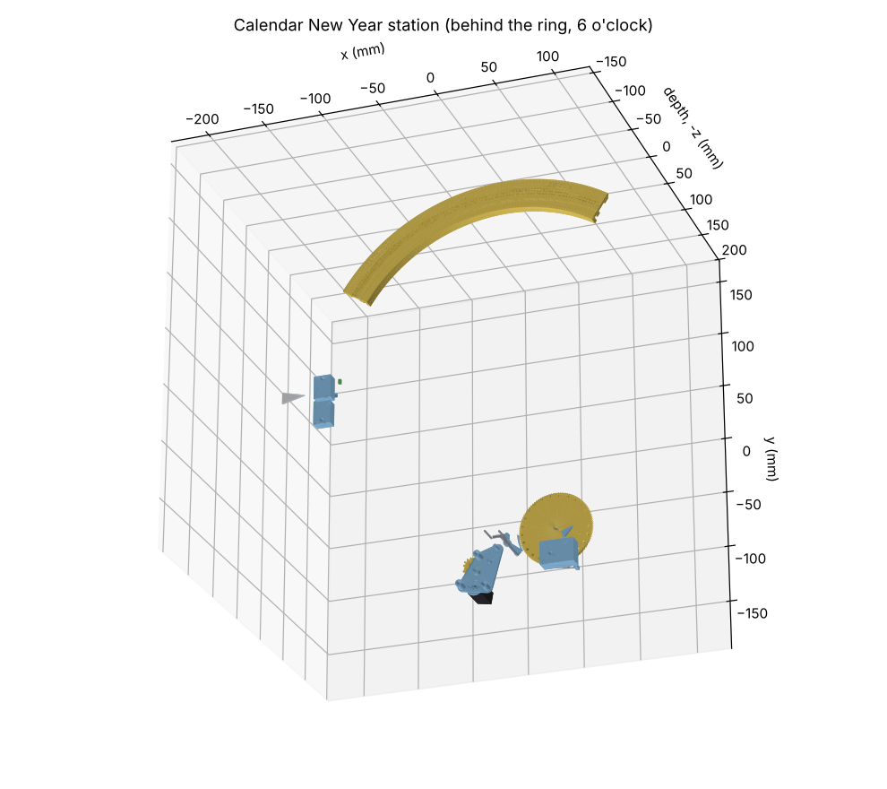</p>
<p align="center">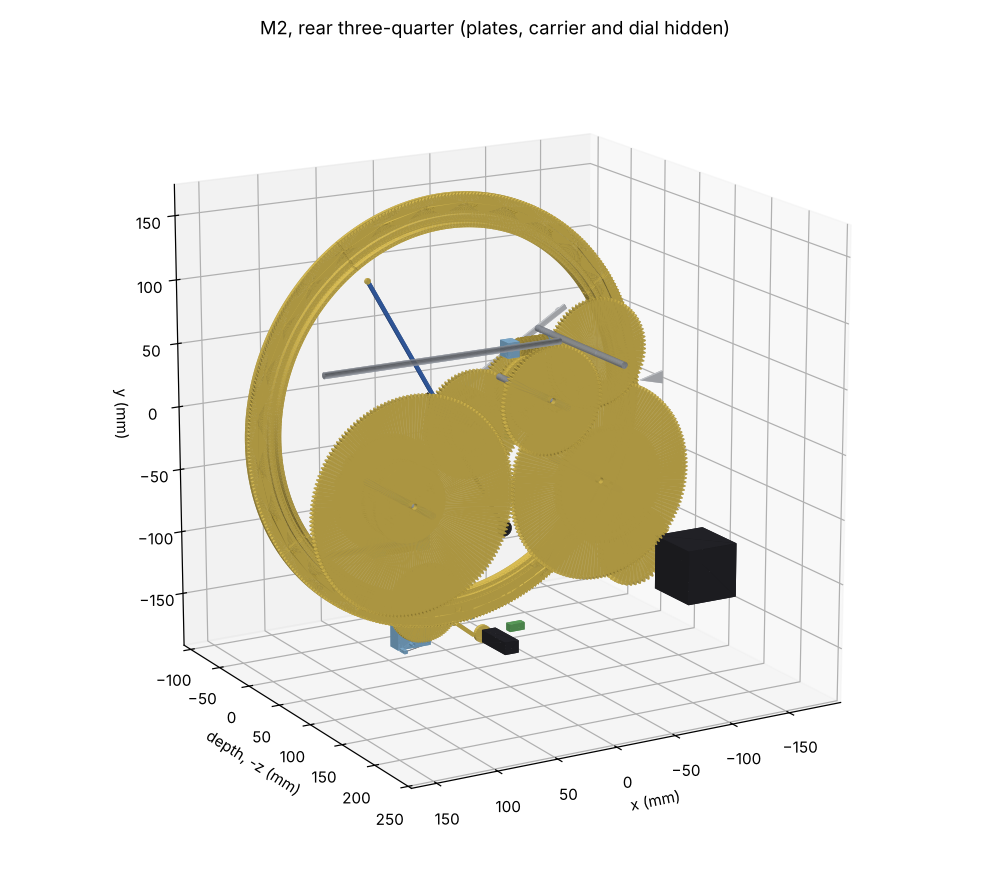 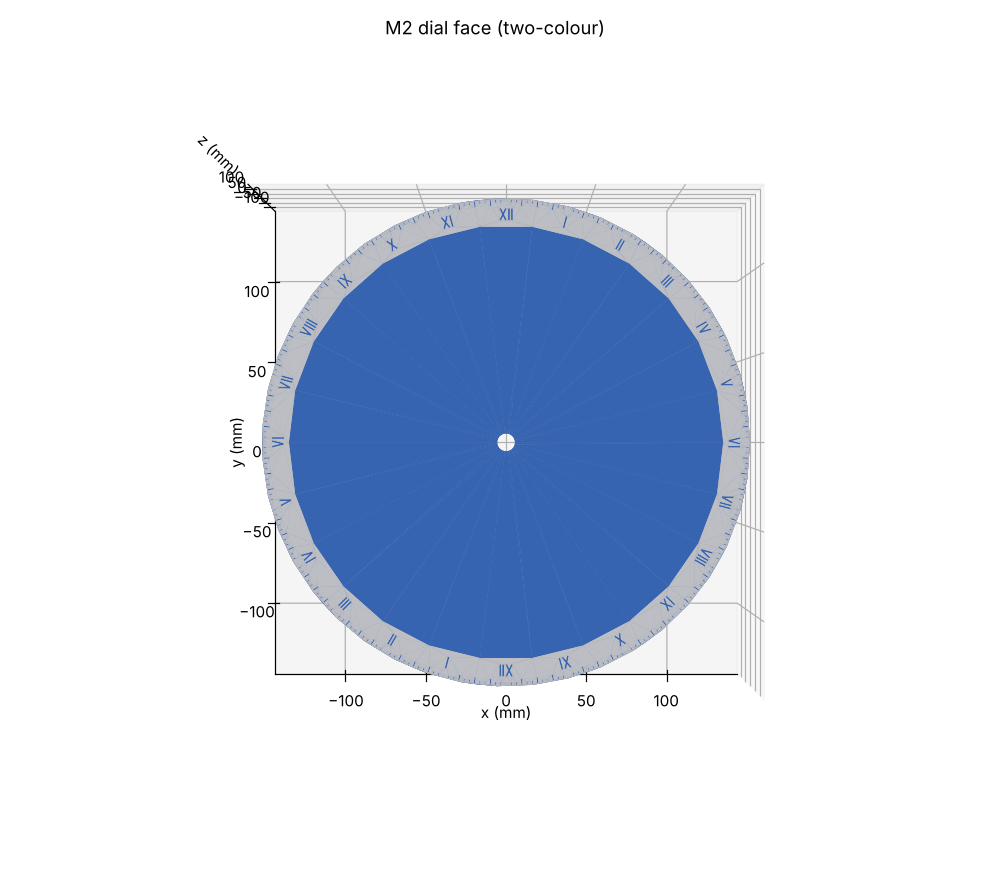</p>
<p align="center">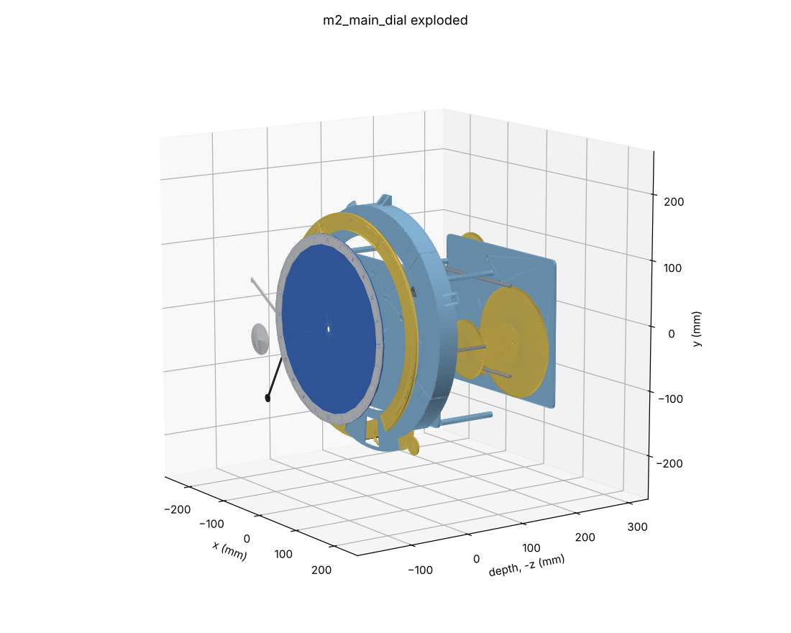</p>

## 2. Kinematics

Signs: + is counter-clockwise seen from the front. An external mesh reverses; a differential with
its carrier still reverses.

```
motor --12/48--> R1 --12/72--> I  (daily arbor, 1 rev per mean day; module 1.25, 6 mm faces)
I --84/84--> S --[Sun differential]--> S sleeve --48/48--> Sun tube    (Sun hand + disc)
                                                  --48/48--> shadow tube (shadow arm, in step)
I --154/169--> J --[Moon differential]--> J sleeve --88/83--> Moon tube  (Moon hand)
S --12/84--> W  (weekday output to M7, 1 rev per 7 days)
```

- **Senses.** The Sun, shadow and Moon tubes all turn with sense −1 × motor (the model checks
  this). Firmware sets the motor direction so that the hands turn clockwise.
- **Trains from `spec/clock.yaml`:** `M2.moon_hand` 154/169 × 88/83, and `M2.weekday` 12/84 (exact).
- **New 1:1 pairs** (exact): I→S 84/84 and the two 48/48 pairs.
- **The 24:1 reduction** is 12/48 × 12/72 (exact, architecture §3).
- **Positions** (mm, dial centre = 0):

| Arbor | Position | Why there |
|---|---|---|
| S, Sun lay shaft | (−41.6, 24.0), 48 from the centre at 150° | 48/48 to the tubes; its differential lies behind the bridge |
| J, Moon intermediate | (74.0, −42.8), 85.5 at −30° | 88/83 to the Moon tube |
| I, daily arbor | (−87.4, −46.4) | 161.5 from J (154/169) and 84 from S (84/84). The 84/84, rather than 80/80, keeps S's arbor clear of the 154-tooth wheel. |
| W, weekday | (−75.5, 57.9) | 48 from S; its arbor leaves the back plate at the top left, towards M7 |
| R1, motor | (−105.4, −95.7), (−140.6, −108.6) | lower left, behind the back plate |
| C, R (v1.5 lay shafts) | 48 at 60° and 100° | clear of the big wheels and the Sun worm; bearing holes are drilled undersize now |

**Depth stack** (dial face = 0):

| Level | z (mm) |
|---|---|
| Hands and hemisphere dome | +0.8 … +23.8 |
| Dial (two-colour) | −3 … 0 |
| Calendar ring, rollers, carrier | −8.5 … 0 (ring); carrier −10.9 … −8.8 |
| Front plate | −15 … −11 |
| Centre wheels: sunset, sunrise, Sun, cam, Moon (83 T), shadow | −21 … −47 |
| Bridge (fixed centre arbor) | −56 … −53 |
| Differentials (Sun on S, Moon on J), worm wheels at the front | −80 … −57 |
| 154/169 | −86 … −82 |
| 84/84 | −92 … −88 |
| Reduction 12/72; weekday 12/84 | −100 … −94 |
| Reduction 12/48 | −108 … −102 |
| Back plate | −114 … −110 |
| NEMA 17 | −162 … −114 |

## 3. Changes from the feasibility layout and the spec

1. **The latitude (node) cam is driven directly from the daily arbor**, not referenced to the Sun
   hand.
   - The node's position on the dial follows sidereal time (mean time), as the Moon's does. Taking
     it from the Sun hand would wrongly add the equation of time once the Sun is corrected in v1.5,
     about ±4°.
   - A three-mesh train does it: **98/99 × 71/79 × 62/55** = 1 + 1/eclipse year turns per mean
     day, **+0.004°/century** [D: `tools/ratios`].
   - That removes a third differential. `spec/clock.yaml` `M2.node_cam` is updated (v1.5, with
     train routing in the v1.5 M2 update).
2. **The weekday output** is arbor W, a horizontal Ø5 arbor turning once per 7 days, handed to M7.
   Architecture §4 is updated.
   - **"Horizontal".** Every M2 arbor is perpendicular to the dial, so on the wall it is horizontal
     and points into the room. W is one of them: at x −75.5, y +57.9 mm from the dial centre (upper
     left, between S and the front-plate edge). It stands 25 mm out of the back plate (z −114 to
     −139).
   - **The ratio is made in M2 by gears.** S turns once per mean day, and W gets 12/84 from it:
     exactly 1/7 turn per day, ratio error 0 (`spec/clock.yaml` `M2.weekday`). M7 adds no ratio;
     it only carries the motion to the chariots (rule 2).
   - **The coupling is keyed, with one dog.** A single dog engages in only one angle, so M7 can come
     off and go back without losing the day. The "Sunday noon" Hall witness on the carousel
     (architecture §6) checks the phase.
   - **What M7 does with it is M7's design.** DA says only that the chariots "roulent sur un chemin
     de fer circulaire, en suivant un mouvement continu" [S: DA p. 47]. The carousel's axis is
     still TBD (photos and the Bach/Rieb book).
     - If the carousel turns in the wall's plane, its axis is parallel to W. M7 then needs only a
       1:1 spur or timing-belt link up to the carousel, about 240 mm higher [E: from
       `docs/envelope.md`].
     - If it turns on a vertical axis, like a turntable, M7 adds a 1:1 right-angle pair: printed
       bevels, or crossed helicals.
   - **Why not turn it upward inside M2.** A bevel pair in M2 would need its own bearings and depth
     next to the S worm. It would also tie M2 to M7's undecided layout. A plain parallel arbor keeps
     M2 all-spur and serves either M7 layout.
3. The daily arbor I and the lay shafts were placed to clear the 154/169 wheels and the worm
   shafts. The bridge turned to 20° so its pillars clear S, C, R and J.
4. Both plates share one 281 × 232 mm outline, with six pillars at points the model found clear of
   every gear.

## 4. Differentials and the M3 interface (architecture §13)

**Differential** (`cad/lib/differential.py`): spur gears only.
- Two 20-tooth suns, and two pairs of 18-tooth planets that mesh with each other in a middle level.
- Output = 2 × carrier − input.
- Planets on Ø3 pins in the carrier. The carrier's front plate is a **60-tooth worm wheel**.
- The input sun is pinned to the shaft (S, J); the output sun is pressed on a brass sleeve (OD 6)
  that carries the output gears forward.
- **Checks:** no interference; every mesh engaged.

**Worm** (`cad/lib/worm.py`): module 1, Ø12 pitch, single start.
- Lead angle 4.76°, tan = 0.083. It self-locks for any PLA friction coefficient above that
  (typically 0.2–0.35 [E]), so **in v1 the still worm is the lock**: no key.
- The wheel is helical (4.76°) with a throat cut by the worm's tip torus.
- Tested at four worm angles: no interference, and engaged.

**Gain:**
- 1 worm turn = 1 tooth = 6° of carrier = **12° at the Sun hand**, and 12 × 88/83 = **12.72° at
  the Moon hand**.
- M3 therefore turns its shaft by at most ±0.34 turn for the Sun's ±4.1° [D].
- 0.3° of play in the shaft is 0.01° at the hand [D].
- Recorded in `spec/clock.yaml` → `interfaces`.

**Worm shafts.** Ø5, along +X at z −60, y +60 (Sun) and y −78.8 (Moon). Each runs in two pillow
blocks (MR85ZZ) and ends in a keyed dog coupling at x = 135, facing the equations bay.

**Torque on the worm [E]:**
- The carrier carries twice the output torque.
- With 10–20 N·mm at the output sun and about 0.25 worm efficiency [E], M3 needs about 2–3 N·mm
  at the shaft.

## 5. Centre stack and hands

- Six brass tubes (OD 4–9) on a fixed Ø3 arbor held by the bridge, levels as in the feasibility
  study.
- **v1 builds** the Sun hand with its disc and the shadow arm with its disc (k = 4 sizes: 4.7 and
  12.2 mm), the Moon hand with its ball (4.5 mm), and the dome.
- **Hand hubs** are split collets on their tubes: a friction clutch for setting (architecture
  §7). The grip is set by the collet interference, which the tolerance coupons give.
- **The idle v1.5 tubes** (cam, sunrise, sunset) are in the stack from v1 with their 48-tooth
  wheels. Each is held by a Ø2 **lock pin** through its wheel into the front plate, so v1.5 adds
  drives without dismantling the stack.
- **v1.5 still to add:** the cam plate, the Moon-hand slide with its 4:1 lever, the phase ball's
  drive, and the sunrise/sunset hands with their sectors and yearly cam. The space is reserved.

## 6. Calendar ring and New Year station

**Ring** [S: ELS i4 at 1:8]:
- Ø 341 × 26 mm, 368 divisions, in 4 printed segments joined at day boundaries.
- It runs on 6 rollers (688ZZ on Ø8 studs) from a rear skirt.
- A thin rear lip carries **368 ratchet teeth, one per division**.
- Ring and sector together are about 150 g of PLA at 100 % infill [D: model volume 122 cm³].

**Pointer on the viewer's left (9 o'clock), corrected on 3 Nov 2026.**
- Apollo "se tient à la droite du calendrier" [S: DA p. 27]. That is the calendar's own right, so
  the viewer's left: DA writes "à la droite du spectateur" when it means the viewer's right.
- ELS confirms it: "le jour qui commence venant alors sur la gauche de l'anneau, en face de la
  flèche" [S: ELS i4].
- The first draft had the pointer on the right. It is now at 180°.
- **Direction: the ring turns clockwise** [S: Paul's photograph of the original, PR #6].
  - Down the left side, the photograph shows the dates running from late September through
    October into November. Apollo's hand is at about 1 November.
  - So the year runs **counter-clockwise** round the ring, and **tomorrow is just below the
    arrow**.
  - The first draft of PR #6 had it the other way [D, unsourced]. The model is now built in its
    canonical frame and turned 180°.
  - The crop is `docs/img/m2/original_calendar_band.jpg`.
- **The station stays at 6 o'clock.** With the ring turning clockwise, a division leaving the arrow
  reaches it three quarters of a turn later. So the station sees the division **92 days ahead of
  the pointer** (`STATION_OFFSET = +92`), and the year counter and setter act in October (below).
- **E6's pawl** is unchanged in place; with the ratchet now driven clockwise, it pulls the tooth
  instead of pushing it.
- The pointer's readers (stop lever, stop switch, 1 March witness) reach back through a window in
  the M2 front plate at 168°–192°, r 140–177 mm.

**Layout of the 368 divisions** (`calendar_logic.py`):

| Divisions | Content |
|---|---|
| 0, 1, 2 | "COMMENCEMENT DE L'ANNÉE" … "commune" (on d = 2) |
| 3 … 61 | movable sector, 1 Jan … 28 Feb, in its common-year position |
| 61 | "29 Feb", printed on the fixed ring, covered by the sector in common years |
| 62 … 367 | fixed, 1 Mar … 31 Dec |

- **In a leap year** the sector slides back one division. It covers "commune" and uncovers 29 Feb,
  as Ungerer describes [S: ELS i4].

**Each midnight:**
1. The index sensor on the daily arbor (the time train) releases E6 (rule 4).
2. E6 is a small gearmotor with a crank and pawl. One crank turn is one ratchet tooth, one
   division. A jumper holds the ring between strokes, and a lock switch stops E6 at the crank's
   home.
3. **The stop lever at the pointer** keeps E6 running while it is held up:
   - fixed bumps (Ungerer's projection S) at d = 0 and 1;
   - **a lug on the sector**, one division before its first day. It sits at d = 2 in common years
     (jump 4) and at d = 1 in leap years (jump 3).
   - So **the sector's position alone decides 3 or 4**. Ungerer's separate cam E is not needed.
   - **How the lug is carried (corrected after PR #5).**
     - The sector's **foot** passes through a floor slot under its first day.
     - Behind the face, an **arm** reaches one division back to the **lug**. The arm sits on a
       chamfer, so the face-down print needs no support.
     - The stop-lever track is split: the fixed bumps run on its inner half and the lug on its
       outer half. In leap years the lug lands on d = 1, where a bump already is, so it needs its
       own half. The one lever spans both halves.
     - **The PR #5 model was wrong here.** It had the lug in the solid face in the leap position,
       unconnected to the sector, and the tab slot two divisions off. A blanket ring-sector contact
       allowance hid both.
     - Now the sector clears the ring in both positions, and a test checks it
       (`cad/tests/test_calendar_ring.py`).

**Year counter (station at 6 o'clock, behind the M2 front plate):**
- **Wheel C** (100 positions, one per year) is a 100-tooth ratchet. Each year on 1 October the
  **counter pin** on the ring (d = 0) pushes the **counting lever** aside, and the lever's hook pulls
  C forward one tooth (detail below).
- **24 leap bumps** sit on C's face at positions 4 … 96.
- **Ungerer's satellite** [S: ELS i4] rides on C at position 0. A fixed pin turns it a quarter turn
  per turn of C, so its single arm supplies the leap bump at x00 only when x00 is divisible by 400.
- **The follower** is a spring plunger that rides on C's face and carries the setter's set ramp.
- **The setter** is a rocker on the ring and two ramps at the station (below). It puts the sector in
  the leap or common position for the coming year in mid-October, about two and a half months
  before it reaches the arrow.
- Everything acts between 1 March and 31 December, so it never disturbs a date being shown (the
  test checks the timing).

**Setter and follower: concept approved by Paul (3 Nov 2026); detail design below.**

<p align="center">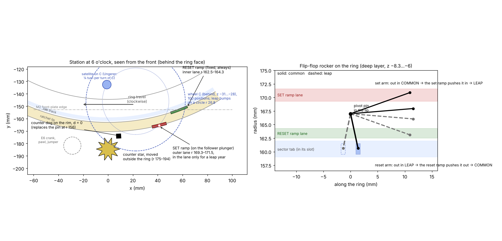</p>

- **Why a rocker.** A fixed part at the station can hold the sector back while the ring moves on,
  but it can never push the sector forward. Something on the ring must therefore turn the ring's
  motion into a push in either direction.
- **The rocker.** It is a small two-position rocker on the ring, beside the sector's tab, and its
  two positions are the sector's two positions:
  - common: the set arm is out;
  - leap: the reset arm is out.
- **At the station, each October, two ramps act on it:**
  - the **reset ramp** is fixed and always present. It flips a leap rocker to common;
  - the **set ramp** rides on a spring plunger that follows wheel C's bumps. It stands in the lane
    only when the coming year is a leap year, and then flips the rocker to leap.
- **Energy.** It all comes from the ring's own motion (E6). There is no extra motor, and the
  counting stays purely mechanical (rule 2).

**Detail design** (`cad/modules/m2_main_dial/setter.py`; rules checked in
`cad/tests/test_setter.py`). The drawing is made from the model's own geometry.

<p align="center">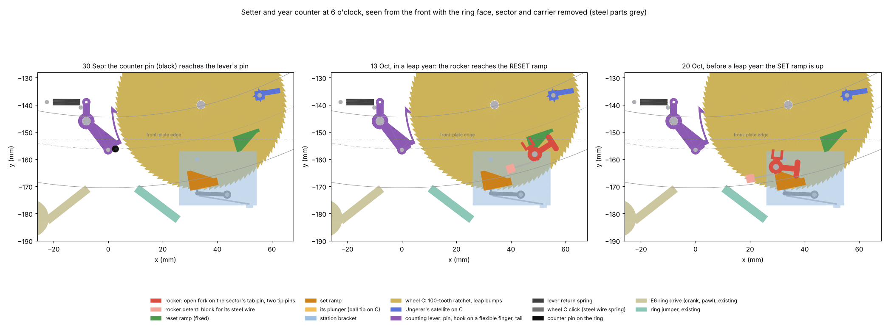</p>

*On the ring:*

| Part | Detail |
|---|---|
| Rocker | PLA, on a Ø2 pin pressed into the ratchet lip at r 165.5, between the tab's common and leap places (d 29.5). An **open fork** holds the sector's Ø2.2 tab pin (r 160.5), 5.0 mm from the pivot. It swings ±15.9°, which moves the tab **one division** [D: 2 × 5.0 × sin 15.9° = 2.740 mm = 2π × 160.5 / 368]. The fork's tines point to the dial centre, so the rocker stays outside r 158.8. |
| Tip pins | Two Ø1.6 pins on a cross-bar 7.7 mm along the ring from the pivot, ±2.5 mm radially, hanging below the rocker's bars (z −8.3 … −7.0). Their radii [D: `pin_radii`]: common: set 170.15, reset 165.40; leap: set 165.99, reset 161.13. |
| Detent | A steel wire (Ø0.4, 10 mm free) along the ring, clamped in a printed block glued under the lip. It presses on the hub's outer side, in one of two V-notches (0.3 deep, at ±15.9°), so it holds the rocker, and with it the sector, in either position. Steel, not printed (Paul, PR #8). |

*At the station:*

| Part | Detail |
|---|---|
| Reset ramp | PETG, fixed on the carrier, r 158.6–164.35, 18.6° past the station. It meets the reset pin only when the pin is out (leap, 161.13) and pushes it to 165.40 (common). |
| Set ramp | PETG, r 167.04–174.2, 11.7° past the station, glued on its plunger's peg; the carrier window keeps it square. **Down** (no bump), it sits 1.4 mm low in the window, 0.5 mm under the pins. **Up** (on a bump), it overlaps the set pin by 0.9 mm, meets it only when the pin is out (common, 170.15) and pushes it to 165.99 (leap). |
| Clearances | Each ramp clears the other pin by 0.84 mm, and lets its own pin go 0.25 mm before the end of its face [D: ramp and pin radii above, pins Ø1.6]. Both ramps stay under the rocker's bars (ramp top −7.4, bars from −7.0). |
| Plunger | PETG, Ø3, at r 172.0, with a Ø0.8 ball tip on C's face at the bump circle (r 28.42 on C) and a Ø5 collar just above the bumps. Two guides: the collar in a Ø5.4 pocket in a boss that hangs from the bracket, and the shank in a bore at the bracket's front. The steel spring sits in the pocket between its fixed ceiling and the collar, so it **presses the plunger onto C** (spring and forces: *Steel springs* below). |
| Timing | Reset on the step into **14 October**, set on the step into **21 October** [D: `RESET_OFFSET`, `SET_OFFSET` in `calendar_logic.py`]. The reset always comes first: a leap sector goes back to common every year, and the set ramp puts it back to leap only when the coming year is a leap year. Both come after the counter (1 October), so the plunger already reads the coming year. |

*Year counter:*

| Part | Detail |
|---|---|
| Wheel C | PLA, 0.2 mm nozzle; 100 ratchet teeth (root r 30.5, tips r 31.5), 3 mm thick, on a Ø3 stud at (34, −140) pressed into the M2 front plate. The drive faces are radial with a 0.1-pitch undercut and face clockwise. C turns anticlockwise, 3.6° a year. |
| Leap bumps | 1.4 mm high, on the bump circle (1.79 mm per year there). Each is a **48° ramp on the side that reaches the plunger first, a 0.6 mm top, and a sheer drop** on the other side: the plunger climbs on only when C steps onto that year, and drops off when C steps on. With C up to ±0.25 mm off, the plunger is fully up in its own year and lifts at most 0.16 mm for a neighbour's bump (the lowered ramp stays 0.34 mm under the pin) [D: `plunger_lift`]. A two-point guide does not jam at 48° (limit ≈ 69° with friction 0.3) [D: test]. |
| Counting lever | PETG, 0.2 mm nozzle, **one flat print in C's layer**, on a Ø3 stud at (−8, −146). It has three arms:<br>- a Ø1.5 steel pin, at r 156.55 at rest, reaching up into the ring's deep layer;<br>- a spring tail;<br>- the **hook** on a flexible finger, 0.6 × 3 mm and 10.2 mm long, outside C's tips. |
| Stroke | The counter pin (Ø2.5, r 156.25) overlaps the lever pin by 1.7 mm and pushes it outward until it slips past. That turns the lever 14.6° [D: `lever_turn`]. The hook then carries C **2.93 mm = 1.50 pitch** at r 31.0 [D: `hook_travel`]. |
| One tooth, every time | With radial drive faces, the click's nose passes a tooth tip after exactly 1 pitch, and the next after 2. Any carry between 1 and 2 pitches therefore ends as one tooth once the click settles C back. 1.50 is the middle, so the stroke may vary by ±0.5 pitch (±1 mm, about ±4.9° of lever turn) [D]. |
| Hook path | The hook's rest and end points are both on r 31.0, symmetric about the line of centres. Through the stroke it stays within 0.09 mm of that radius, so it neither slips off a tooth nor digs into the root [D: test]. |
| Pulled, never pushed | The finger's root is ahead of the hook, so the finger is in tension while it pulls, and the undercut faces hold the hook in. On the way back, the hook's 45° back rides up the next tooth's flank and the finger bends 0.8 mm outward. |
| Return and stop | An extension spring (OD 2.5) runs from the tail, 7 mm above the pivot, to a fixed pin 13 mm to its left, and pulls the lever anticlockwise. The tail rests on a fixed stop pin. Both fixed pins are Ø1.5, pressed into the front plate. |
| Click | A printed PETG click on a Ø1.5 steel pivot pin in the bracket, its nose (r 0.35) in a tooth gap at C's bottom. A steel wire (Ø0.5, 18 mm free), clamped in the bracket, presses its arm towards C. It lets C turn forward, stops it turning back, and sets each yearly step. |
| Satellite | On a Ø1.5 pin at C's position 0, 6.6 mm inside the bump circle, so its star passes inside the plunger's boss. Three layers: a square hub, an arm that is a leap bump (same profile) when it points out, and a 4-point star. A fixed pin, 6° before the plunger, turns the star a quarter turn as C goes from 98 to 99 [D: 6° / 3.6° per year = 1.67 positions]. A steel wire (Ø0.4, 10 mm free), glued in a boss on C, presses a flat of the square hub, so the satellite stays in its quarter-turn positions. The first draft had no detent. |

**Loads on the counter [E].** Method: cantilever beams, PETG E ≈ 2.0 GPa [E: typical datasheet
value], friction 0.3. The spring forces come from the catalogue data or the wire calculation below.
The test rig confirms them.
- **Finger:** I = 3 × 0.6³ / 12 = 0.054 mm⁴ and L = 10.2 mm, so k = 3EI/L³ ≈ 0.30 N/mm. That is
  ≈ 0.24 N at 0.8 mm, with a bending strain of ≈ 0.7 %. Dragging it back up a flank (about 30°)
  takes ≈ 0.26 N at 11.55 mm from the pivot, **≈ 3 N·mm**.
- **Return spring:** 5.1 N·mm at rest (1.7 times the drag) and 7.2 N·mm at full stroke, where the
  tail has moved 1.8 mm [D: `bought_springs`].
- **Click:** lifting its nose (0.54 N at most) over a tooth's 30° flank costs the lever ≈ 6.6 N·mm.
- **Plunger, every fourth year:** climbing a leap bump at 48° against its spring (0.48 N at most)
  costs ≈ 29 N·mm on C, **≈ 11 N·mm** at the lever. In other years its friction on C costs
  ≈ 0.4 N·mm.
- **Counter pin:** ≈ 25 N·mm in a leap step and ≈ 14 N·mm otherwise, on the 13.2 mm pin arm. That is
  **about 1.9 N along the ring once every four years, and about 1.1 N in other years**. E6's
  sizing (D3) must allow for it.

**Steel springs** (Paul, PR #8: "I'd rather go with steel springs"). Every spring in the setter and
the counter is steel. Two are catalogue parts; three are cut from straight spring wire.

| Spring | Part | As installed [D] | Check |
|---|---|---|---|
| Set-ramp plunger, compression | **Sodemann C01800120500S**, stainless AISI 302: d 0.30, De 4.57, Di 3.97, L0 12.70, Ln 4.72, R 0.25 N/mm [S: [ressorts-sodemann.fr](https://www.ressorts-sodemann.fr/c01800120500s)] | 12.2 mm at rest: 0.13 N. 10.8 mm lifted: 0.48 N. | Fits over the Ø3 shank, inside the Ø5.4 pocket; 6 mm from solid. |
| Counting-lever return, extension | **Sodemann E00940110500S**, stainless AISI 302: d 0.28, De 2.39, L0 12.70, F0 0.22 N, R 0.17 N/mm, Ln 26.16 [S: [ressorts-sodemann.fr](https://www.ressorts-sodemann.fr/e00940110500s)] | Stretched 3.0 mm at rest: 0.73 N. 4.8 mm at full stroke: 1.03 N. | 1.7 times the hook's drag at rest. |
| Rocker detent | Spring wire, EN 10270-1 DH, **Ø0.4**: 10 mm free, plus about 3 mm clamped | In a notch, deflected 0.65 mm: 0.51 N. On the rim between notches: 0.74 N, 1174 MPa. | Holds 1.9 N·mm, **3.7 times** the sector's weight on the tab (10.3 g at 5 mm: 0.5 N·mm, with the ring at 3 or 9 o'clock). |
| Wheel C click | Spring wire, DH, **Ø0.5**: 18 mm free | 0.35 N at rest (0.30 N at the nose). 0.63 N with the nose over a tooth: 922 MPa. | Settles C against its friction; light on the counter. |
| Satellite detent | Spring wire, DH, **Ø0.4**: 10 mm free | 0.31 N on a flat. 0.86 N on a corner: 1365 MPa. | Holds the quarter-turn positions. |

- **Wire stress limit.** 0.7 Rm, the static limit for bent spring wire (EN 13906-3). For DH wire,
  Rm min is 2560 MPa at Ø0.4 and 2480 MPa at Ø0.5 [S: EN 10270-1 Table 3, as tabled in
  [Stahl-Becker's data sheet](https://static.rapidonline.com/pdf/521667_v1.pdf)]. The same sheet
  allows up to 10 % less for straightened rods, so the limits are 1613 and 1562 MPa. Every wire
  stays under its limit (`test_setter.py`).
- **Wire formula [D].** A wire clamped at one end with its tip deflected δ: F = 3EIδ/L³, and
  σ = 3Edδ/(2L²). E = 206 GPa (EN 13906-1, EN 10270-1 wire).
- **Wire mounting.** Each wire is glued (CA) about 3 mm deep into a Ø0.6 hole drilled with a pin
  vice in its printed block. The hole points along the wire's unloaded line; the part it presses on
  then bends it by its preload. The model draws each wire straight, along its installed chord.
- **Sodemann** (Denmark, French shop): ships to France by UPS in 4–5 working days, €8.00 (business)
  or €9.60 (private) up to 1 kg [S: [shipping](https://www.ressorts-sodemann.fr/expedition)].
  - Its sizes are inch-based but quoted in mm. No standard part mates with them, so that causes no
    interface problem.
  - Pack sizes and prices are not readable without the shop's pop-up: confirm them when ordering.
  - Check on the drawing that the extension spring's L0 is measured inside the hooks. The anchor
    pin's position (`ANCHOR_XY`) is set from it.
- **Wire supply.**
  - Preferred: Gutekunst straight 1 m bars, EN 10270-1 SH/DH, refs 23514 (Ø0.4) and 23516 (Ø0.5)
    ([federnshop.com](https://www.federnshop.com/en/products/steel-wire-bars.html)). **Not
    verified:** the site refused this session; open the pages to confirm.
  - Verified alternative: Boley 538805 (Ø0.40) and 538807 (Ø0.50) piano wire, a watchmakers'
    supplier, in 5 m bundles, not straight ([boley.de](https://www.boley.de/en/shop/1906.spring-steel-wires)).
- **Metric alternatives, not verified:** Gutekunst VD-011Y (compression, d 0.25, Dm 4.4, L0 15) and
  RZ-020I (extension, d 0.32, De 3.52, L0 12.9).
- **Other M2 springs.** The ring jumper, the E6 pawl and the stop lever are still placeholders
  from PR #5. They get steel wire springs from the same stock when E6 is detailed (D3): about 1 N,
  0.2 N and 0.3 N respectively [E].

**A change from the approved sketch: approved by Paul in PR #8** ("The lever instead of the star is
fine").
- **The sketch kept the 10-point counter star at the station.** It filled the band r 157–176 that
  the rocker must pass.
- The counter pin stays where it was (r 156.25). The star and its 10-tooth pinion are replaced by the
  **counting lever, hook and click** above. The lever's only part in the ring's band is the Ø1.5
  pin, in the counter pin's own lane.
- Ungerer describes a star and rake [S: ELS i4]. The lever and ratchet make the same count of one
  per year.
- **Caught in review:**
  - **before PR #8 opened:**
    - the first draft of the lever had wheel C's ratchet the wrong way round, so C could not turn;
    - its stroke ended on a tooth tip (1.8 pitch);
    - it had no return spring.
  - **while specifying the springs:**
    - the plunger's first spring sat in a counterbore under the ramp, where it could only push the
      plunger away from C;
    - the first leap bumps were sheer cylinders as tall as the stroke, which the plunger could not
      climb;
    - the satellite had no detent.

  The interference and sweep checks cannot see motion, so `test_setter.py` now checks every link
  of the chain:
  - the direction, the stroke, the hook path and the return;
  - which way the plunger spring pushes;
  - the bump profile, in the plunger's own year and its neighbours';
  - the springs' forces and stresses.

**Radial tracks behind the ring.** Each track has one reader, so nothing triggers the wrong reader.

| Track | r (mm) | Depth | Reader |
|---|---|---|---|
| 1 March witness flag | 148–149.5 | deep | reflective opto at the pointer (architecture §6, updated) |
| Stop-lever track: rim; bumps S (inner half, 150.2–151.8); sector lug (outer half, 152.2–153.8) | 150–154 | rim at −6.5, bumps and lug to −8.3; the lug's arm stays in front of −6.3 | stop lever at the pointer, spanning both halves |
| Counter pin | 155–157.5 | full depth | counting lever's Ø1.5 pin at the station (r 155.8–157.3) |
| Sector tab pin | 159.4–161.6 | −6.9 … −2.2 | the rocker's fork, on the ring (it travels with the ring) |
| Rocker tip pins | 160.3–171 | −8.3 … −7.0 | reset ramp (inner lane, 158.6–164.35) and set ramp (outer lane, 167.04–174.2) at the station |

- **Station position.** The station sits at 6 o'clock and sees the division 92 days ahead of the
  pointer. It and wheel C are
  kept at least 195 mm below the dial centre, about 18 mm above the floor [E].
- **Setting** (architecture §7): turn the ring to the date (lift the jumper), set the sector by
  flipping the rocker, and set wheel C (lift its click and the plunger) and the satellite to the
  year, as `calendar_logic.initial_state` does.

**Carrier: a printed frame that belongs to the works, not the case** (Paul, PR #5: "Print if
possible, otherwise use model grade plywood"; decisions D12).

| Part | Detail |
|---|---|
| Carrier ring | PETG, 2.1 mm plate (r 133–178) carrying the 6 roller studs and the station. Printed **face down**, in **4 segments** (each fits the dual-nozzle bed). |
| Splits | At 45°, 135°, 225° and 330°. The 225° split lies on the M2 front plate. The other three get a PETG splice plate behind, 2 × M3 each side. The fourth split is at 330°, not 315°, so its splice clears the plate's corner. |
| Rear rim (L-section) | r 174–178, 31 mm deep, from −55° to 150°: where the carrier overhangs the front plate (top and right). It turns the flat ring into an L-section that holds its shape. |
| Fixing to M2 | 3 countersunk M3 at r 172 (165°, 195°, 225°), into the front plate where they overlap. |
| Mounting tabs | 3 tabs at the back of the rim (20°, 90°, 120°), each with an M5 clearance hole, for the works' internal frame. Two 45° gussets flank each hole, so the tab prints without support. |

- **Why printed.** Each segment is at most 280 × 129 × 31 mm in its print pose, so the H2D prints it.
  The L-section makes up for PETG's stiffness, which is lower than plywood's.
- **No plywood** is needed in M2.
- **Separation from the case.** The tabs hold the works on their own internal frame; the
  decorative case only surrounds it (D12). M2 lifts out with its ring, carrier and station as one
  unit.

## 7. Dial (two-colour print)

- **Field (azure):** the Ø 287.5 disc with raised inlays.
- **Hour ring (silver):** r 128–143.75, 0.8 mm, with the 24 Roman numerals (I–XII twice, 7 mm
  tall, 1 mm strokes) and the ticks cut through it.
- **Ticks:** quarter hours long, 5 minutes short. The azure inlays fill the cuts flush, so the
  numerals read azure on silver [S: DA "peint en azur … cercle en argent"].
- **No font is needed:** the numerals are built from straight strokes.
- **Noon is at the top**, as in Strasbourg [S: ELS i1]:
  - "le méridien de Strasbourg est verticalement au-dessus du pôle Nord, qui est figuré au centre";
  - "Lorsque le Soleil passe au méridien de Strasbourg, l'aiguille est verticale".
- **The hemisphere is a shallow dome.** The same passage calls it "un disque légèrement bombé",
  which confirms the PR #4 choice.
- **Printed face down**, both bodies together (`export/print/m2_main_dial/dial.3mf`). The silver
  ring and the azure inlays are the first layers, on the smooth plate. Use the 0.2 mm nozzle for
  the 1 mm strokes.

## 8. Print and parts notes

**Print files** (Paul, PR #5): `python -m cad.export_print` writes `export/print/<model>/`:
- one STL per distinct single-colour printed part, already in its print pose and standing on z = 0;
- one 3MF per multi-colour print, holding its bodies in register (no separate STLs for them);
- a `README.md` manifest with quantity, material, nozzle, size, bed fit, down-facing area, and
  whether the part meshes closed and manifold (lib3mf's check, as Bambu Studio expects).

For M2 that is 54 STLs and 6 two-colour 3MFs (the dial, the four ring segments, the sector) for 98 prints. The press, slide and bearing fits still wait for the
tolerance coupons, so these are design-stage files.

**Print poses.** Each part records which way is up (`Item.print_up`). Where it does not, the
exporter tries both faces down and keeps the one with less to support.
- **Face down:** ring segments and sector, each a two-body print (gold base, black dates as a flush
  inlay on the bed side: `ring_0.3mf` … `ring_3.3mf`, `sector.3mf`); the dial (two bodies,
  `dial.3mf`); and the carrier segments (rim and tabs grow upward; the tab gussets are 45°).
- **Flat:** gears, plates, hands and links lie flat, on whichever face needs less support.
- **Worm: axis vertical.** The thread's lower flank is a 70° overhang, 2 mm deep. An earlier draft
  said the 4.76° lead made this "fine"; that was wrong, because the lead angle is not the
  overhang.
  - Use the 0.2 mm nozzle and fine layers (0.1 mm).
  - Proposed: add a worm to the next coupon plate to check it before the M2 print.
  - Fallback: print it in two halves split along the axis, flat side down, with no overhang.
- **Support needed in one place:** ring segment 0, where the Jan–Feb sector's seat is a pocket open
  to the bed, 2.4 mm deep. Use support from the bed inside the pocket. A support-interface filament
  on the H2D's second nozzle leaves the cleanest seat.
- **Other down-facing areas** in the manifest are bridges over bearing seats, holes and slots.
  They print without support.

**Materials:**
- PETG: plates, bridge, pillars, carrier, pillow blocks;
- PLA: gears, dial, ring, hands;
- nylon is an option for the worm and worm wheel if wear shows on the test rig.

**Bought:**
- Ø5 rod: S, J, I, W, R1, the motor shaft and 2 worm shafts;
- Ø3 rod: fixed arbor, differential pins; the studs for wheel C and the counting lever;
- setter and year counter: Ø2 rocker pivot pin; Ø1.5 rod for the lever pin, stop and spring anchor,
  click pivot, satellite pin and step pin; two Sodemann springs (plunger, lever return); Ø0.4 and
  Ø0.5 spring wire (rocker detent, click, satellite detent);
- Ø8 studs for the rollers; Ø2 lock pins;
- brass tubes OD 4–9 for the stack, plus OD 6 sleeves;
- MR85ZZ bearings: 9 in the plates, 4 in the worm blocks;
- 6 × 688ZZ rollers;
- NEMA 17;
- E6 gearmotor;
- 2 microswitches (E6 lock, stop lever), 1 reflective opto, 2 Hall sensors and magnets.

`bom.md` has the rows.

## 9. Loads [E]

**M2 stepper:**
- Input friction 5 N·mm at I.
- The Sun, shadow and Moon tubes at 10 N·mm each, each through 5 meshes (η 0.9 each).
- The weekday output at 10 N·mm through 2 meshes.
- Total ≈ 57 N·mm at I, so ≈ 2.9 mN·m at the motor through 24:1 (η 0.81).
- **The margin is about 50× at 0.5 A.**
- **Tooth strength** [D: Lewis as in `tools/ratios/strength.py`, allowable 9.75 MPa]. Every
  safety factor is above the accepted minimum of 4:

| Mesh | Running load | Root stress | Safety factor |
|---|---|---|---|
| 84/84, I → S (Sun and shadow loads) | ≈ 30 N·mm | 0.4 MPa | 24 |
| 12/72 at module 1.25, 6 mm (reduction into I) | ≈ 57 N·mm | 0.7 MPa | 14 |
| Differential sun 20 T / planet 18 T | ≈ 20 N·mm at the output | 1.6 MPa | 6 |
| Worm wheel (carrier, 2 × output) | ≈ 40 N·mm | 0.5 MPa | 18 |

**E6:** the ring turns on six ball bearings, so the jumper's spring sets the pawl force. The
gearmotor class from D3 is chosen after the event-motor noise test (BOM Batch 1).

## 10. Not modelled yet

These are reserved or simplified:
- v1.5 drives (cam train routing, sunrise/sunset sectors and yearly cam, Moon slide and lever, phase
  ball);
- the setter's and counter's springs are sized (§6), not yet tested on the rig;
- the springs of the ring jumper, the E6 pawl and the stop lever wait for E6's detail design (D3);
- axial retention of the parts on the station's studs (push-on lock washers, BOM);
- the dominical-letter dial (I10: set by hand in v1);
- the v2 feasts arc;
- Apollo's figure.

## 11. Decisions

**Settled in Paul's review of PR #5 (3 Nov 2026):**
1. **M2 design approved**, including the latitude cam from mean time and the weekday output (now
   explained in §3 item 2).
2. **Calendar ring face:** saints' names out; 0.2 mm nozzle approved.
3. **Noon at the top**, as in Strasbourg [S: ELS i1; §7].
4. **Carrier support: printed**, as a frame that belongs to the works (§6). Plywood only where size or
   strength rules out a print; M2 needs none.

**Text size and readability** (Paul asked: what point size is 2 mm text?).

Method [E]:
- Font size is set by the em; a capital is about 0.7 em (Helvetica 0.72, Times 0.66). So
  pt ≈ cap height / 0.7 / 0.3528 mm.
- A 20/20 eye resolves letters that subtend 5′ of arc (Snellen). So the farthest a cap height h can
  be read at all is h / tan 5′ ≈ 688 h.
- Comfortable, fluent reading needs about 3× that size, so divide that distance by 3.
- At 1:8, text read from d looks as large as the original's from 8 d.

| Cap height | ≈ Point size | Readable at most (20/20) | Comfortable up to |
|---|---|---|---|
| 2.0 mm | 8 pt | 1.4 m | 0.45 m |
| 2.2 mm | 9 pt | 1.5 m | 0.5 m |
| 3.0 mm | 12 pt | 2.1 m | 0.7 m |
| 4.0 mm | 16 pt | 2.75 m | 0.9 m |
| 5.0 mm | 20 pt | 3.4 m | 1.15 m |

What fits on the ring [D]:
- One division is 2.9 mm wide at the outer edge (2π × 170.5 / 368) and 2.5 mm at the inner edge.
  Anything printed once per day therefore tops out at about **2.2 mm**, written radially along its
  division.
- A month spans 28–31 divisions, about 85 mm of arc, so its name can be much larger.

**Decision 5: approved by Paul on 3 Nov 2026** ("Ring font face size approved"):
- **day numbers and dominical letters at 2.2 mm (≈ 9 pt)**, the most a division allows;
- **month names at 4 mm (≈ 16 pt)** along the circumference.

**As modelled** (`calendar.py`, `cad/lib/lettering.py`):
- **Font.** Single-stroke capitals drawn in code, so no font file is needed and the result is the
  same on every machine.
- **Inlay.** Black on gold, flush, 0.4 mm deep. Each ring segment and the sector is a two-body
  print (`ring_<k>.3mf`, `sector.3mf`), face down, 0.2 mm nozzle.
- **Layout across the band, outside in, as on the original** [S: Paul's photograph, PR #6]: month
  name, day number, dominical letter. The saints' names that follow on the original are left out at
  1:8.
- **Each day:** the day number, then its dominical letter, reading inwards along its division at
  2.2 mm (stroke 0.35 mm). The letters form one straight column (r 158.0 inwards) and the numbers
  are right-aligned on it.
  - The letters run A … G from A on 1 January [S: ELS i4: "Au 1er janvier correspond la lettre A"].
    The photograph agrees: 15 Oct = A, 22 Oct = A.
- **Months:** names at 4 mm (stroke 0.6 mm) round the **outer edge**, reading clockwise with their
  tops outward, as on the original. JANVIER and FÉVRIER are on the sector.
  - At the bottom of the ring they read upside down, as on any ring.
  - Accents (FÉVRIER, AOÛT, DÉCEMBRE) stay inside the sector's edge.
- **The letter column is a black stripe with the letters left gold**, as on the original (light
  letters on a dark column; Paul, PR #6). The stripe runs the length of each part's days, r 155.9–158.4,
  0.4 mm wider than the letters and 0.5 mm clear of the day numbers. It is part of the same black
  inlay, so there are no extra parts.
- **Divisions 0–2:** "COMMENCEMENT", "DE L'ANNÉE", "COMMUNE" at 1.6 mm, the longest words that fit
  one division radially [S: ELS i4 for the words].
- **On the recess floor:** "COMMUNE" (d = 2) and "F 29" (d = 61) sit on the floor, where the sector
  uncovers them.
- **29 February carries F**, as on the original (Paul, PR #6). F is the letter of the Roman
  bissextile day, the doubled 24 February, so the letters from 1 March on are unchanged.
- **Language and colour.** The language is French, as in the sources' quotations of the ring. The
  black letter colour is [E]; DA gives only the gold ground.

<p align="center">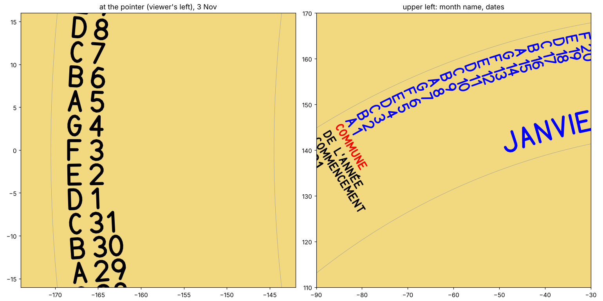 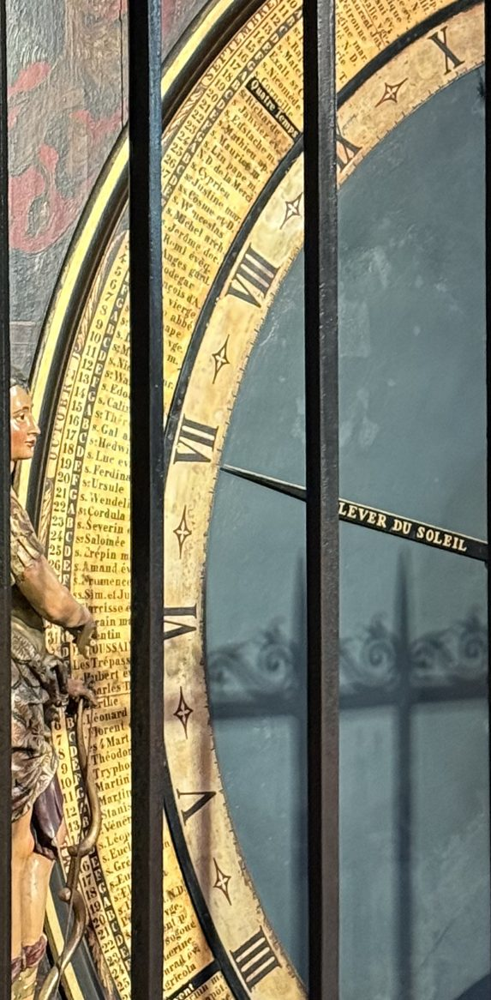</p>

**Settled from Paul's photograph (PR #6):** the ring turns clockwise (tomorrow below the arrow),
and the layout across the band is month, day, letter.

**Settled (Paul, PR #6):** dominical letters light on a dark column, as on the original: a black
stripe with the letters left gold.

**Still to confirm on a photo, not a decision:** the weekday carousel's axis (§3 item 2; M7 design).
