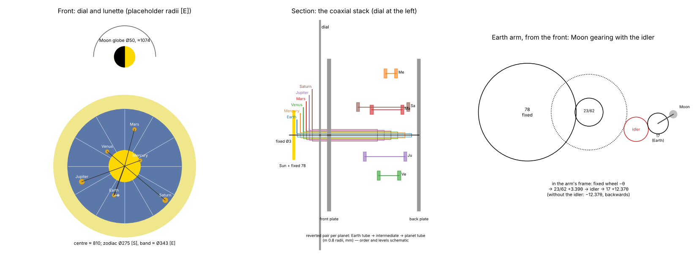
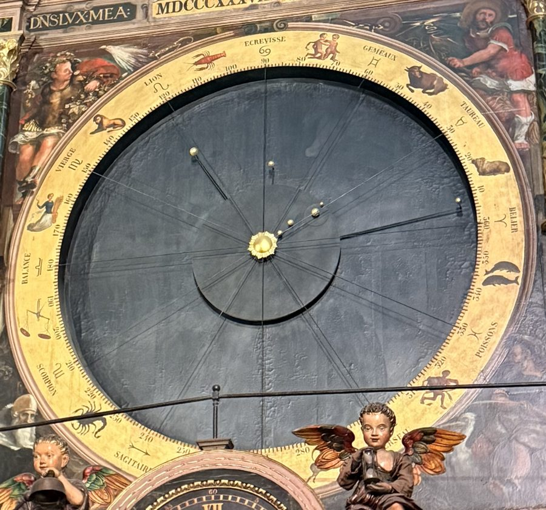
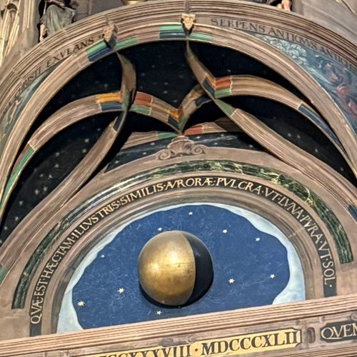

# M5 planetary dial and Moon-phase globe: concept gate

Phase 2, module M5: the Copernican planetary dial above the lion gallery (I14) and the Moon-phase
globe in the lunette above it (I15). One stepper turns M5's daily arbor at 1 rev per mean day
(`docs/gear-trains.md` §7). Every ratio after it is gearing, from the trains accepted in Phase 1.

**Status: concept accepted** (Paul, PR #20, 7 Nov 2026: "M5 & M6 design recommendations are
approved"; the decisions are in §11). The detail design follows in its own PR, after M7's. Tags as in `docs/reference-notes.md`.

*Schematic only, not to final dimensions. Heights are from `docs/envelope.md` §2 [E].*

## 1. What M5 shows

**I14, the planetary dial** [S: DA p. 51–53; ELS i2; mechanism-inventory I14].
- A Copernican "planétaire" on a large azure dial, on the storey above the lion gallery.
- The gilded Sun disc in the centre "n'est soutenu par aucun support" (has no visible support).
  Twelve rays lead from it to the twelve signs of the zodiac painted round the edge.
- "Sept petites sphères dorées" (seven small gilded spheres): Mercury, Venus, the Earth, the Moon,
  Mars, Jupiter and Saturn, sized to the planets' apparent dimensions.
- Each planet goes round the Sun in its own period; the Moon goes round the Earth "dans l'espace
  du mois lunaire".
- "Autour d'un cercle de 2m,20 de diamètre sont peints les douze signes du Zodiaque" [S: ELS i2].
- **In the replica the rates are NASA/JPL's mean motions**, tropical (Paul, PR #3;
  `docs/gear-trains.md` §4F). The arrangement is Schwilgué's: every planet is driven from the
  Earth's tube by a reverted pair, so every arm is coaxial with the Sun.

**I15, the Moon-phase globe** [S: DA p. 53–55; ELS i3; mechanism-inventory I15].
- "Un globe spécialement destiné à rendre visibles les phases de la lune. En tournant sur son
  axe, ce globe, qui est incliné, s'éclaire et s'obscurcit."
- "Un globe de 40 centimètres de diamètre, mi-partie doré, mi-partie noir", axis tilted about 40°
  [S: ELS i3]. That is **Ø 50 mm** at 1:8.
- It turns once per synodic month.

## 2. What is known, and what is not

| Item | Value | Tag |
|---|---|---|
| Dial centre | ≈ 810 mm above the floor | [E: envelope §2, plate ±(3 % + 15 mm)] |
| Zodiac circle | Ø 2.20 m, so **Ø 275 mm** at 1:8 | [S: ELS i2] |
| Zodiac band, outer | ≈ 2.75 m, so ≈ 343 mm: larger than the bed, **printed in segments** | [E: envelope §3] |
| Moon globe | Ø 0.40 m, so **Ø 50 mm**; half gilt, half black; axis "incliné", about 40° | [S: ELS i3; DA p. 53–55] |
| Moon globe centre | ≈ 1074 mm, **≈ 264 mm above the dial centre** | [E: envelope §2]; [D: 1074 − 810] |
| Trains | `M5.earth` 15/99 × 13/97 × 12/89; Mercury 135/67 × 136/66; Venus 70/63 × 79/54; Mars 35/48 × 35/48; Jupiter 15/56 × 17/54; Saturn 17/75 × 12/80; `M5.moon_arm` 78/23 × 62/17; `M5.moon_globe` 19/83 × 25/169 | [S: `spec/clock.yaml`, accepted PR #3] |
| Ratio errors | Earth −0.012, Mercury −0.096, Venus +0.54, Mars −0.67, Jupiter −0.52, Saturn +0.51, Moon arm +0.58, Moon globe +0.94 °/century: all inside the 1°/century target | [D: `docs/gear-trains.md` §8] |
| Strength | Earth train 8 mm faces, safety factor 6; Moon arm 8 mm faces; every other train ≥ 27 (at module 1.0) | [D: `docs/gear-trains.md` §5, §8] |
| Orbit radii on the dial | **TBD.** Not to scale on the original (Saturn would be 9.5 times the Earth's) | photo (§10) |
| Sphere sizes | **TBD**: "proportionnées" to the apparent sizes | photo (§10) |
| Sun disc size | **TBD.** IMG_0766 shows a darker central circle with the rays starting at its edge, very roughly **Ø 0.6 m (≈ 76 mm at 1:8)** | [E, weak: chord 190 px and sagitta 75 px on the gallery crop, scaled by the M1 bezel (315 px ≈ 0.98 m); upward view not corrected; ±25 %]. Whether that circle is the Sun disc is not clear from the crop |
| Zodiac direction | the signs appear to run **counter-clockwise** (Balance, Scorpion, Sagittaire down the left side) | [E: gallery crop, `docs/img/m1/original_gallery.jpg`]; confirm on a full photograph |
| How the original's arms, tubes and Moon are built | not described beyond the gear table | [S: LEF gear table only]; Ungerer 1922, Bach/Rieb 1992 |
| Moon-globe axis | "incliné", "about 40°": **from what, and in which plane, is TBD** | photo (§10) |

## 3. A correction found at this gate: the planetarium Moon turns backwards

The accepted `M5.moon_arm` train has the right **ratio** but, as written, the wrong **sense**.

- It is an epicyclic: a fixed 78-tooth wheel on the dial's axis, a compound 23/62 on the Earth
  arm, and a 17-tooth pinion on the Moon arm, whose pivot is at the Earth.
- Look at it from the Earth arm. The fixed wheel turns backwards at −θ while the arm turns +θ.
  Each external mesh reverses:
  - the 23 turns at +θ × 78/23;
  - the 17 turns at −θ × (78/23) × (62/17) = **−12.37 θ** [D].
- So the Moon arm turns **backwards** relative to the Earth arm, and backwards in space too
  (−11.37 θ). The Moon must turn forwards: relative to the Earth arm it gains the synodic rate,
  **+12.37 θ** [D: 365.24219 / 29.53059], and +13.37 θ in space.
- **Fix: an idler** between the 62 and the 17, on the Earth arm. An idler changes the sense and
  not the ratio, so the ratio, the error (+0.58°/century) and every tooth count stay as accepted.
- **Why the check missed it.** `tools/ratios` compares ratios as magnitudes and does not model
  idlers (`tools/ratios/core.py`, header). Its load model already assumes the Moon runs forwards
  (`(1 + ratio)` in `tools/ratios/spec.py`), so that model is right once the idler is in.
- **What changes in the shared files** (in the detail PR, as a small append-only note): the
  `M5.moon_arm` note in `spec/clock.yaml` gains "plus an idler between 62 and 17: three external
  meshes, so the Moon arm turns forwards". The detail design adds a sense test for every M5
  output.
- The planets do not have this problem: each reverted pair is two external meshes, so every
  planet turns with the Earth's tube. The Moon globe's sense is a separate check (4.6).

## 4. Proposed concept

**4.1 Where M5 sits.**
- The dial's centre is at ≈ 810 mm (§2). M1's top is at ≈ 623 mm [D: 567 + 56], so the
  planetary works can reach down to about 640 mm.
- With module 0.8 for the planet trains (§6), the largest reach from the axis is 136 mm
  (§4.3), so the plates fit inside a Ø ≈ 290 mm outline: from ≈ 665 to ≈ 955 mm. That clears M1
  below and leaves the lunette (≈ 1000–1150 mm) for the Moon globe [D: on [E] heights].
- M5's own NEMA 17 plugs in from behind on the D16 adapter (`cad/lib/motor_mount.py`), through a
  printed 24:1 reduction (12/48 × 12/72, as M2) to the daily arbor (architecture §3).

**4.2 The coaxial stack (front to back).**
- A **fixed Ø3 arbor** on the axis carries the Sun disc at the front, and the Moon's fixed
  78-tooth wheel just behind it (4.4).
- **Six brass tubes** turn on it, 0.45 mm wall, 1 mm steps (D4): within D4's limit of seven tubes
  on a Ø3 arbor.

| Tube | OD | Carries at the front | Carries at the back |
|---|---|---|---|
| Earth | 4 | the Earth arm, frontmost, with the Moon gearing (4.4) | the year train's 89, and the five drivers 135, 70, 35, 15, 17 |
| Mercury | 5 | Mercury's arm | its output 66 |
| Venus | 6 | Venus's arm | its output 54 |
| Mars | 7 | Mars's arm | its output 48 |
| Jupiter | 8 | Jupiter's arm | its output 54 |
| Saturn | 9 | Saturn's arm, nearest the dial | its output 80 |

- **Why the Earth innermost.** The innermost tube stands out furthest at both ends. At the back
  it must carry six wheels. At the front its arm must sit right behind the Moon's fixed wheel,
  which the fixed arbor can only carry in front of every tube.
- **The others in orbit order**, the inner planets in front. An arm sweeps every radius inside its
  own planet. With the inner planets' arms in front, each sphere can stand in front of its own arm
  without ever meeting a larger orbit's arm. Only Mercury's and Venus's spheres pass behind the
  Earth arm, so they must fit in the gap behind it. The detail design checks every pair.
- **Torque on the Earth tube** [D]. It carries the planetarium's 139 N·mm. A Ø4 × 0.45 tube has
  J = π/32 × (4⁴ − 3.1⁴) = 16.1 mm⁴, so the shear stress is 139 × 2 / 16.1 = 17 MPa, well under
  brass's yield in shear [E: ≈ 100 MPa for CuZn alloys; the detail design cites the supplier's
  grade]. The gear-to-tube joints carry it; the detail design sizes them (clamped hubs, D4).

**4.3 The planet trains (reverted pairs).**
- Each planet has its own intermediate arbor. The first mesh takes off the Earth tube, the second
  comes back to the planet's tube. Arbor radii [D: m (z1 + z2) / 2]:

| Planet | Teeth | Arbor radius, m 1.0 | m 0.8 | Reach of its largest wheel, m 1.0 | m 0.8 |
|---|---|---|---|---|---|
| Mercury | 135/67 × 136/66 | 101 | 80.8 | **170** | **136** |
| Venus | 70/63 × 79/54 | 66.5 | 53.2 | 107 | 85.6 |
| Mars | 35/48 × 35/48 | 41.5 | 33.2 | 66.5 | 53.2 |
| Jupiter | 15/56 × 17/54 | 35.5 | 28.4 | 64.5 | 51.6 |
| Saturn | 17/75 × 12/80 | 46 | 36.8 | 84.5 | 67.6 |

- The five arbors stand at different angles round the axis, each clear of the others' wheels.
- Eleven wheels are centred on the axis (six on the Earth tube, one on each planet tube), so they
  need eleven levels. At 4 mm faces with 1.5 mm gaps, and the 89 at 8 mm, the stack behind the
  front plate is about 65 mm [E: 10 × 5.5 + 9.5, ±20 %].

**4.4 The Moon round the Earth (recommended: A, §5).**
- The accepted epicyclic, plus the idler of §3, on the Earth arm, at module 0.8:
  - the fixed 78 (Ø 64 over the tips [D: 0.8 × 80]) on the fixed arbor, behind the Sun disc;
  - the compound 23/62 on the arm, 40.4 mm out [D: 0.4 × (78 + 23)];
  - an idler (about 20 teeth), then the 17-tooth pinion at the Earth, which carries the Moon arm.
- The idler also frees the geometry: the Earth can stand anywhere from about 50 to 88 mm from the
  axis [D: 40.4 + 0.4 × (62 + 20) + 0.4 × (20 + 17) = 88 when in line], so the Earth's orbit
  radius can be chosen for the look, not the gears.
- The gears ride on the arm in front of the dial. A two-plate arm, gilt or painted, encloses them,
  so the arm reads as one bar. The fixed wheel hides behind the Sun disc if the disc is at least
  Ø 66 mm (§2 suggests ≈ 76 mm).
- **Strength at module 0.8** [D]. Capacity scales with m², so 0.64 × 82 = 52 N·mm for the Moon
  arm (8 mm faces). Its clutch window becomes 9 … 26 N·mm, still open. `check` re-runs in the
  detail design.

**4.5 The planets on the dial.**
- Each arm carries its gilt sphere on its own clutched hub (setting, architecture §7).
- The Moon arm has its own clutch at the Earth.
- **Orbit radii and sphere sizes: from a photograph (§9).** Until then they are parameters.
  A placeholder that fits the gearing: Mercury 40, Venus 55, Earth 75, Mars 92, Jupiter 110,
  Saturn 128 mm [E: evenly spaced inside the 137.5 mm zodiac circle, with Mercury outside the
  Sun disc and the Moon's 10 mm arm clear of Venus and Mars].
- **Dial.** A Ø 275 mm azure disc with the twelve rays, printed in one piece (it fits the bed,
  envelope §3). The zodiac band is printed in four 90° segments, as M2's calendar ring is
  (`docs/m2-design.md` §6). Lettering by the M2 method (two-colour inlay, `cad/lib/lettering.py`).
  The signs and their direction follow a photograph (§2).
- **Depth in front of the dial** [E]: six arm planes, about 4 mm apart, plus the Earth arm's
  gear box and the spheres: about 30–40 mm from the dial face to the Sun disc.

**4.6 The Moon globe (recommended: B, §7).**
- A belt carries the **daily** rate from M5's daily arbor up 264 mm to a small cassette behind the
  lunette: a GT2 timing belt, 1:1, all shafts parallel to the dial's axis.
- The cassette holds the accepted train 19/83 × 25/169 (the 169 is 171 mm at module 1.0, as
  accepted in Phase 1 decision 3). Its output turns once per synodic month.
- The output turns the globe's axis through a friction coupling (setting, architecture §7).
  The tilt of the axis is open (§8). If it lies in the wall's plane, one bevel pair at the tilt
  angle turns the motion onto it. If the globe's axis can be the cassette's last arbor, no bevel
  is needed.
- **The globe** is printed in two colours, gilt and black, as one sphere or two hemispheres
  (Ø 50 mm, well inside the bed).
- **Sense.** Seen from the room, the gilt half must grow from the right after New Moon, as the
  waxing Moon does in the northern hemisphere. The belt keeps the sense, the train's two external
  meshes keep it, and the bevel (if any) sets it. The detail design tests it.
- **Witness (new).** A magnet on the globe's wheel passes a Hall once per synodic month, at New
  Moon. Architecture §6 lists only M5's input index and the Earth-arm witness. The belt makes the
  globe a separate train that could slip on its own, so it needs its own witness (§11, item 6).

**4.7 Sensing and setting** (architecture §6–§7).
- Index: a Hall on the daily arbor (as listed).
- Witness: the Earth arm at a reference longitude (as listed), and the Moon globe (4.6).
- Setting: every arm and the Moon arm on friction-clutched hubs, turned forwards by hand to the
  setting sheet; the globe on its friction coupling. The simulator's setting sheet gives each
  angle.

## 5. Decision 1: how the Moon goes round the Earth

| Option | How | For | Against |
|---|---|---|---|
| **A. The accepted epicyclic, plus an idler** (4.4) | Fixed 78 behind the Sun; 23/62, an idler and the 17 on the Earth arm, in front of the dial, enclosed in a two-plate arm | Keeps the accepted train and its error (+0.58°/century); one extra idler. The Earth's radius is free (50–88 mm). | Gears in front of the dial. They need a covered arm and a Sun disc of at least Ø 66 mm. The arm is the thickest of the six (≈ 12 mm). |
| B. A sidereal-month tube and a 1:1 belt along the arm | A seventh coaxial tube turns at the Moon's sidereal rate, made by a new train behind the dial. A tiny 1:1 belt (or gear, idler, gear) along the Earth arm keeps the Moon arm parallel to that tube | A slim arm and no wheel at the centre; the Sun disc can be any size | A new train to engineer and accept (Phase 1 work again). A seventh tube, D4's maximum. A belt or three gears along the arm still. |
| C. Schwilgué's differential (k/K 83/122, l/L 14/196, J/j 312/24 [S: LEF]) | As the original | Faithful | His 312-tooth wheel is 251 mm even at module 0.8, and how the original arranged it is not known. Not recommended. |

**Recommendation: A**, with the idler. It keeps an accepted train and adds one part.

## 6. Decision 2: module for the planet trains

| Option | For | Against |
|---|---|---|
| **Module 0.8 for the planet trains and the Moon gearing; 1.0 for the year train and the 24:1 reduction** | The reach is 136 mm, so the plates fit the bed in one piece (≈ Ø 290). D4 already says to use 0.8 for the planetary coaxials. Every planet train keeps a safety factor ≥ 17 [D: 0.64 × 27]. | Needs the 0.2 mm nozzle for those gears (approved for M2's ring). |
| Module 1.0 throughout | Stronger teeth; the 0.4 mm nozzle | Mercury's 136 reaches 170 mm from the axis, so the plates are ≈ 350 mm wide: larger than the bed, made in two pieces and joined. The works grow wider than the zodiac circle (275 mm). |

**Recommendation: 0.8 for the planet and Moon trains, 1.0 for the year train** (the Earth train
stays at 1.0 and 8 mm faces, so its safety factor of 6 is kept). The module stays a parameter,
as CLAUDE.md requires.

## 7. Decision 3: how the Moon globe is driven

| Option | How | For | Against |
|---|---|---|---|
| A. Train in M5's main box, monthly shaft up | 19/83 × 25/169 behind the planetary dial; a 1:1 link carries the monthly output up 264 mm | The globe end is only a bearing | The 171 mm wheel competes for space behind the planetary dial. Any play in the link is play at the globe directly. |
| **B. Daily belt up, train at the globe** (4.6) | A 1:1 GT2 belt carries the daily rate up; the train sits in a small cassette behind the lunette | The 171 mm wheel goes where there is room. The globe train divides any play in the belt by 29.5. The cassette comes out on its own. | A belt and a tensioner. A second witness. |
| C. Its own stepper | The globe gets a small module with its own motor at 1 rev/day | No link at all | A seventh stepper and driver channel for a 50 mm globe. |

**Recommendation: B.** One stepper for the module, as rule 3 allows, and a link whose play does
not show.

## 8. Decision 4: the Moon globe's axis

The sources say only that the axis is "incliné", "about 40°" [S: DA; ELS i3].
- If the boundary between the gilt and black halves contains the axis, any axis direction shows
  the phases: the terminator then looks like the Moon's, a half-ellipse.
- So the tilt is a matter of appearance, and of following the original.

**Proposed:** follow a photograph (§10). Until then, the model uses an axis in the wall's plane,
40° from the vertical, as a parameter. **TBD** which way it leans.

## 9. Decision 5: what the dial looks like

To size from a photograph (§10), all parameters until then:
- the six orbit radii and the Moon's arm (placeholder in 4.5);
- the seven sphere sizes;
- the Sun disc (≥ Ø 66 mm if option A in §5);
- the zodiac band's segments, signs and direction;
- the colours: DA's azure, as on M2's dial (Paul kept DA's 1844 scheme on M2, 4 Nov 2026).

## 10. What Paul could provide

- **A frontal photograph of the planetary dial**, and one of the Moon globe in its lunette, if he
  has them. With the M1 bezel (0.98 m) or the zodiac circle (2.20 m [S]) as the scale, they give
  the orbit radii, the sphere and Sun sizes, the arm shapes, the zodiac's direction, and the
  globe's tilt.

## 11. Decisions (accepted as recommended, Paul, PR #20, 7 Nov 2026)

1. **The planetarium Moon's sense** (§3): accept the idler fix. Ratio and tooth counts are
   unchanged; the `spec/clock.yaml` note gains one line in the detail PR.
2. **The Moon round the Earth: A**, the accepted epicyclic plus the idler, on a covered Earth
   arm, with the fixed wheel behind the Sun disc (§5). **Revision proposed after the photographs:
   A′, the central disc as the Earth's drum (§14.4).**
3. **Module 0.8** for the planet and Moon trains, **1.0** for the year train and the motor
   reduction (§6).
4. **The Moon globe: B**, a daily belt up to a small cassette behind the lunette (§7).
5. **The globe's axis** (§8) and **the dial's look** (§9): from photographs; parameters until
   then.
6. **A new witness** on the Moon globe, added to architecture §6 in the detail PR (4.6).

## 12. After the gate: the detail design

- **CAD:** `cad/modules/m5_planets/`: the plates and pillars, the motor adapter and 24:1, the
  year train, the coaxial stack and its five intermediate arbors, the arms and spheres, the Earth
  arm's Moon gearing, the dial and zodiac segments, the belt and the Moon-globe cassette.
- **Checks:** the ratio error of every train (from `tools/ratios`); **the sense of every output**,
  including the Moon arm and the globe's waxing side; every mesh engaged; no interference between
  the five intermediate arbors' wheels; the arm planes and spheres over a full Saturn period;
  strength at module 0.8 (`check`); endshake; motor access (D16); bed fit and print poses.
- **Files:** print files, SketchUp files with an exploded view, BOM rows.

## 13. BOM impact (to be added as rows in the detail PR)

| Item | Qty [E] | Note |
|---|---|---|
| NEMA 17, TMC2209, D16 mount set | 1 | already counted in Batch 2 (M5 is listed) |
| Ø3 ground rod | ≈ 0.15 m | the fixed centre arbor |
| Brass tube, 0.45 mm wall, OD 4, 5, 6, 7, 8, 9 | one ≈ 100 mm length of each | the coaxial stack; a second set of Batch 1's lengths, or longer lengths |
| Ø5 ground rod | ≈ 0.6 m | daily arbor, year train, five intermediate arbors, the globe cassette |
| Bearings MR85ZZ / MR63ZZ | ≈ 16 / ≈ 4 | the arbors; the Moon gearing on the Earth arm |
| GT2 timing belt, closed loop, 6 mm, and two printed 20-tooth pulleys | 1 | length from the CAD (≈ 600 mm) [E] |
| Wave washers | 8 | the six arms, the Moon arm and the globe coupling |
| Hall switches + magnets | 3 + 3 | index, Earth witness, Moon-globe witness; within Batch 2's 20 + 30 |
| Connector | 1 | already counted |
| Screws, heat-set inserts | small | from the Batch 1 assortments |

The 0.2 mm nozzle is already on the list for M2.

## 14. Measured from Paul's photograph (8 Nov 2026), and one change to propose

 

*IMG_0766 (Paul, 30 Oct 2026, 10:08 CET = 09:08 UT), crops: the planetary dial and the Moon
globe.*

**14.1 Which sphere is which.** I computed the planets' heliocentric mean longitudes for the
moment of the photograph from JPL's elements (Table 1, plus the precession to the date) and
measured each sphere's angle on the dial [D: angles from the Sun's centre, 0° at the right,
counter-clockwise, the vertical stretched by 1/0.86 to undo the upward view (the zodiac circle
measures 1080 px across and ≈ 930 px high)]:

| Sphere | Angle on the dial | Mean longitude, 30 Oct 2026 09:08 UT [D] | Difference |
|---|---|---|---|
| Mercury | ≈ 39° | 33.0° | +6° |
| Venus | ≈ 44° | 41.4° | +3° |
| Earth (with the Moon beside it) | ≈ 36° | 38.7° | −3° |
| Mars | ≈ 85° | 90.8° | −6° |
| Jupiter | ≈ 123° | 128.9° | −6° |
| Saturn | ≈ 15° | 18.3° | −3° |

- Every sphere sits within 6° of its planet's mean longitude: the identification is certain,
  and the reading error (a few degrees at these small radii, in an upward view) explains the
  differences.
- **The dial runs counter-clockwise with 0° (Bélier) at the right** and 90° (Écrevisse) at the
  top [S: the graduation 0–360 by tens on the band]. §2's estimate is confirmed.
- **The original shows mean motions**, as the replica does.

**14.2 Sizes** [E ±10 % for radii, ±30 % for the spheres]. Scale: the zodiac circle, 2.20 m
[S: ELS], measures 1080 px across, so 491 px/m, and 275 mm at 1:8 is 3.93 px/mm.

| Item | Original | **1:8** |
|---|---|---|
| Mercury's orbit radius | 0.12 m | **15 mm** |
| Venus | 0.20 m | **25 mm** |
| Earth | 0.34 m | **42.5 mm** |
| Mars | 0.49 m | **62 mm** |
| Jupiter | 0.68 m | **85 mm** |
| Saturn | 1.06 m | **132 mm** |
| Moon from the Earth | 0.06 m | ≈ 8 mm |
| **Raised central disc** (dark, with a rim) | 0.76 m | **Ø 95 mm** |
| Sun (gilt sunburst) | 0.15 m | **Ø 18 mm** with rays; the ball ≈ Ø 10 mm |
| Spheres | — | Jupiter and the Earth ≈ 4.5–5 mm; Saturn ≈ 3.5; Mars and Venus ≈ 3; Mercury and the Moon ≈ 2.5 |

- So §4.5's placeholder radii (40 … 128 mm) and §2's Sun estimate (≈ 76 mm, which was the
  central disc, not the Sun) are replaced.
- **The arms.** Mercury, Venus and the Earth stand on thin wires in front of the central disc.
  The arms of Mars, Jupiter and Saturn come out **from behind the disc's edge**: each visible rod
  starts at about the disc's radius.
- **Colours today:** a dark slate field (DA says azure), a gilt band with the French sign names
  (BÉLIER, TAUREAU, GÉMEAUX, ÉCREVISSE, LION, VIERGE, BALANCE, SCORPION, SAGITTAIRE …), the signs'
  symbols and painted figures, and the graduation. For M2 Paul kept DA's 1844 scheme; the same
  choice is assumed here unless he says otherwise.

**14.3 The Moon globe.** Mostly gilt, with a dark crescent on the right, on a blue starry ground.
The Moon was 19.2 days old [D: from the mean new Moon of 6 Jan 2000, 18:14 UT, and the synodic
month], waning gibbous, which is lit on the left as seen from the north. The globe agrees. Its
terminator is close to vertical. A faint horizontal line crosses the globe at mid-height,
perhaps a seam. The tilt of the axis still cannot be read from one view; it stays a parameter
(§8).

**14.4 The change to propose: the central disc as the Earth's drum.**

The measured radii break the accepted arrangement (§5 A, §4.2):
- Mercury (15 mm) and Venus (25 mm) lie **inside** the fixed 78-tooth wheel (Ø 64 at module 0.8).
  In the accepted stack that wheel is in front of every arm, so it would hide them.
- The original's Sun is Ø 18 mm, so it cannot hide that wheel either.

The photograph suggests the answer: the Ø 95 mm raised disc.

| Option | How | For | Against |
|---|---|---|---|
| **A′. The disc turns with the Earth (proposed)** | The Ø 95 disc is a shallow drum on the Earth tube. The Moon gearing (fixed wheel, compound, idler, pinion) is inside it, the Earth sphere and the Moon on its face at 42.5 mm. Mercury and Venus are on tubes inside the Earth's, so their arms are in front of the drum. Mars, Jupiter and Saturn are on tubes outside it, so their arms come out from behind its edge, as in the photograph. The fixed wheel is on a fixed tube between Venus's and the Earth's. | Matches the photograph: the radii, the small Sun, the disc, the outer arms from behind it. All the Moon gearing is hidden. A plain dark disc looks the same turning or still. | Tubes, inside out: fixed Ø3 (Sun), Mercury 4, Venus 5, **fixed 6**, Earth 7, Mars 8, Jupiter 9, Saturn 10. That is D4's limit of seven tubes. The fixed Ø6 tube must be held at the back, between gear levels. **The Moon gearing must fit inside r 47.5 mm**: at module 0.8 the compound's 62 reaches 66 mm, so it needs module 0.5 [D: then it reaches 41 mm] or a new, more compact Moon train. At module 0.5 the capacity falls to a quarter [D: m²]: with 12 mm faces the clutch window is 9 … 15 N·mm [D: 82 × 0.25 × 12/8 / 2]. Tight but open. A train search in the detail design may find a better one. |
| A. As accepted | Moon gears on the arm in front; fixed wheel in front of all arms | Already accepted | Hides Mercury and Venus at their measured radii, or needs them moved out past ≈ 35 mm and a Sun ≥ Ø 66 mm, unlike the original |
| A″. Larger drum | As A′, with the drum and the Earth's orbit enlarged (e.g. Ø 120, Earth at 55 mm), keeping module 0.8 | Stronger Moon gearing | The proportions no longer match the original's |

**Recommendation: A′**, with the Moon train re-searched for compactness in the detail design.
Fall back to module 0.5 with 12 mm faces if no better train is found. The Earth tube is now
Ø7 instead of Ø4, which is stiffer for its 139 N·mm.

**Decision needed from Paul:** A′ instead of the accepted A (§11 item 2). Everything else in §11
stands.
