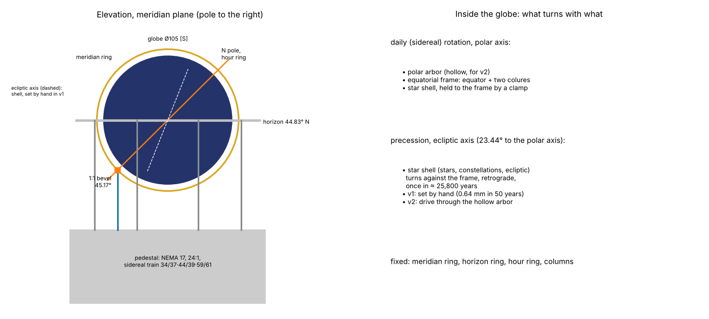

# M6 celestial globe: concept gate

Phase 2, module M6: the star globe on four columns at floor level, in front of the case. It turns
once per sidereal day and shows sidereal time on an hour circle (I16). Precession (I17) is v2:
v1 provides for it and lets it be set by hand (D5).

**Status: concept accepted** (Paul, PR #20, 7 Nov 2026: "M5 & M6 design recommendations are
approved"; the decisions are in §11). The detail design follows in its own PR, after M5's. Tags as in `docs/reference-notes.md`.

*Schematic only, not to final dimensions.*

## 1. What M6 shows

- **The sphere** [S: DA p. 24–26]:
  - "Au bas du monument est placée une sphère céleste, indiquant sur un cadran le temps sidéral."
  - It is "construite en cuivre et supportée par quatre belles colonnes en métal, est disposée
    pour la latitude de Strasbourg".
  - All the stars of the first six magnitudes, "au nombre de passé 5000", in **110**
    constellations.
  - It turns east to west in a sidereal day. The equator, the ecliptic and the colures turn with
    it. The meridian and the horizon stay fixed, so every naked-eye star's rising, setting and
    meridian passage can be seen.
  - Precession: the moving circles complete their retrograde turn in "environ 25,804 années".
- **Ungerer** [S: ELS i3]: "une sphère en cuivre de 0m,84 de diamètre, peinte en bleu", its polar
  axis "incliné de 48°35 sur l'horizon" (Strasbourg's latitude). Precession "25 806 ans … fournie
  par la constante de Bessel (50″,22)".
- **Paul's photographs** [S: IMG_0762–0764; reference-notes, *Celestial globe (M6)*]: a dark blue
  globe with gilt stars and constellation lines, on four columns. A horizon ring, a graduated
  brass meridian ring ("POLE BORÉAL", "ZENITH") and **a small hour ring at the pole**. The
  silvered rings are graduated in degrees, 0–90 on the meridian and 0–360 round.
- **In the replica: the Bordeaux sky** (D2, accepted). The polar axis is tilted at **44.83°**
  (44°50′) to the horizon, and the globe's phase is **Bordeaux local sidereal time**, Strasbourg's
  minus 33.3 min [D: D2]. That is a setting offset, not a gear change.

## 2. What is known, and what is not

| Item | Value | Tag |
|---|---|---|
| Globe | Ø 0.84 m, so **Ø 105 mm** at 1:8 | [S: ELS i3] |
| Polar axis | 44.83° to the horizon (Bordeaux) | [S: D2] |
| Train | `M6.sidereal` **34/37 × 44/39 × 59/61** from the daily arbor; 1 turn in 23 h 56 min 4.09 s; **+0.15°/century**, against a target of 0.25°/century (1 min of sidereal time) | [S: `spec/clock.yaml`; D: `docs/gear-trains.md` §8] |
| Strength | 4 mm faces; safety factor 25; clutch window 30 … 123 N·mm | [D: `docs/gear-trains.md` §8] |
| Input | the M6 stepper, 24:1 to a daily arbor (architecture §3); torque margin 153× | [D: `docs/gear-trains.md` §8] |
| Precession (v2) | `M6.year` 15/99 × 13/97 × 12/89 then two worms 1/160 × 1/161: 0.045 % fast, +0.0006°/century | [D: `docs/gear-trains.md` §8] |
| Precession over 50 years | 0.70°, which is **0.64 mm** on the Ø 105 globe | [D: 360° × 50 / 25,771.6; × π × 105 / 360] |
| Height of the globe's centre; how far it stands in front of the case | **TBD** | no source; photo |
| Size of the hour ring, horizon ring, meridian ring and columns | **TBD** | Paul's photographs IMG_0762–0764 can give them (§10) |
| Which way the meridian ring faces the room | **TBD** | photo (§10) |
| How the original is driven from the clock, and its precession gearing | **unknown** | Ungerer 1922; Bach/Rieb 1992 |
| The sidereal-time dial | a small hour ring at the north pole [S: photograph]; whether the ring or the pointer turns is **TBD** | photo (§10) |

## 3. Boundary and interfaces

As everywhere: **pass timing electrically and position mechanically** (architecture §4).

| To | What | Link |
|---|---|---|
| M0 controller | the stepper; the daily index Hall; the sidereal witness Hall (architecture §6) | one connector, one cable from the case base |
| Other modules | **none**: M6 has its own stepper and needs no shaft from any module | — |
| Case | the globe stands in front of the case at floor level; the plinth and the glazing (§9) | the works stand on the internal frame, never on the case (D12 R5) |

## 4. Proposed concept

**4.1 The module (recommended: A, §5).** The globe, its rings and columns, and the whole drive
form one module: a low pedestal under the globe holds the stepper, the 24:1 reduction and the
sidereal train.
- The NEMA 17 plugs in from below or behind on the D16 adapter (`cad/lib/motor_mount.py`).
- 24:1 (12/48 × 12/72, as M2) makes the daily arbor. The index Hall reads it.
- `M6.sidereal` (34/37 × 44/39 × 59/61) gives one turn per sidereal day. Its three external
  meshes reverse the sense, which the firmware's motor direction absorbs: M6 drives nothing else.

**4.2 From the train to the polar axis.**
- The polar axis lies in the meridian plane, tilted 44.83° to the horizon. Its lower end, at the
  south celestial pole, is below the horizon ring, inside the stand.
- A vertical shaft rises from the train, through the stand, to a **1:1 bevel pair** at the
  south-pole bearing. The shaft angle between them is **45.17°** [D: 90° − 44.83°]. Printed
  bevels at any shaft angle are as easy as at 90°.
- The polar axis carries the globe through a **friction coupling**, so the globe can be turned
  forwards to the setting sheet (architecture §7). The coupling must hold 3× the running load
  and slip below half the train's capacity: 30 … 123 N·mm (§2).
- **Witness.** A magnet on the polar arbor passes a Hall once per sidereal day (architecture §6).
  It checks the train and the coupling every day.
- **Sense.** The globe turns east to west: seen from outside, above the north pole, clockwise.
  The detail design sets the motor direction and tests it.

**4.3 Inside the globe: the frame and the star shell.**
- The polar arbor carries a light **equatorial frame**: the equator and the two colures as thin
  printed rings, fixed to the arbor. They turn with the sphere, as DA says.
- The **star shell** (Ø 105 mm, two hemispheres) turns inside them on its own **ecliptic axis**,
  inclined 23.44° to the polar axis [S: mean obliquity at J2000.0, 84381.406″ = 23°26′21.406″,
  IAU 2006 (Hilton et al. 2006), as listed in USNO *Astronomical Constants 2007*,
  https://webarchive.library.unt.edu/web/20130213204050/http:/asa.usno.navy.mil/SecK/2007/Astronomical_Constants_2007.pdf,
  retrieved 2026-11-07; it falls by 47″ per century, invisible at 1:8]. The ecliptic is painted on the
  shell, so it moves with the stars, as it should.
- **Precession in v1** (D5): the shell is held to the frame by a clamp and turned by hand about
  its ecliptic axis against a small scale. Over 50 years it moves 0.64 mm on the globe (§2), so
  setting it once at commissioning is enough.
- **Precession in v2** (§8): the polar arbor is made **hollow** now, so that a drive can later
  reach the shell through it without rebuilding the globe.

**4.4 Fixed rings and the hour circle.**
- The **meridian ring** (vertical) holds both ends of the polar axis. It is graduated 0–90° from
  the equator to each pole, and lettered "PÔLE BORÉAL" and "ZÉNITH", as on the original.
- The **horizon ring** (horizontal), set for 44.83° N, is graduated 0–360°.
- The **hour ring** (24 h) sits at the north pole, fixed to the meridian ring. A pointer on the
  polar arbor reads **Bordeaux local sidereal time** on it. 1 min of sidereal time is 0.25° of
  arc [D: 360° / 1440 min].
  - On a ring of about Ø 25 mm, 1 min is 0.05 mm, so the ring reads to about 5–10 min. The globe
    itself is the display; the ring is a check. Its size is TBD from the photograph.
- **Columns: four**, standing on the pedestal and carrying the horizon ring (§9).

**4.5 The stars** (recommended: A, §7).
- The shell is printed in two colours on the H2D, dark blue with **gilt stars and constellation
  lines inlaid** flush, as M2's lettering is (`cad/lib/lettering.py`).
- Stars from a public catalogue (the Yale Bright Star Catalogue), down to the magnitude whose dot
  can still be printed: the smallest dot is set by the 0.2 mm nozzle (≈ 0.4 mm). Brighter stars
  get larger dots. The star count follows from that limit; the detail design gives it.
- 1° on the globe's surface is 0.92 mm [D: π × 105 / 360]. Most constellations span tens of
  degrees, so their lines and the brighter stars read clearly at 1:8.
- Constellation figures: lines only. The original's 110 constellations include old ones that are
  no longer used; which set to draw is a detail-design question for Paul.

## 5. Decision 1: where the drive lives

| Option | How | For | Against |
|---|---|---|---|
| **A. In a pedestal under the globe** (4.1) | Stepper, 24:1 and sidereal train in a low base between or under the four columns; a short shaft up to the south pole | Self-contained: the globe and its drive come out as one module, with one cable. The drive line is short (≈ 100 mm [E]), so its play is small. | The pedestal is visible, so it must look like a stand (painted as metal, as the columns). A NEMA 17 is ≈ 42 mm square and 48 mm long: the pedestal is at least ≈ 60 mm tall [E]. |
| B. In the case base, with a shaft forward | The train in a cassette inside the case base; a horizontal shaft out through the plinth to the globe | The stand can be slender; the motor is hidden in the case | A long shaft from the case, and a second bevel. The globe cannot come out without parting the shaft. It ties M6 to the case design. |

**Recommendation: A.**

## 6. Decision 2: which way the meridian faces

| Option | For | Against |
|---|---|---|
| **A. Meridian ring parallel to the facade** | The globe is seen square-on from the room, with the pole to one side, as on the original | The horizon ring's "N" points along the wall, not to true north (unless the wall happens to run north–south) |
| B. Turned to true north in Paul's room | The horizon's compass points match the room, so "the sky above the house" (D2) is literal | The axis may point into or out of the wall. Needs the wall's bearing. A deeper base. |

**Recommendation: A**, with the cardinal points lettered as on the original. The rising and
setting times it shows are right either way: they depend on latitude and sidereal time, not on
the ring's direction in the room.

## 7. Decision 3: how the stars are made

| Option | For | Against |
|---|---|---|
| **A. Two-colour print, gilt inlay** (4.5) | No painting of thousands of dots; the result is exact and repeatable; the method is proven on M2's ring | The smallest dot sets the faintest star. The two hemispheres meet at a seam (along the ecliptic or the equator). |
| B. Printed blank shell, stars painted or transferred (waterslide decals) | Very fine dots possible; any finish | Hand work; decals on a sphere wrinkle unless cut in gores |
| C. Pin-holes lit from inside | Striking | Not the original; light, wiring and heat in the globe |

**Recommendation: A.**

## 8. Decision 4: what v1 provides for precession

| Option | How | For | Against |
|---|---|---|---|
| **A. Shell on an ecliptic axis inside an equatorial frame; hollow polar arbor** (4.3) | The equator and colures are rings on the frame; the star shell turns inside them; set by hand in v1 | Right in principle: the equator and colures move against the stars, as DA says. v2 adds a drive through the hollow arbor without rebuilding the globe. | A frame, a second axis and a clamp inside a Ø 105 mm globe. |
| B. Everything painted on one shell | The simplest globe | Precession can never be shown; the painted equator would be 0.7° wrong after 50 years (0.64 mm, invisible). v2 would need a new globe. |

**Recommendation: A.** It is also what D5 asked for ("provisioned in v1").

**A note for v2, found at this gate.** The accepted precession train (`M6.year` and the two
worms) makes one turn in 25,760 years in the **fixed** frame. The shell must turn relative to
the **rotating** frame. So v2 needs one of:
- a differential that adds the precession to the sidereal rotation, fed into the hollow arbor; or
- a train that rides on the frame and takes its motion from the frame's own turn against a fixed
  wheel. Its input is then one turn per sidereal day, not per mean day. The accepted year train
  on that input would run 0.27 % fast [D: 366.2422 / 365.2422 − 1], within the "1 % is
  invisible" note but outside the 0.05 % target (`docs/gear-trains.md` §3). The ratio would be
  re-searched.
Both fit inside the v1 provision. Nothing needs deciding before v2.

## 9. Decision 5: columns, rings and glazing

- **Columns and rings.** CLAUDE.md asks for metal to be hidden where possible; the computus is
  the one visible exception. DA's columns are "en métal" and the rings brass.
  - **Recommended:** print the columns and rings and paint them as brass and silver, with a
    hidden steel rod inside each column for stiffness.
  - The alternative is real brass tube for the columns: a second visible-metal exception, which
    only Paul can grant.
- **Glazing.** The globe stands in front of the case, outside the main glazing.
  - **Recommended:** its own small glazed vitrine or acrylic dome on the plinth, removable, so
    the globe module lifts out after it.
  - The alternative is to bring the case's plinth and glazing forward around it. That is a case
    decision; the dimensions come from this module (≈ Ø 150 mm round the horizon ring [E]).
- **Height and projection** (TBD, §2): from Paul's photographs. Until then, parameters.

## 10. What Paul could provide

- **IMG_0762–0764**, or crops of the globe from them. With the globe's 0.84 m [S] as the scale,
  they give the rings' and columns' sizes, the hour ring, the globe's height and how far it
  stands in front of the case, and which way the meridian faces.

## 11. Decisions (accepted as recommended, Paul, PR #20, 7 Nov 2026)

1. **Drive: A, a pedestal under the globe** holding the stepper and the sidereal train (§5).
2. **Meridian: A, parallel to the facade** (§6).
3. **Stars: A, two-colour print with gilt inlay**; the magnitude limit from the smallest
   printable dot (§7). Which constellation set to draw is still open: proposed in the detail PR.
4. **Precession provision: A**, an equatorial frame with a star shell on its ecliptic axis and a
   hollow polar arbor; set by hand in v1 (§8).
5. **Columns and rings printed and painted as metal**, and **the globe under its own small
   vitrine** (§9).
6. **The photographs** in §10.

No interface change is needed: M6 shares no shaft with any module.

## 12. After the gate: the detail design

- **CAD:** `cad/modules/m6_globe/`: the pedestal with the motor adapter, the 24:1 and the
  sidereal train; the vertical shaft and the 45.17° bevel; the polar arbor and its friction
  coupling; the equatorial frame and the star shell; the meridian, horizon and hour rings; the
  columns.
- **Checks:** the train's ratio error (+0.15°/century) and the globe's sense; every mesh engaged;
  the bevel at 45.17°; the shell's clearance inside the frame and rings at every angle; the
  coupling's window; endshake; motor access (D16); bed fit and print poses.
- **Files:** print files (two-colour 3MF for the shell), SketchUp files with an exploded view,
  BOM rows, and the star map's source and magnitude limit recorded in the doc.

## 13. BOM impact (to be added as rows in the detail PR)

| Item | Qty [E] | Note |
|---|---|---|
| NEMA 17, TMC2209, D16 mount set | 1 | already counted in Batch 2 (M6 is listed) |
| Ø5 ground rod | ≈ 0.4 m | daily arbor, train arbors, vertical shaft, polar arbor |
| Brass tube OD 6 or 7 | ≈ 80 mm | the hollow polar arbor (§8) |
| Bearings MR85ZZ | ≈ 10 | the train and the shafts |
| Steel rod Ø3 | 4 × ≈ 80 mm | hidden inside the four columns (§9) |
| Wave washer | 1 | the globe's friction coupling |
| Hall switches + magnets | 2 + 2 | index and sidereal witness; within Batch 2's 20 + 30 |
| Vitrine or acrylic dome | 1 | ≈ Ø 150 mm [E]; size from the CAD |
| Connector | 1 | already counted |

The shell's two colours (blue and gold PLA) are already in use for M2.
