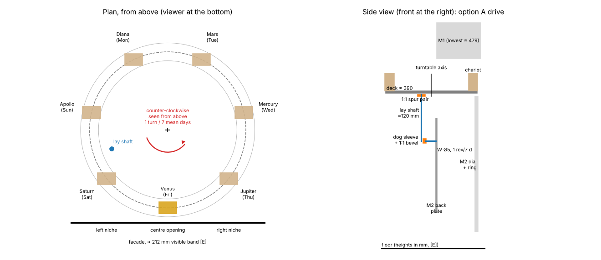
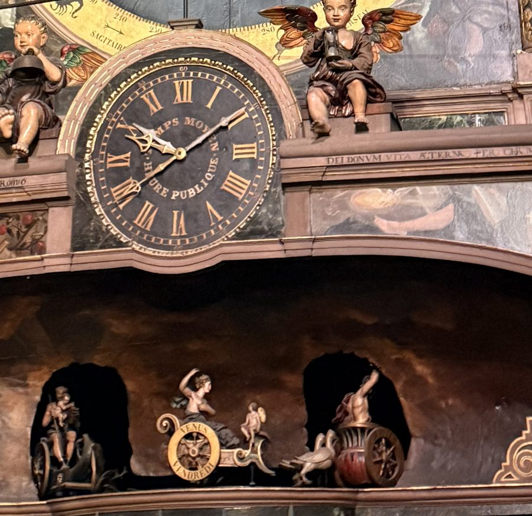
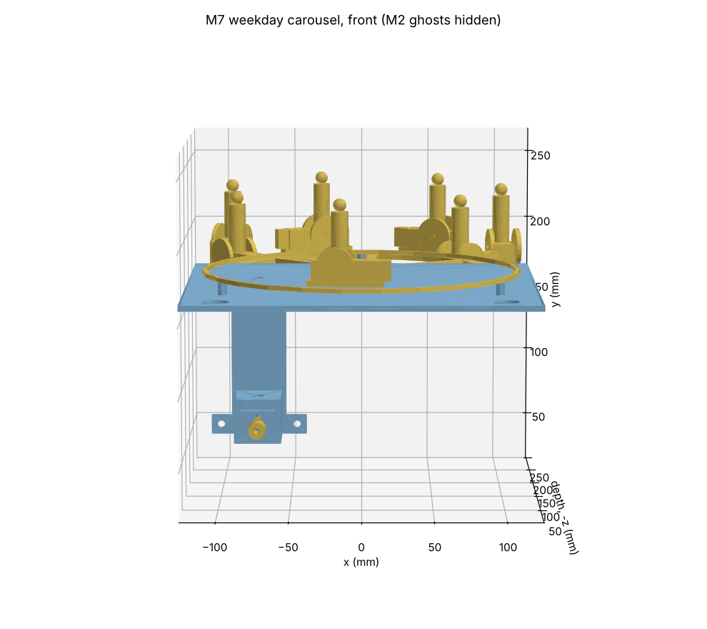
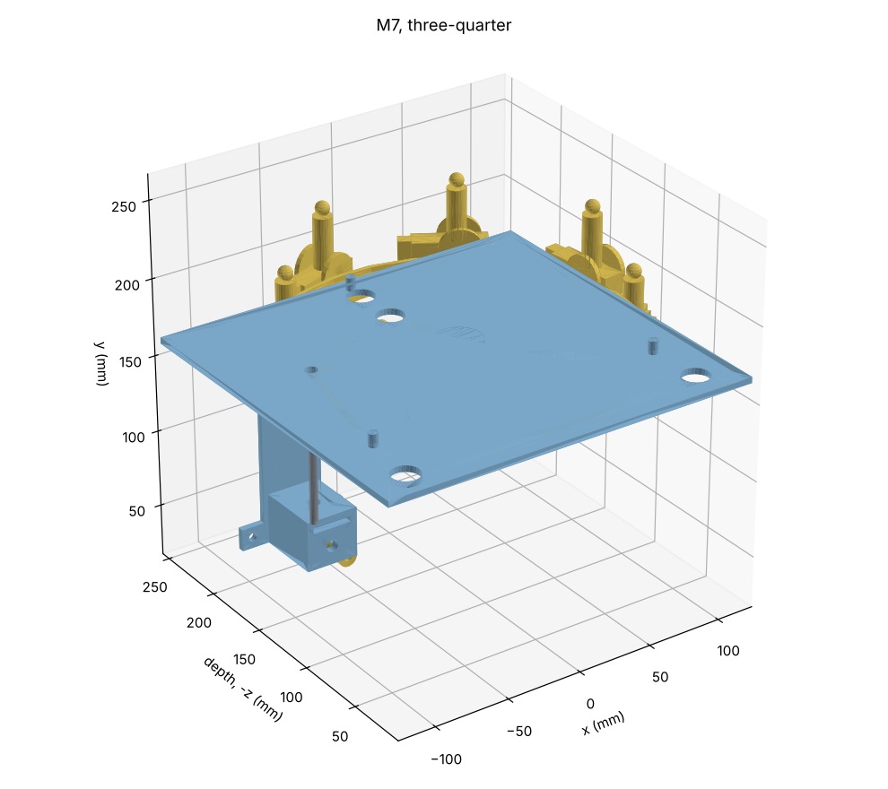
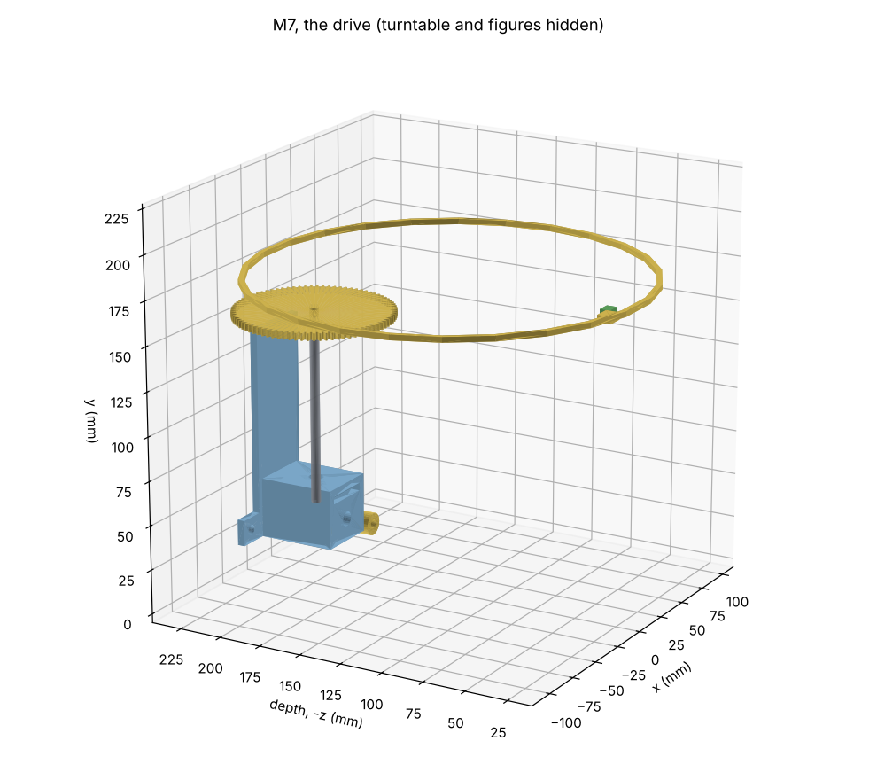
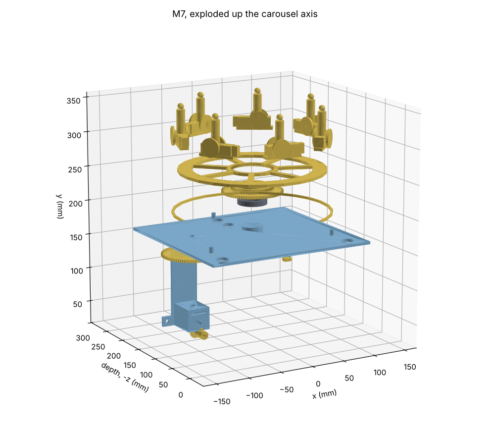

# M7 weekday carousel: concept gate and detail design

Phase 2, module M7: the seven chariots of the days of the week, which turn on a circular rail
under the lion gallery, above the main dial. M7 has no stepper. It takes M2's weekday arbor W,
which turns once in 7 days, and carries that motion up to the carousel.

**Status: detail design for review (§13).** The concept was accepted (Paul, PR #20, 7–8 Nov 2026;
the decisions are in §9, the photograph's measurements in §12). Tags as in
`docs/reference-notes.md`.

*Schematic only, not to final dimensions. Heights are from `docs/envelope.md` §2 [E].*

## 1. What M7 shows

- **Seven deities on chariots, one per day** [S: CLEA; mechanism-inventory I11]: Apollo (Sunday),
  Diana (Monday), Mars, Mercury, Jupiter, Venus, Saturn (Saturday).
- **Original** [S: DA p. 46–48]: each chariot is drawn by the deity's animals, and its wheels
  carry the deity's and the day's names. The chariots "roulent sur un chemin de fer circulaire, en
  suivant un mouvement continu" (run on a circular rail, in continuous motion).
- **What Paul saw on Friday 30 Oct 2026, 10:08–10:10 CET** [S: IMG_0766; reference-notes,
  *Weekday chariots (M7)*]:
  - Venus's chariot, lettered "VENUS" and "VENDREDI", with Cupid, is in the centre opening below
    the gallery.
  - Saturn's chariot (with a child) is in the left niche, Jupiter's (drawn by an eagle) in the
    right.
  - The wheels face the viewer, so the chariots cross the opening parallel to the facade. **The
    carousel turns about a vertical axis.** This settled the open point in `docs/m2-design.md` §3
    item 2.
- **Which way it turns** [D]. Saturday's chariot waits in the left niche on Friday, so the
  chariots cross the front from the viewer's left to the right. Seen from above, the carousel
  turns **counter-clockwise**.
  - Proof: put the axis at the origin, x to the viewer's right, y into the case. The front chariot
    is at (0, −R) and moves at +v along x. Its angular velocity is x·v_y − y·v_x = R·v > 0, which
    is counter-clockwise seen from above.
- **When each chariot is centred.** "Le carrousel tourne de façon continue et laisse apparaître
  devant, à midi, le char de la planète du jour courant" [Sn: source not identified;
  reference-notes, *Automata*]. Paul's photograph agrees: at 10:08 CET Venus was in the centre
  opening, about 2 h before mean noon.

## 2. What is known, and what is not

| Item | Value | Tag |
|---|---|---|
| Rate | 1 turn per 7 mean days, continuous | [S: DA p. 47]; ratio made in M2 (`M2.weekday` 12/84, exact) |
| Height of the chariots | ≈ 453 mm above the floor at 1:8 | [E: envelope §2, plate ±(3 % + 15 mm)] |
| Visible band | ≈ 1.70 m wide, so **≈ 212 mm at 1:8** | [E: envelope §3, plate 145 px ÷ 85.5 px/m] |
| Free height for the chariots | from the calendar ring's top, 383.5 mm [D: 213 + 170.5], to M1's lowest part, ≈ 479 mm [D: 567 − 88; M1's noon wheels hang to y −88 below its dial centre, `docs/m1-design.md` §9.2]: **≈ 95 mm** | [D], on [E] heights |
| Arbor W | Ø5, 1 rev per 7 days, at x −75.5, y +57.9 from the dial centre, standing out of M2's back plate at z −114 … −139 (dial face = 0). Keyed single-dog coupling | [S: `docs/m2-design.md` §2–§3; architecture §4] |
| Height of W | **≈ 271 mm** above the floor | [D: 213 + 57.9, on the [E] dial height] |
| Sense of W | **counter-clockwise seen from the front** | [D: `docs/m2-design.md` §2. The Sun tube turns clockwise; the 48/48 reverses, so the S sleeve turns counter-clockwise; the Sun differential with its carrier still reverses, so S turns clockwise; 12/84 reverses again, so W turns counter-clockwise] |
| Number of chariots in view | three: centre opening and two niches | [S: IMG_0766] |
| Size of the chariots and deities | **TBD.** Not in any source read so far. | Paul's photograph IMG_0766 can give it (§8) |
| Carousel radius | **TBD; ≈ 100–110 mm [E]** | [E: see below] |
| How the original supports and drives the chariots | **unknown**: DA gives only the rail and the continuous motion | Ungerer 1922; Bach/Rieb 1992 |

**Carousel radius [E].** If the niche chariots stand one place either side of the centre, their
centres are 51.4° round from it, at R · sin 51.4° = 0.782 R to each side [D]. The band of 212 mm
then holds 2 × 0.782 R plus one chariot's length L:

| Chariot length L (assumed) | R that fills the 212 mm band |
|---|---|
| 40 mm | 110 mm |
| 50 mm | 104 mm |
| 60 mm | 97 mm |

[D: R = (106 − L/2) / sin 51.43°.] So R ≈ 100–110 mm. The uncertainty is that of the plate
(±3 % + 15 mm) and of L, which a photograph will fix. At R = 105 mm:

- the chariots are 91 mm apart, centre to centre [D: 2R sin(180°/7)];
- the front chariot moves 94 mm a day, **3.9 mm an hour** [D: 2πR/7]: continuous, as DA says, but
  too slow to see.

## 3. Boundary and interfaces

As everywhere: **pass timing electrically and position mechanically** (architecture §4).

| To | What | Link |
|---|---|---|
| M2 | the drive: arbor W, 1 rev per 7 days | keyed single-dog coupling at W's end (architecture §4). M7 adds no ratio (rule 2: the 7:1 is made by gears in M2) |
| M0 controller | one Hall witness, "Sunday noon" (architecture §6) | one connector |
| Case | the centre opening and the two niches, the gallery's cornice above, the facade in front | the works stand on the internal frame, never on the case (D12 R5) |
| M1, E1 | none. M7 must stay below M1's lowest part (≈ 479 mm, §2), unless the two are offset in depth | — |

**No interface change is needed.** W stays as M2 built it.

## 4. Proposed concept

**4.1 The carousel.**
- A printed turntable (a spider, Ø ≈ 2R + 25 mm) turns on one bearing on a fixed post at the
  centre of the band, on the case centreline.
- Seven chariots stand on its rim, 51.4° apart. Each deity and its animals are one parametric
  figure group, printed as visible parts (CLAUDE.md: figures may be printed).
- A circular rail under the chariots, fixed to the deck, gives the look of DA's "chemin de fer
  circulaire" (§6 has the alternative, where the wheels really roll).
- Only the front third is in view, through the three openings in the facade. The rest turns
  behind the gallery.

**4.2 The drive (recommended: A, §5).**
- M7's input is a short Ø5 stub in its own bearing bracket, in line with W. A sliding
  single-dog sleeve joins it to W.
- A 1:1 bevel pair at the stub turns the motion upward into a vertical Ø5 lay shaft at
  x ≈ −75.5 mm.
- The lay shaft rises about 120 mm, from W's height (≈ 271 mm) to just under the deck
  (≈ 390 mm, above the calendar ring's 383.5 mm) [D: on [E] heights].
- Under the deck a 1:1 spur pair takes the motion across to the turntable's hub. Two equal
  wheels of about 40 teeth at module 1.0 span the ≈ 80 mm between the lay shaft and the
  turntable's axis [E: the axis at x 0, about 25 mm in front of W; the detail design fixes it].
- **Overall ratio 1:1 exactly**, so M7 adds no ratio error. `M2.weekday` is exact, so the carousel
  is exact: **error 0**.
- **Sense.** W turns counter-clockwise seen from the front (§2), and the carousel must turn
  counter-clockwise seen from above (§1). The bevel's hand (which side of the stub the upright
  wheel sits) sets the sense of the lay shaft, and the spur pair reverses it once. The detail
  design picks the bevel side so the result is counter-clockwise, and a test checks it.

**4.3 Loads [E].**
- The rotating parts weigh about 0.3–0.5 kg [E: a printed spider and seven figure groups at
  20–40 g each, ±50 %].
- On a ball bearing that is a friction torque well under 1 N·mm [E: μ ≈ 0.002 × 5 N × 10 mm
  radius ≈ 0.1 N·mm], against the 10 N·mm running load and the 30–201 N·mm clutch window already
  allowed for `M2.weekday` (`docs/gear-trains.md` §8). The bevel and spur pair add their mesh
  losses (0.9 each [E]).
- The real load is the tipping moment of an unbalanced ring of figures on a single central
  bearing. A thin-section bearing (61806, 30 × 42 × 7) or three small rollers under the rim
  (§6) carries it. The detail design sizes it from the CAD masses.

**4.4 Phase, setting and sensing.**
- **Phase.** Each chariot is centred at **Bordeaux mean noon** (13:02 CET), §9 item 4.
- **Setting** (architecture §7: "dog clutch at the drive"). The turntable sits on its hub through
  an indexed dog clutch, lifted to free it, turned, and dropped back. With 84 dog teeth one tooth
  is 2 h of carousel motion [D: 7 × 24 h / 84], ample for a display that moves 3.9 mm an hour.
- **The single-dog sleeve at W keeps the phase** when M7 comes out and goes back (P4).
- **Witness.** A magnet under Apollo's chariot passes a Hall on the deck at Sunday mean noon
  (architecture §6). The controller logs the time of each pass, once a week.

**4.5 Removal.**
- M7 is one cassette: the input bracket, the lay shaft, the deck with its turntable, and the
  chariots.
- To remove it, slide the dog sleeve back off W, then lift M7 out. Whether it comes out forward
  (through a removable panel above the main dial) or from behind depends on the case design.
  The detail design records the move and checks it in the model.

## 5. Decision 1: how the drive reaches the carousel

All three keep the ratio at 1:1, so the choice does not change any ratio.

| Option | How | For | Against |
|---|---|---|---|
| **A. Lay shaft** (4.2) | Bevel at W, vertical shaft at x −75.5 up to the deck, 1:1 spur pair under the deck to the turntable | The turntable keeps its own fixed post and bearing, free of the drive. Its axis can sit at any depth. Only one bracket behind M2, small. | The lay shaft stands inside the turntable's circle (≈ 78 mm from its axis), so it must end under the deck. Two meshes after the bevel. |
| B. Central spindle | 1:1 spur pair behind M2 from x −75.5 to x 0, then a bevel up into a vertical spindle that is the carousel's own axis | The spindle is the turntable's axle; one drive line on the centreline | The turntable's axis is then tied to W's depth (z ≈ −150). The spur pair and bevel sit in the crowded space behind M2's back plate. A long spindle (≈ 200 mm) needs bearings at both ends. |
| C. Timing belt in the wall's plane | A 1:1 GT2 belt from a pulley on W's stub up to a horizontal shaft at the deck, then a bevel to the turntable | No long rigid shaft; a belt tolerates small misalignment | A belt is a new kind of part in the works, and one more purchase. It needs a tensioner, and its slack adds a little play to the phase. A timing belt cannot slip a tooth while tensioned, so it does not lose phase. |

**Recommendation: A.** It keeps the carousel's position free of M2's geometry, it puts only one
small bracket behind M2, and it uses only printed gears and Ø5 rod.

## 6. Decision 2: how the chariots ride

| Option | How | For | Against |
|---|---|---|---|
| **A. Fixed to a turntable, rail decorative** (4.1) | Each chariot is fixed to the spider's rim; a printed rail lies under its wheels without carrying it | Simplest and stiffest. Nothing can derail. | The wheels do not turn. At 3.9 mm an hour nobody can see that they do not. |
| B. Rolling on a real rail, pushed by spider arms | Each chariot runs on its own wheels on a circular rail; a spider arm pushes it | Faithful to DA's "roulent sur un chemin de fer". The rail carries the weight, so the central bearing carries no tipping moment. | Seven rolling chariots, each with axles and a loose coupling to its arm. More friction and more ways to stick, for a motion nobody can see. |

**Recommendation: A**, with the rail modelled so the wheels sit on it. If the central bearing's
tipping moment proves awkward, three hidden rollers under the spider's rim on the same rail do
the carrying, which gets most of B's benefit.

## 7. Decision 3: size and phase

**Size.**
- **Recommended: the faithful size**, R ≈ 105 mm, about **235 mm deep** in all
  [D: 2R + 25 mm for the chariots' width]. That is about the same as E2's turntable (243 mm,
  `docs/e2-design.md` §2), which Paul accepted subject to the case depth.
- The alternative is a smaller ring with the niche chariots partly hidden, if the case cannot
  give the depth. The radius is a parameter.

**Phase.**
- W is driven from M2's mean-time arbor S, so M7 runs on **Strasbourg mean time**, like the
  calendar ring.
- **Recommended: each chariot centred at mean noon** (12:29 CET, 13:29 CEST). The day's chariot
  then holds the centre all day and the change happens behind the facade near midnight, as the
  unconfirmed description says (§1). Paul's 10:08 CET photograph fits this.
- Any other phase is the same mechanism with a different setting. Centring on legal noon
  (12:00) is not possible all year: W follows mean time, so it would be 1 h out in summer.

## 8. What Paul could provide

- **A crop of IMG_0766 around the chariot opening**, and any other photograph of it. With the
  M1 dial's bezel as the scale (0.98 m, `docs/m1-design.md` §2), it gives the chariots' length
  and height, the opening's width and the niches' positions. That fixes R and the figure size.
- If a photograph shows the rail or the underside, it would answer §6.

## 9. Decisions (Paul, PR #20, 7 Nov 2026: "M7 design recommendations approved")

1. **Drive: A, the lay shaft** (bevel at W, vertical shaft, 1:1 spur pair to the turntable), §5.
2. **Chariots: A, fixed to the turntable on a decorative rail**, §6.
3. **Size: the faithful size**, a parameter, to be checked against the case depth, §7. Measured
   from Paul's photograph (§12): **R ≈ 100 mm, about 225 mm deep** [E ±15 %].
4. **Phase: each chariot centred at Bordeaux mean noon**, 13:02 CET (14:02 CEST) (Paul: "we are
   basing the localtime on Bordeaux, not Strasbourg").
   - Paul then chose Bordeaux mean time for the whole clock, "the sky over this house"
     (decision D-next (M5–M7), `docs/decisions.md`, 8 Nov 2026). W follows M2's mean-time arbor,
     so the carousel is centred at mean noon with **no setting offset**.
   - (Before that decision it would have needed a 33.3 min offset, 1.2° of the carousel, on a
     Strasbourg-time M2.)
5. **The photographs**: Paul committed IMG_0762–0764 and IMG_0766 to `docs/img/photos/`
   (8 Nov 2026). §12 gives what they settle.

No interface change is asked of M2.

## 10. After the gate: the detail design

- **CAD:** `cad/modules/m7_weekdays/`: the input bracket and dog sleeve, the bevel pair, the lay
  shaft, the deck, the spur pair, the turntable with its dog clutch, the rail, seven parametric
  chariot-and-deity groups (placeholders until the photograph sizes them), and the witness.
- **Checks:** the ratio (exact) and sense (counter-clockwise from above); every mesh engaged;
  interference with M2's back plate and M1's lowest parts; the keyed sleeve's single position;
  the setting clutch; endshake; bed fit and print poses.
- **Files:** print files, SketchUp files with an exploded view, BOM rows, a `spec/clock.yaml`
  note on the 1:1 link.

## 11. BOM impact (to be added as rows in the detail PR)

| Item | Qty [E] | Note |
|---|---|---|
| Stepper, driver | **0** | M7 is driven by M2 |
| Ø5 ground rod | ≈ 0.25 m | input stub, lay shaft, turntable post (D4) |
| Bearings MR85ZZ (5 × 8 × 2.5) | 4–6 | input stub, lay shaft, spur arbor |
| Thin-section bearing 61806 (30 × 42 × 7), or three small rollers | 1 | turntable (§4.3) |
| Hall switch + magnet | 1 + 1 | Sunday witness; within Batch 2's 20 + 30 |
| Connector | 1 | already counted in Batch 2 (M7 is listed) |
| Screws, heat-set inserts | small | from the Batch 1 assortments |

Everything else is printed: the bevel and spur pairs, the brackets, the deck, the turntable and
the figures.

## 12. Measured from Paul's photograph (8 Nov 2026)

*IMG_0766 (Paul, 30 Oct 2026, 10:08 CET), crop. Venus's chariot ("VENUS", "VENDREDI") in the
centre, Saturn's in the left niche, Jupiter's (with its eagle) in the right.*

**What it shows.**
- A wide, dark cavity under the gallery's cornice. Its back wall has **two arched niches**. The
  day's chariot stands in the open **between** them, nearest the viewer. The chariots either side
  pass behind the wall and show through the niches. That is what a turntable whose front arc
  comes forward of the wall gives, and it confirms the vertical axis (§1).
- Each chariot is a two-wheeled car with large spoked wheels facing the viewer, a deity seated or
  standing, and its animal or attendant in front (Venus: Cupid and doves).
- The day's chariot faces right, the way it is going (§1: left to right across the front).

**Scale.** The mean-time dial above, in the same plane as the facade: its pearled minute ring is
≈ 0.83 m and its bezel ≈ 0.98 m (`docs/reference-notes.md`, *Mean-time dial*). On the crop
they measure ≈ 505 and ≈ 635 px, so **≈ 620 px per metre** [E ±15 %, the reference sizes' own
uncertainty].

| Item | Photo | Original | 1:8 | Tag |
|---|---|---|---|---|
| Venus's chariot, length (scroll to shaft) | ≈ 310 px | ≈ 0.50 m | **≈ 62 mm** | [E ±15 %] |
| Its wheel | ≈ 136 px | ≈ 0.22 m | ≈ 27 mm | [E ±15 %] |
| Chariot and figure, height | ≈ 297 px | ≈ 0.48 m | **≈ 60 mm** | [E ±15 %] |
| Niche chariots' centres from the middle | ≈ ±380 px | ≈ 0.61 m | ≈ 77 mm | [E ±15 %] |
| Niches, width × height | ≈ 260 × 340 px | ≈ 0.42 × 0.55 m | ≈ 52 × 69 mm | [E ±15 %] |
| Cavity height, arch to floor | ≈ 585 px | ≈ 0.94 m | ≈ 118 mm | [E ±15 %] |
| Chariots' floor below the mean-time dial's centre | ≈ 880 px | ≈ 1.42 m | ≈ 177 mm, so **≈ 390 mm above the floor** | [E ±15 %, on M1's 567 mm [E]] |

**What follows.**
- **Radius.** The niche chariots are one place (51.4°) round, so 0.782 R ≈ 77 mm and R ≈ 98 mm
  [D]. They stand further back than the facade, so they look a little small; **R ≈ 100 mm**
  [E ±15 %]. The band check in §2 with L = 62 mm gives 96 mm [D: (106 − 31) / 0.782]. They agree.
- **Depth** ≈ 2R + 25 mm ≈ **225 mm** [D], a little less than §7's 235 mm.
- **Deck height.** The chariots' floor at ≈ 390 mm is where §4.2 put the deck, just above the
  calendar ring's top (383.5 mm). The figures, ≈ 60 mm tall, reach ≈ 450 mm, under M1's lowest
  part (≈ 479 mm, §2).
- **Figures.** Seven parametric groups, ≈ 62 mm long and ≈ 60 mm tall. Their likenesses are a
  detail-design question; IMG_0766 shows Venus, Saturn and Jupiter. The other four need a
  photograph on another day, or the books.

## 13. Detail design

`cad/modules/m7_weekdays/mechanism.py`, with `cad/lib/bevel.py` (new, additive) for the bevel pair.
Tests: `cad/tests/test_m7.py`, `cad/tests/test_bevel.py`. Coordinates are M2's: origin at the main
dial's centre on its face, +X right, +Y up, +Z towards the viewer; the dial's centre is ≈ 213 mm
above the floor [E].

 

 

*The model at the moment of Paul's photograph: Friday 30 Oct 2026, 10:08 CET, which is 09:06
Bordeaux mean time, 2.9 h before mean noon. Venus's chariot is 6.2° short of the front, so it sits
just left of centre and reaches the centre at 13:02 CET. The figures are placeholders.*

### 13.1 The drive, from W to the turntable

| Part | Where (mm) | What |
|---|---|---|
| Dog hub on W | W's last 8 mm, z −139 … −131, at (−75.5, 57.9) | pressed on M2's arbor W; one dog. It is supplied with M7, so M2 needs no change |
| Dog sleeve | z −146.6 … −139.6, on the stub | one slot for the dog. Slide it back to free M7; push it on to key it. **One position only**, so M7 comes out and goes back without losing the day (P4) |
| Stub, Ø5 × 49 mm | z −189 … −140, in two MR85ZZ in the bracket's walls | carries bevel A |
| Bevel A, 20 teeth, module 1.0 | large end z −156, apex z −166 on W's axis | straight bevel, 45° pitch cone, 4.5 mm face |
| Bevel B, 20 teeth | on the vertical lay shaft, large end Y 67.9, apex at W's height | 1:1 with A, shafts at 90° |
| Lay shaft, Ø5 × 109 mm | at (X −75.5, Z −166), Y 64 … 173 | MR85ZZ in the bracket's bridge (Y 74–78) and in the deck (Y 161–165) |
| Lay gear 85 | Y 167 … 171, above the deck | 1:1 to the turntable hub's 85 |
| Turntable hub | axis at (X 0, Z −127.0), Y 167 … 179 | the 85-tooth wheel, a Ø60 seat, the 84-tooth spline and the seat of a 61806 bearing, in one print. It turns on the 61806 on a Ø30 post that stands on the deck |
| Turntable (spider) | Y 173 … 177, Ø210 | seven spokes and a rim, R 85–105; its centre is an internal 84-tooth spline that drops over the hub's |

- **Positions.** The spur pair fixes the turntable's axis: 85 mm from the lay shaft [D: m 1.0,
  (85 + 85)/2], on the centreline, so Z = −166 + √(85² − 75.5²) = −127.0 [D]. Then:
  - the front chariot's centre is at Z −27;
  - the front of the chariots is at Z ≈ −15, behind M2's calendar ring and its carrier
    (z −11 … 0).
- **Ratio.** 20/20 × 85/85 = 1. With `M2.weekday` 12/84 the carousel turns once in 7 mean days
  exactly: **ratio error 0** (the test checks it).
- **Sense** [D, `senses()` in the model; tested]:
  - The hands turn clockwise, so W turns counter-clockwise seen from the front (+1 about +Z), §2.
  - Bevel B's body is above the apex and A's in front of it. At the pitch point the two surface
    speeds match only if the lay shaft turns −1 about +Y.
  - The spur pair reverses that, so **the carousel turns +1 about +Y: counter-clockwise from
    above**, as the photograph requires (§1).
- **The bevel generator** (`cad/lib/bevel.py`). Straight bevels by Tredgold's back-cone method: the
  large end has the tooth of a 28-tooth spur gear (20 / cos 45°), and every point runs straight to
  the apex.
  - The library test runs a 1:1 pair through three positions with no interference.
  - Turning one gear 1.5° either way makes them clash, so the pair is engaged with its 0.15 mm
    backlash.

### 13.2 The frame and the turntable

- **The bracket** (PETG): two walls carrying the stub's bearings, a bridge carrying the lay
  shaft's lower bearing, and side cheeks clear of bevel B. A spine (z −193 … −189) rises from it
  to the deck. Two tabs take 2 × M5 to the works' internal frame (D12 R5), as on M1 and M2.
- **The deck** (PETG, 250 × 235 × 4 mm, Y 161–165) carries:
  - the turntable's Ø30 post;
  - the lay shaft's upper bearing;
  - three posts under the rail, behind the visible arc;
  - the Hall's post.
  Its front edge is at Z −15. It sits on the spine.
- **The rail** (decorative) is a 3 mm ring at R 112, 0.5 mm below the chariots' outer wheels.
- **Setting** (§4.4): lift the turntable off the hub's spline, turn it, and drop it back. The 84
  teeth are 84 positions, 2 h of carousel each.
- **The witness**: a 5 × 2 magnet in the turntable under Apollo's chariot. It passes a DRV5032 on
  a post at the front, 1 mm below, once a week at Sunday's Bordeaux mean noon.

### 13.3 Checks (`python -m cad.modules.m7_weekdays.mechanism`, `pytest cad/tests/test_m7.py`)

| Check | Result |
|---|---|
| Interference, every pair (M2's arbor W, back plate and calendar ring included as reference shapes) | **none** |
| Bed fit, single and dual nozzle | every printed part fits; the largest are the deck (250 × 235) and the rail (Ø227) |
| Ratio | 1:1 in M7; one turn in 7 days exactly |
| Sense | counter-clockwise from above |
| Meshes engaged | bevel pair (±1.5°), spur pair (0.4 mm towards each other clashes) |
| Phase | at its mean noon the day's chariot is at the front; tomorrow's is on the left, yesterday's on the right |
| Clearances | deck behind z −13; figures' tops at ≈ 450 mm above the floor, under M1's lowest part (≈ 479 mm); the drive behind W's end |
| Envelope | X −125 … +125 (the deck), Y 46 … 237, Z −250 … −15 in M7's own parts |

### 13.4 Print and SketchUp files

- `export/print/m7_weekdays/`: 12 distinct STLs for 18 prints, with a manifest README. The seven
  chariots are one placeholder printed seven times until the figures are modelled.
  - Every part is posed flat, with little or no overhang.
  - The bracket's 600 mm² and the turntable hub's 579 mm² are bridges over bearing seats; the
    hub's 1 mm cap over its 61806 also holds the bearing in.
  - The deck and the bracket are PETG (structural); the rest is PLA.
- `export/sketchup/m7_weekdays.dae` and `m7_weekdays_exploded.dae` (apart up the carousel's axis).

### 13.5 Open items

1. **The figures.** Seven placeholder groups (≈ 62 mm long, ≈ 60 mm tall). The photograph shows
   Venus, Saturn and Jupiter. The other four need photographs taken on other days, or the books.
   They will be modelled as separate figure prints on the same pads.
2. **The case.** M7 needs about 235 mm of depth behind the facade (Z −15 to −250) and the cavity
   with its two niches (§12). Removal is upward and forward once the sleeve is slid back; the
   panel that allows it belongs to the case design.
3. **Fits** wait for the tolerance coupons: the stub's flat and the sleeve, the spline, and the
   bearing seats.
4. **M2's model reports the wrong sense for W.** `cad/modules/m2_main_dial/mechanism.py` sets
   `sense["W"] = -sense["I"]`, but its geometry meshes W from S (12/84), which gives W = −S = +I.
   M2's geometry and its document (§3 item 2) are right; only that line of its report is
   inverted. It is M2's file, so it is not edited here.
