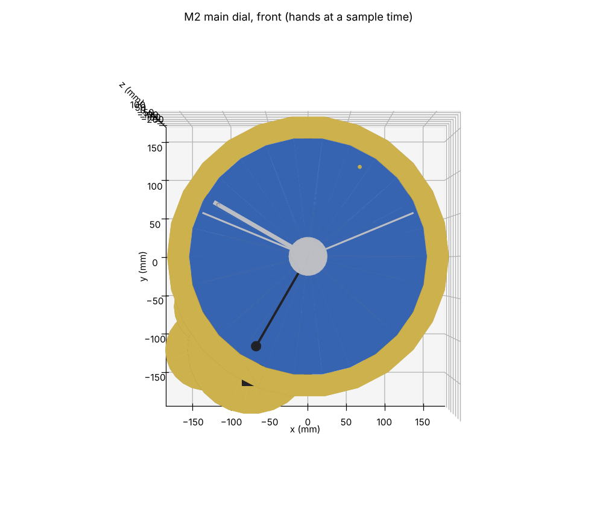
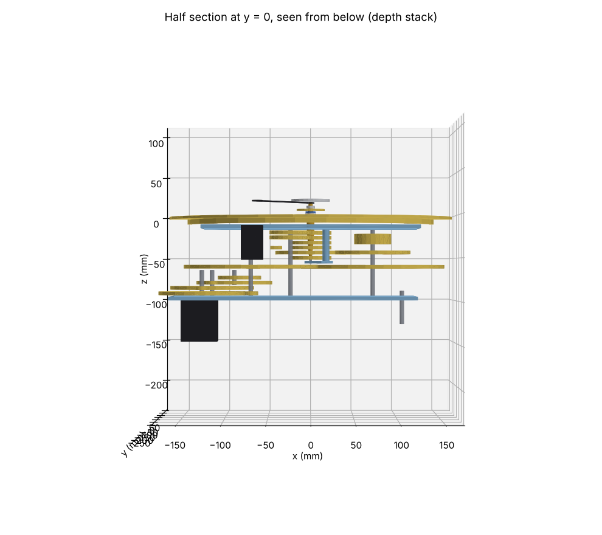
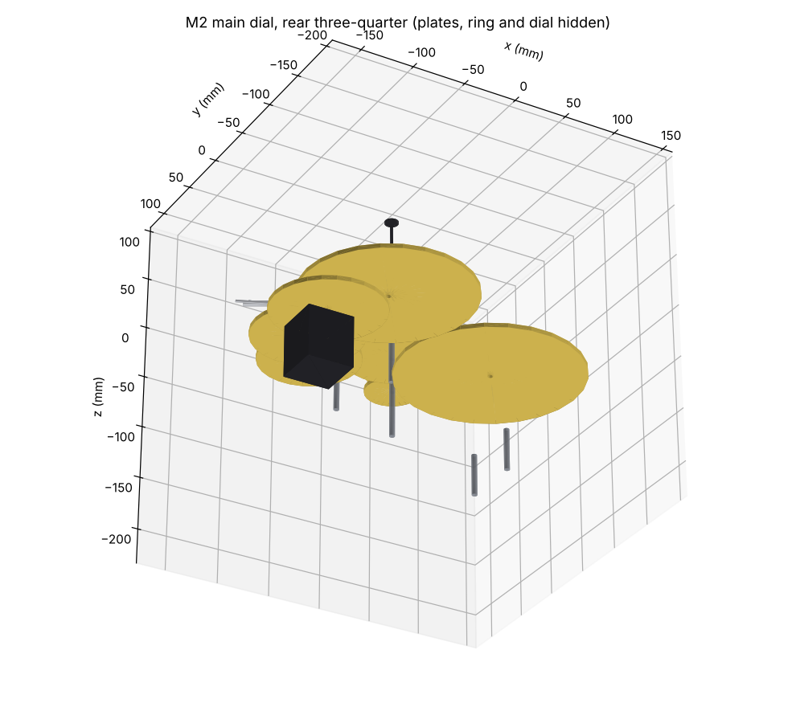
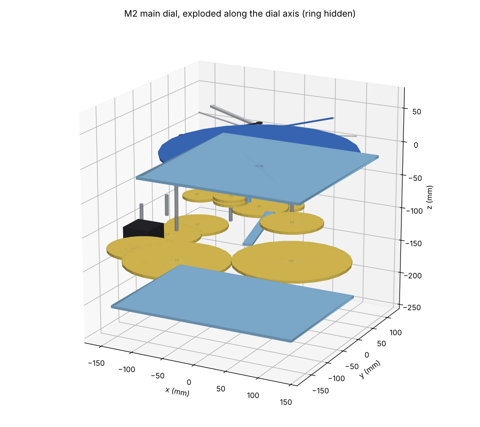

# M2 main-dial feasibility study

Phase 2, step 2 of the brief: "the densest point … Report whether it fits behind the 287.5 mm dial
at 1:8 before going further."

- **Model:** [`cad/modules/m2_main_dial/feasibility.py`](../cad/modules/m2_main_dial/feasibility.py).
  It is a *layout* model:
  - gears are blanks at their tip diameter, at their true centre distances;
  - differentials, the motor and the calendar motor are space claims;
  - tubes, rods, plates, hands, the cam and the calendar ring are at real size.
- **Checks:** [`cad/tests/test_m2_feasibility.py`](../cad/tests/test_m2_feasibility.py).
- **Run it:** `python -m cad.modules.m2_main_dial.feasibility export/m2` writes the numbers
  (`feasibility.json`) and the renders.
- Tags as in `docs/reference-notes.md`.

**Status: Proposed** (Phase 2 gate). The decisions needed are in §8.

## 1. Answer

**Yes, it fits.** Everything the main dial shows fits at 1:8 with module 1.0, including the v1.5
and v2 provisions (D5). Module 0.8 is not needed here.

| Check | Result |
|---|---|
| Interference (exact B-rep volumes, every pair) | **0** clashes among 67 parts |
| Rotating hands: any two parts that turn relative to each other could touch at some angle (swept annuli, Moon ball including its eclipse excursion) | **0** conflicts |
| Bed fit (H2D 325 × 320; dual-nozzle 300 × 320) | Every printed part fits except the **calendar ring**, which was already planned in 4 segments (envelope §5). The back plate is 289 × 200 mm. |
| Inside the M2 bay [E: 464 × 430 mm, the central body from the floor to the weekday rail] | Yes: x −177 … +171, y −194 … +171 mm |
| Depth, hemisphere face to motor rear | **169 mm** [D]: 21.8 mm in front of the dial face and 147 mm behind it. Within the 200 mm interior planned in envelope §1. |
| Coaxial tubes at the centre | 6 brass tubes, OD 4–9 mm, on a fixed Ø3 arbor. D4 allows 7. |
| Motor torque (M2) | About 2.7 mN·m at the motor, a **≈ 55×** margin at 0.5 A [E, §6] |

 

 

*Renders from the layout model (matplotlib, headless).*
- Front: the hands are at a sample time. Some large wheels show beyond the calendar ring, where
  the case front will hide them.
- Section: a half section at y = 0.
- Rear: the plates, ring and dial are hidden.
- Exploded: along the dial axis.

## 2. What is in front of the dial

Front to back, the order is forced by what each part must hide [S: DA p. 33–36]:
- in a lunar eclipse, the Earth's-shadow disc covers the Moon;
- in a solar eclipse, the Moon covers the Sun.

So the order is **shadow → Moon → Sun**. The latitude cam and the fixed hemisphere go in the
centre, as in the original, where "le mécanisme fût entièrement caché derrière l'hémisphère
terrestre" [S: ELS].

| Level (dial face = 0) | z (mm) | On tube | Notes |
|---|---|---|---|
| Sunset hand | 0.8–2.3 | OD 9 | moved by the yearly cam, symmetric with the sunrise hand (I7) |
| Sunrise hand | 3.1–4.6 | OD 8 | |
| Sun hand + Sun disc | 5.4–6.9 | OD 7 | hand 125 mm [S: ELS]; it passes over the sunrise/sunset hands |
| Latitude cam (v1.5) | 7.7–9.7 | OD 6 | Schwilgué's geometry at 1:8: mean radius 16.75 mm, R − r = 5.05 mm [S: ELS] |
| Moon hand + Moon ball + eclipse slide | 10.5–15.6 | OD 5 | this level is deep enough for a ball centred on the hand (the v1.5 phase ball, I4b) |
| Earth-shadow arm + disc | 16.4–17.9 | OD 4 | in front of the Moon, opposite the Sun |
| Hemisphere (fixed) | 18.8–21.8 | fixed Ø3 arbor | Ø 46.5 mm [D: hides the cam]; flat in the model, a shallow dome is possible |

- **The Sun therefore needs two tubes** (OD 7 for the hand and disc, OD 4 for the shadow arm). The
  Moon tube runs between them.
  - Both tubes are driven 1:1 from one lay shaft (S) through equal 48/48 pairs, so they stay in step.
  - Their relative error is only the backlash of two printed meshes. To be checked on the test rig.
- **Glazing:** the front parts reach 21.8 mm in front of the dial face. Leave at least 30 mm to the
  glass [E].
- The dial-to-ring radial gap is only 0.75 mm [D] (dial Ø 287.5; ring inner Ø 289).
  - So the v2 feasts arc must ride *on* the ring, in a groove at its inner edge. It cannot run
    between the ring and the dial.
  - That agrees with Ungerer's iron circle "sur des galets sur le bord intérieur du calendrier"
    [S: ELS i4].

## 3. What is behind the dial

| Level | z (mm) | Contents |
|---|---|---|
| Ring rollers | −8.5 … −3.5 | 6 × 688ZZ on a rear flange inside the calendar ring (Ø 297 flange, printable) |
| Front plate | −15 … −11 | 256 × 256 mm, PETG; tube bearing |
| Centre-wheel levels | −51 … −17 | one wheel per tube, outermost tube first: sunset, sunrise, Sun, cam, Moon (83 T), shadow; 6 mm pitch |
| Bridge | −56 … −53 | carries the fixed centre arbor. Everything at the centre ends here, so large wheels can pass behind it. |
| Big-wheel level | −62 … −58 | the Moon train's 169 T (on J) and 154 T (on the daily arbor I). The 169 T reaches across the dial axis, which is why the bridge is needed. |
| Year-train levels | −93 … −77 | 15/99 × 13/97 × 12/89 (the shared year train) and the sunrise/sunset cam (v1.5) |
| Back plate | −99 … −95 | 289 × 200 mm, PETG. It holds bearing seats, so it is printed, not wood (D12). |
| Motor | −147 … −99 | NEMA 17 behind the back plate. The 24:1 reduction to I sits between the plates (Phase 2 M2 design). |

**Shafts and meshes** (centre distances from `cad/lib/gears.py`):

| Shaft | Position (x, y) mm | Role |
|---|---|---|
| S | (24, 42) | Sun lay shaft: 48/48 to the Sun tube and to the shadow tube. The Sun differential sits on it (keyed in v1, fed by M3 in v1.5). |
| C | (−42, 24) | Cam lay shaft (v1.5): 48/48 to the cam tube. Node differential: Sun rate + the M2.node_cam eclipse-year term. |
| J | (74, −43) | Moon intermediate: 169 T (from 154 T on I, CD 161.5) and 88 T (to the 83 T on the Moon tube, CD 85.5). The Moon differential sits between them. |
| I | (−70, −116) | Daily input arbor: 154 T to J; 15 T into the year train |
| R | (−24, −42) | Sunrise/sunset sectors: 48/48 to both hand tubes, one through a reversing idler (not modelled) |
| Y1, Y2, Y3 | lower left | Year train. Y3 is a stub arbor on a cock: a through arbor would cross Y2's 97 T wheel. |

- **M3 correction inputs (architecture §13):** two Ø5 shafts with keyed dog couplings on the right
  of the back plate, at (110, 45) for the Sun and (110, −10) for the Moon.
  - The Moon input is close to J.
  - The Sun input reaches S through a short cross train behind the back plate (M2 design).
- **Weekday output to M7 (12/84 from I):** a vertical Ø5 shaft up the left side, outside the ring
  (the space from x −175 to −232 is free).
- **E6 calendar motor** (space claim 25 × 25 × 40) sits at the lower left behind the ring. The
  century wheel C and the leap cam E go beside it (M2 design).
- **Dominical-letter dial (I10)** goes left of the ring, in the 57 mm band from x −175 to −232. Its
  size is still TBD.

## 4. Eclipse display: the one real choice (envelope §5)

At true 1:8 scale the Sun and Moon discs are about 1.2 mm across, which is invisible
[S: ELS sizes; D]. Enlarge both the discs **and** the Moon's latitude excursion by the same factor
k. The display is then still a true map in both directions, so **eclipses happen exactly when they
should**.

| k | Sun / Moon / shadow disc | Moon's radial excursion | Latitude cam without a lever: mean radius, diameter (slope ≤ 37.5°) | With a k:1 lever on the Moon hand |
|---|---|---|---|---|
| 1 (true scale) | 1.2 / 1.1 / 3.0 mm | ±2.5 mm | 16.8 mm, Ø 39 | no lever needed |
| **4** | **4.7 / 4.5 / 12.2 mm** | **±10.1 mm** | 67 mm, **Ø 154 mm** (half the dial) | cam stays Ø 39 under the Ø 47 hemisphere |
| 8 (the original's absolute sizes) | 9.3 / 9.1 / 24.3 mm | ±20.2 mm | 134 mm, Ø 309 mm (impossible) | cam stays Ø 39 |

- **Method [D].** The latitude curve is the one Ungerer gives, sin β = sin i · sin F within ±13° of
  each node and flat between [S: ELS], with i = 5.147° [D]. The steepest slope is computed for each
  mean radius.
  - **Check:** at Schwilgué's own figures (mean radius 134 mm, R − r = 40.4 mm) the method gives
    **37.56°**. That is the 5/6 × 45° = 37.5° he stated [S: ELS], so it reproduces his design point.
  - The test suite asserts this.
- **What the enlargement costs.** Along the hand direction the scale stays true: 1° of longitude
  is 2.2 mm at the 125 mm radius. So enlarged discs stay overlapped k times longer than a real
  eclipse lasts, but they overlap on the right days.
- **Lever.** A k:1 lever pivoted on the Moon hand multiplies the cam follower's ±2.5 mm. The cam
  keeps Schwilgué's geometry at 1:8 and stays hidden under the hemisphere, as in the original.

## 5. Not modelled yet (M2 detailed design)

These are known and allowed for in the space claims:
- the internals of the three differentials (Sun, Moon, node);
- the 24:1 reduction;
- the reversing idler for the sunrise/sunset hands;
- the phase-ball drive (I4b, v1.5): crown wheel on the shadow tube → pinion and rod along the Moon
  hand → bevel at the ball, telescoping for the slide;
- the Moon-hand lever and rollers;
- the cross train from the Sun M3 input to S;
- the weekday shaft;
- E6, the century wheel and the leap sector;
- bearing seats, slip clutches (architecture §7), sensors and their magnets.

Tooth-level meshes are checked by the gear tests, not here.

## 6. M2 motor torque [E]

- Phase 1 gave M2 0.96 mN·m at the motor ([`gear-trains.md`](gear-trains.md) §8).
- That count had no train for the Sun hand (the input arbor turns it directly). The layout adds
  three outputs at about 1 turn per day: the Sun, shadow and cam tubes. At 10 N·mm each through
  one mesh (η 0.9) they add about 33 N·mm at the input arbor.
- Total about 52 mN·m at the input, i.e. **≈ 2.7 mN·m at the motor** through 24:1 (η 0.81).
- The NEMA 17 gives 148 mN·m at 0.5 A, so the margin is **≈ 55×**.
- Phase 2's M2 design recomputes this from CAD masses.

## 7. Print and parts notes

- **Print orientation:**
  - dial, ring segments, plates and hands flat;
  - gears flat with the hub up;
  - hemisphere dome up;
  - latitude cam flat (its working edge is the outline).
- **Part count of the layout:** 67 items, 42 of them printed. The detailed M2 design will add bushes,
  couplings and the differential internals.
- **BOM rows** are added to [`bom.md`](bom.md), Batch 2, "M2 from the feasibility layout".

## 8. Decisions needed from Paul

1. **Eclipse display scale k** (§4).
   - Options: 1 (true scale, invisible), **4 (recommended)** or 8 (the original's absolute sizes:
     big, and the Moon swings ±20 mm on a 125 mm hand).
   - Whichever k you choose, use a k:1 lever on the Moon hand so the cam stays Schwilgué's size,
     hidden under the hemisphere.
2. **Accept this layout as the basis for the M2 design:**
   - the two Sun tubes;
   - the fixed centre arbor on a bridge, with the big-wheel level behind it;
   - the M3 inputs on the right;
   - module 1.0 throughout.
3. **Hemisphere:** a flat painted disc or a shallow printed dome, about Ø 47 mm. The original's
   size is not in our sources; Ø 47 is the smallest that hides the cam.
4. **Go-ahead for step 3, the test rig**: one stepper driving hour/day motion work, the first thing
   printed. It would also test the two-tube Sun drive and a printed slip clutch.
