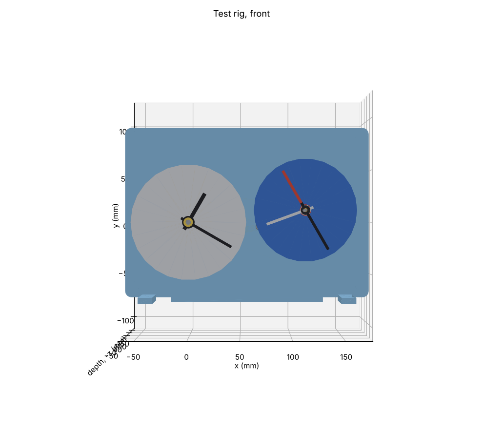
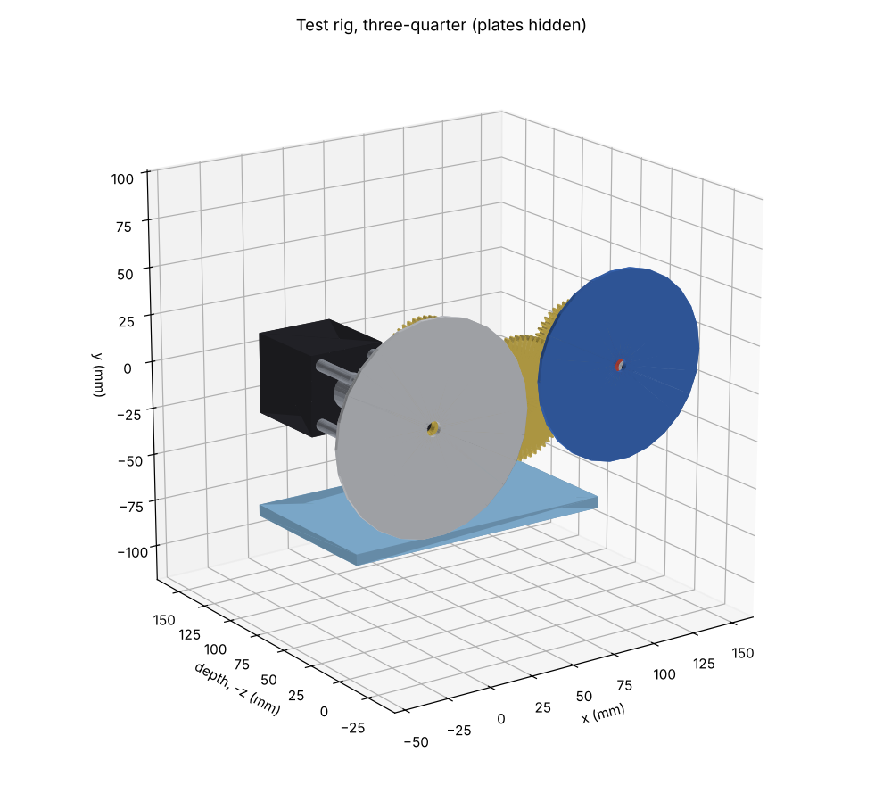
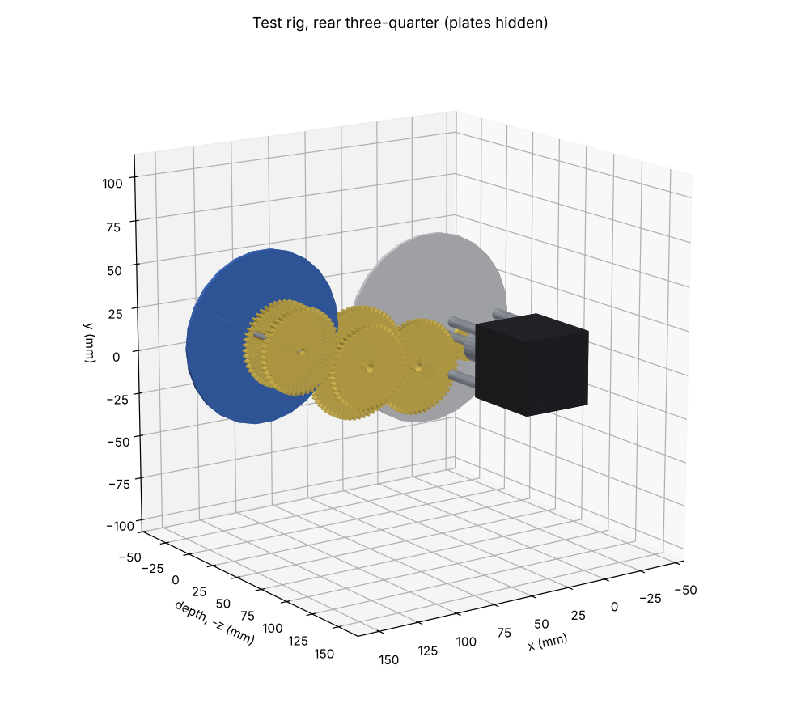
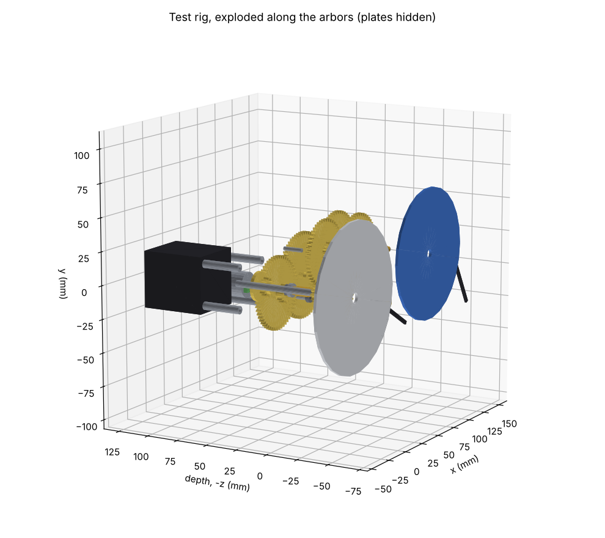
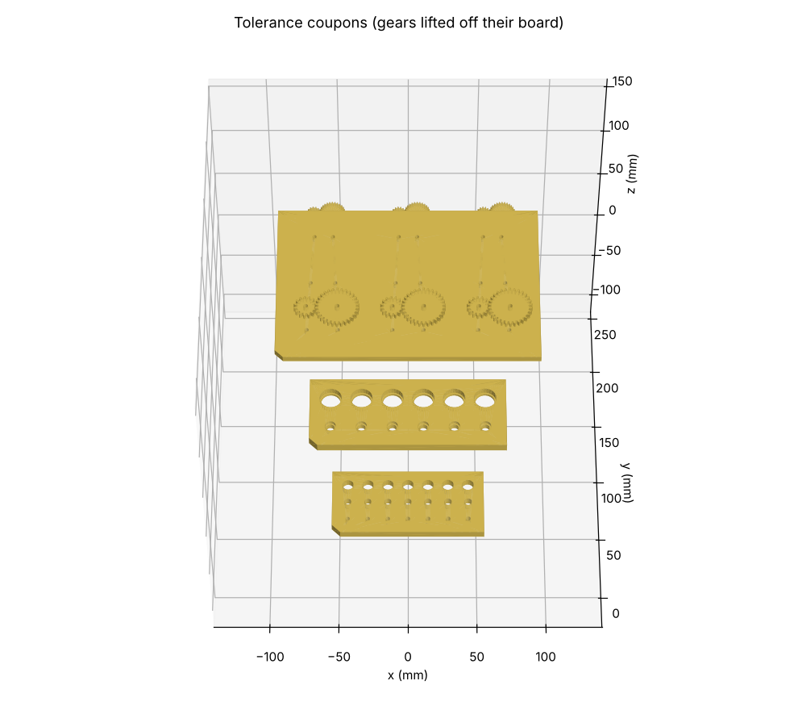

# Test rig

Phase 2, step 3 of the brief: "A test-rig module (one stepper driving hour/day motion work) to be
the first thing printed."

- **Model:** [`cad/modules/test_rig/rig.py`](../cad/modules/test_rig/rig.py) and
  [`coupons.py`](../cad/modules/test_rig/coupons.py).
- **Checks:** [`cad/tests/test_test_rig.py`](../cad/tests/test_test_rig.py).
- **Firmware:** [`firmware/test_rig/test_rig.ino`](../firmware/test_rig/test_rig.ino). It is
  **untested**: written before the hardware exists.
- **Print files:** `export/test_rig/test_rig.3mf` and `export/test_rig/tolerance_coupons.3mf`.
- **SketchUp:** `export/sketchup/test_rig.dae` and `export/sketchup/tolerance_coupons.dae`.

**Status: Proposed** (Phase 2 gate). The decisions needed are in §9.

## 1. What it proves before the clock depends on it

| # | Question | How the rig answers it |
|---|---|---|
| 1 | Do printed module-1.0 gears with 0.15 mm backlash (D4) run for weeks at clock speed? | The real **M1 trains** from `spec/clock.yaml` run continuously at 1 rev/h: the motion work `M1.hour_hand` 12/48 × 15/45 and the noon train `M1.noon_cam` 12/54 × 12/64. |
| 2 | Does the stepper time base work? (rule 2: a plain clockwork rate) | One NEMA 17 turns the minute arbor directly at 1 rev/h (architecture §3), from an ESP32-S3 + TMC2209 in StealthChop (D3). |
| 3 | Does the setting clutch work (architecture §7)? | The **cannon pinion slips on the minute arbor**, as in a clock. The preload is adjustable: a shaft collar, a wave washer, and a front collet. |
| 4 | Do the main dial's two Sun tubes stay in step? (`main-dial-feasibility.md` §2) | The 24 h arbor drives an outer "Sun" tube and an inner "shadow" tube through two equal 48/48 pairs, with a free middle tube between them, as on M2. |
| 5 | Do index and witness sensing work (architecture §6)? | A Hall sensor and magnet on the minute arbor (index, hourly) and on the 24 h wheel (witness, daily). The firmware counts microsteps between index passes. |
| 6 | What printed fits and what minimum module should the clock use? | The **tolerance coupons** (§6) set `FITS` in `cad/lib/parts.py` and the module (D4). |

## 2. Layout

 

 

*Renders from the model.* The front view shows the 12 h dial (Ø 112) and the 24 h dial (Ø 100). In
the other views the plates are hidden, because matplotlib cannot sort large flat faces correctly.

| Arbor | Position (x, y) mm | Carries |
|---|---|---|
| A, minute arbor (Ø5, the motor axis) | (0, 0) | cannon pinion 12 (clutch) + minute hand; hour wheel 45 + hour hand on the hour tube; noon pinion 12; index flag |
| Minute-wheel stud (Ø3, fixed in the front plate) | (0, 30) | minute wheel 48 + minute pinion 15, one printed part |
| X (Ø5) | (31.0, −11.3) | noon wheel 54 + pinion 12, one printed part |
| B, 24 h arbor (Ø5) | (68.4, −4.7) | day wheel 64 (witness magnet); two 48-tooth drive wheels |
| C, 24 h dial (fixed Ø3 arbor) | (113.5, 11.7) | tubes OD 6 (Sun hand, 48 T), OD 5 (free middle hand), OD 4 (shadow arm, 48 T) |

**Centre distances** [D: `cad/lib/gears.py`]:
- motion work 30.000 and 30.000 mm (reverted). The 12- and 15-tooth pinions are profile-shifted
  (+0.298 and +0.123) and their wheels shifted by the opposite amount, so the centre distance stays
  standard;
- noon train 33.0 and 38.0 mm;
- Sun and shadow pairs 48.0 mm.

**Depth stack** (dial face = 0, z towards the viewer):

| Level | z (mm) |
|---|---|
| Hands (hour, minute; Sun, middle, shadow) | +0.5 … +5.8 |
| Dials | −2 … 0 |
| Motion work: minute pinion 15 + hour wheel 45 | −7 … −4 |
| Motion work: cannon pinion 12 + minute wheel 48 | −10.5 … −7.5 |
| Clutch collar + wave washer | −13.5 … −10.7 |
| Front plate (PETG, 237.5 × 165.3 × 4) | −18 … −14 |
| Sun pair / noon 12-64 / noon 12-54 / shadow pair + index flag | −23 … −37 |
| Back plate | −46 … −42 |
| Coupling, then NEMA 17 | −72 … −131 |

## 3. Checks

| Check | Result |
|---|---|
| Interference, every pair of the 59 parts | **0** |
| Every mesh engaged: each driven wheel, moved 0.4 mm towards its driver, collides | yes, all 6 meshes (test) |
| Bed fit, single and dual nozzle | **all printed parts fit**. The largest is a plate, 237.5 × 165.3 mm. |
| Parts | 28 printed, 31 bought |

## 4. Torque and clutch [E]

**Motor torque at the minute arbor:**
- input friction 5 N·mm, plus the minute output, plus the hour output through 2 meshes, plus the
  24 h arbor and its two tubes through 2–3 meshes (η 0.9 per mesh);
- with Phase 1's conservative 10 N·mm per output: **17.7 mN·m**, an **8×** margin on the 148 mN·m
  the motor gives at 0.5 A;
- with realistic hand loads (2 N·mm: a 1.5 g hand off-balance by 20 mm plus tube friction): 7.5 mN·m,
  a 20× margin;
- the rig's index sensor measures the real figure: missed steps would show as fewer than 3200
  microsteps per pass.

**Clutch window:**
- The cannon pinion (12 teeth, face 3) can carry 43 N·mm at the minute arbor before its teeth reach
  the allowable stress [D: `tools/ratios/strength.py`].
- So the clutch must slip below about 21 N·mm and hold at least 3× the motion-work load (about
  7 N·mm with realistic hands).
- **Target: 10–20 N·mm.** That is a force of 0.2–0.4 N at the 48 mm minute-hand tip, readable with a
  kitchen or luggage scale.

## 5. Parts

**Printed** (PLA unless noted; orientation for Bambu Studio):

| Part | Qty | Orientation and notes |
|---|---|---|
| Front plate, back plate | 2 | PETG, flat. Bearing pockets for MR85ZZ, sized from the bearing coupon. |
| Pillars | 4 | PETG, upright |
| Feet | 2 | PETG. **Lay flat** with "lay on face" (modelled standing). |
| Cannon pinion 12, hour wheel 45, noon pinion 12, day wheel 64, four 48-tooth wheels | 8 | flat, hub up |
| Minute wheel 48 + 15; noon wheel 54 + 12 | 2 | flat, large gear down: no supports |
| Index flag, front collet | 2 | flat; the collet takes an M3 heat-set insert for its grub screw |
| Dials 12 h and 24 h | 2 | flat, face up |
| Hands (hour, minute, Sun, middle, shadow arm) | 5 | flat |
| Electronics tray | 1 | PETG, flat |

**Bought** (Batch 1 of [`bom.md`](bom.md); the new rows are marked there "test rig"):
- Ø5 rod: arbors A, X, B;
- Ø3 rod: the stud and the fixed arbor C;
- brass tubes: OD 6 and 7 at A, OD 4, 5 and 6 at C;
- 6 × MR85ZZ;
- a 5-to-5 mm flexible coupling;
- a Ø5 shaft collar and a Ø5 wave washer (clutch);
- 4 × M3 × 30 standoffs (motor);
- 2 × DRV5032 and 2 × 5 × 2 mm magnets;
- NEMA 17, ESP32-S3-DevKitC-1, TMC2209 on a breakout, 24 V PSU, 24 → 5 V buck converter.

**Assembly order:**
1. Bearings into both plates.
2. Pillars and back plate.
3. Arbors X and B with their wheels, between the plates.
4. Arbor A with the noon pinion and index flag, then the front plate.
5. Fixed arbor C (pressed into the back plate) with the shadow tube and wheel, the middle tube, then
   the Sun tube and wheel.
6. In front of the front plate:
   - collar and wave washer;
   - cannon tube with the cannon pinion;
   - minute wheel on its stud;
   - hour tube with the hour wheel.
7. Dials, then hands, then the front collet (set the preload, §4).
8. Coupling and motor at the back; electronics on the tray.

## 6. Tolerance coupons

**Orientation:** each coupon has a chamfered corner at its low-allowance end, and allowances rise
away from it.

| Coupon | What it tests | Record |
|---|---|---|
| Fit coupon, 106 × 50 × 6 | Ø3, Ø5 and Ø8 holes at diametral allowances −0.10, −0.05, 0, +0.10, +0.20, +0.30 and +0.40 mm | For each rod: the smallest allowance that is a **press** fit, a **slide** fit and a **free-running** fit. These go into `FITS.press`, `FITS.sliding` and `FITS.running`. |
| Bearing coupon, 140 × 56 × 7 | Pockets for MR85ZZ and 688ZZ at OD allowances −0.10 … +0.15 mm, each with a 1 mm shoulder | The allowance that holds the bearing by hand pressure (`FITS.bearing_seat`). Also measure the real bearing ODs (D4). |
| Gear board, 192 × 132 × 5, with 18 gears | 15/30 pairs at module 1.0, 0.8 and 0.6 × backlash 0.10, 0.15 and 0.20 mm, on Ø3 pins at the nominal centre distance | For each pair: smooth, tight or binding; the play felt; the noise. This sets the **minimum module** and the **backlash** (D4, CLAUDE.md). Print it with the 0.4 mm nozzle now, and again when the 0.2 mm nozzle arrives. |

## 7. Wiring (firmware sketch)

| Signal | ESP32-S3 GPIO | To |
|---|---|---|
| STEP / DIR / EN | 4 / 5 / 6 | TMC2209 |
| UART TX / RX | 17 / 18 | TMC2209 PDN_UART (TX through 1 kΩ) |
| Hall index / witness | 7 / 8 | DRV5032 outputs (open drain, internal pull-up) |
| 24 V / GND | — | TMC2209 VM; buck converter to 5 V for the ESP32 |

- **The sketch:** 1 microstep every 1.125 s (3200 microsteps per hour), scheduled against the
  microsecond timer so it never accumulates drift.
  - TMC2209 at 500 mA RMS, 1/16 microstepping, StealthChop.
  - At each index pass it prints the microsteps counted since the last one.
  - It logs each witness pass.
- **Time base:** the ESP32 crystal (about ±20 ppm [E]). The clock proper adds the RTC and NTP in
  Phase 3.

## 8. Test procedure

1. Print the coupons first; record the results; update `FITS` (the CAD regenerates).
2. Print and assemble the rig. Set the minute hand by turning it, and check that the clutch slips
   in the 10–20 N·mm window (§4).
3. Run for **7 days** and log over USB serial:
   - every index pass must show exactly 3200 microsteps;
   - every witness pass must come 24 h after the last, within the 24 h wheel's backlash (≈ 1.4 min
     [D: 0.15 mm on a 24 mm pitch radius = 0.36° = 1.4 min of a 24 h dial]).
4. **Two-tube check.**
   - Set the Sun hand and shadow arm 180° apart with a printed gauge.
   - Each day, check the angle between them.
   - Rock each hand to measure its play. Expect up to about 0.7° of play between them
     [D: 2 × 0.15/24 rad].
5. **Noise:** listen at 1 m and log a phone dB reading.
6. Report the results in a PR comment, or bring them to a local session. The M1 and M2 designs then
   use the measured values.

## 9. Decisions needed from Paul

1. **Approve the rig and coupons for printing**, and order BOM Batch 1. The new rows are the
   coupling, the shaft collar and the motor standoffs.
2. **Coupon set:** is module 0.6 worth printing as a lower bound? Recommended yes: it costs about
   1 g of PLA per pair and shows where printing stops.
3. **Firmware:** the rig sketch is a minimal Arduino program, not the Phase 3 skeleton. Is that
   enough to start with?
